# Arquitetura — Grupo QuarenteNA

> O **Brief**, o **PRD** e o **inventário QuarenteNA** estão **APROVADOS**. Esta arquitetura **foi aprovada pelo responsável do projeto**, com os ajustes de governança e integrações descritos aqui. O schema abaixo é **proposta lógica/física de referência**, não dump PostgreSQL gerado, migrations executadas ou homologação de produção. O código-fonte analisado foi o template em `main` na consulta de 17/10/2026; suas convenções deverão ser conferidas novamente no commit adotado pelo novo repositório.

## 1. Objetivos, restrições e princípios

| Decisão de produto | Diretriz arquitetural |
|---|---|
| Site público e `/admin` | Mesma aplicação Laravel, com fronteira explícita de autorização e dados publicados |
| PHP + PostgreSQL + Docker | **Laravel 13 / PHP 8.5 / PostgreSQL 17** conforme fundação atual do template; upgrades sujeitos a testes |
| BMAD 6.12.4 | Brief/PRD aprovados → UX/Architecture → Specs/Epics → readiness → build |
| Laravel Boost | Documentação version-aware e inspeção do runtime do Laravel durante a implementação |
| Migração integral | Scripts, planilhas, n8n, Apps Script e Looker substituídos por funcionalidades versionadas e testáveis |
| Integrações externas | Zoom, ASAAS, Evolution API e rastreio Correios isolados por adaptadores e filas |
| Um grupo, não SaaS | **Um banco PostgreSQL institucional**, com esquema de domínio; fork parametrizável, sem multi-tenant |
| Anonimato | Menor coleta necessária, isolamento dos dados pessoais e nenhuma vigilância individual de presença Zoom |
| Continuidade | Fonte de verdade única, reconciliação, rollback, backup e restore testado |
| Responsabilidade humana | Permissões derivadas de encargo vigente, auditoria e prestação de contas; decisões coletivas continuam humanas |

### Fronteira de evidência

**Confirmado no template:** PHP `^8.5`, `laravel/framework ^13.17`, `laravel/sanctum ^4`, `laravel/boost ^2` (dev), PostgreSQL com `DB_CONNECTION=pgsql`, tabelas `usuarios`, `clientes`, `cliente_usuario`, `personal_access_tokens`, `jobs`, `job_batches`, `failed_jobs`, e `password_reset_tokens`; migrations com comentários; fluxo de schema/documentação e Docker/Swarm. **Não consta** no template um modelo de dados do QuarenteNA; as tabelas de domínio descritas abaixo serão novas.

**Confirmado no rastreador escolhido:** `opastorello/correios-rastreamento` implementa serviço Python/FastAPI que disponibiliza REST e MCP; rotas `POST /rastreamento/objeto`, `/rastreamento/multiplos`, `/health` e histórico interno. Usa scraping e resolução de CAPTCHA, portanto sua disponibilidade depende de mudanças dos Correios e requer monitoramento e alternativa de consulta manual. Não incorporar o Python ao processo PHP.

Fontes primárias: [README do template](https://github.com/cirinho/template-laravel-bmad/blob/main/README.md), [AGENTS.md](https://github.com/cirinho/template-laravel-bmad/blob/main/AGENTS.md), [config/database.php](https://github.com/cirinho/template-laravel-bmad/blob/main/config/database.php), [migrations](https://github.com/cirinho/template-laravel-bmad/tree/main/database/migrations), [README Correios](https://github.com/opastorello/correios-rastreamento/blob/master/README.md).

## 2. Diagramas de arquitetura

### C4 — Contexto

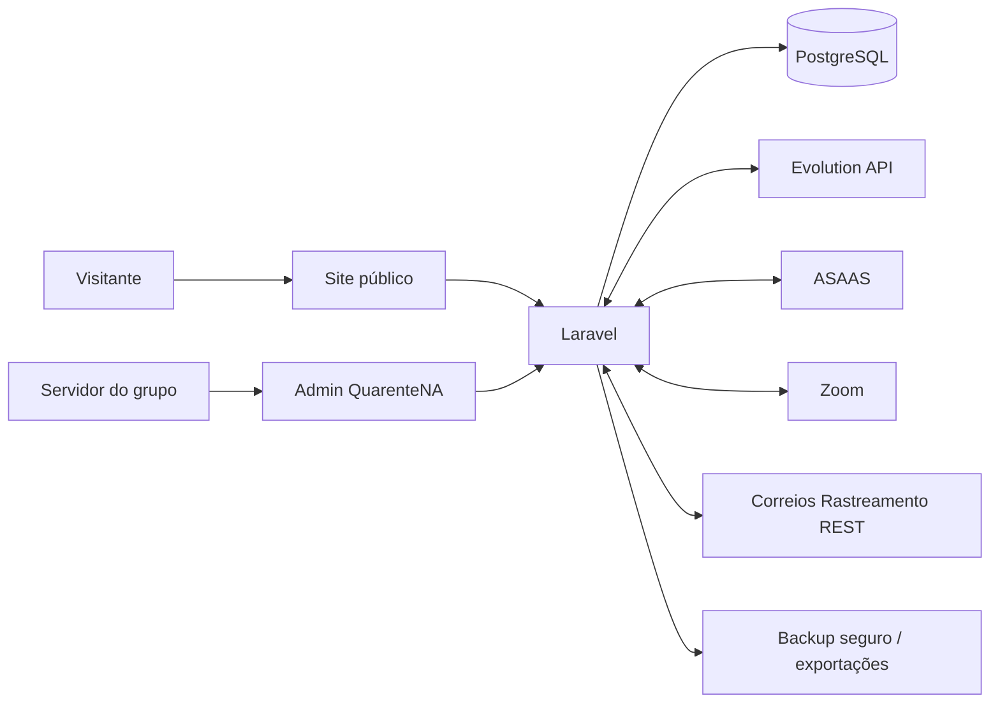

### Containers de aplicação

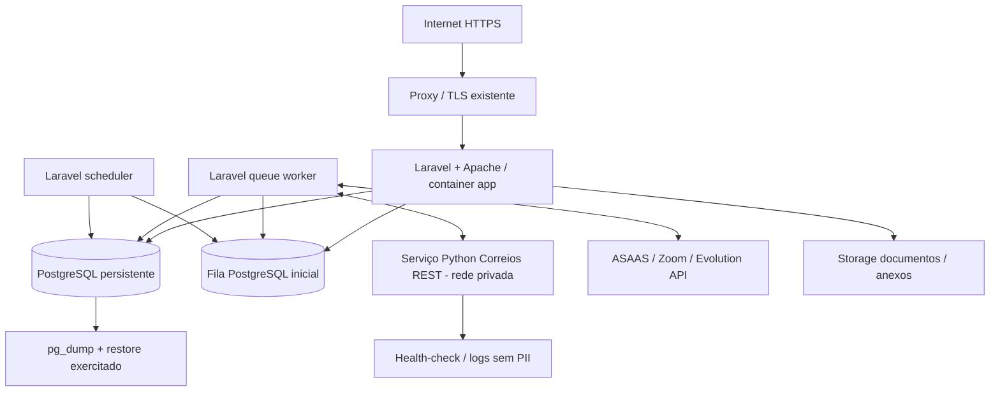

**Escolha inicial recomendada:** PostgreSQL como fila (`QUEUE_CONNECTION=database`) para simplificar o início; Redis permanece **opcional** conforme a carga medida. O template atualmente vem com `QUEUE_CONNECTION=sync`, que **deve mudar** antes de executar jobs reais de webhooks, notificações e rastreio. Em Swarm, ativar réplicas para worker e scheduler; este último deve garantir execução única ou coordenação distribuída.

### Limites por funcionalidade

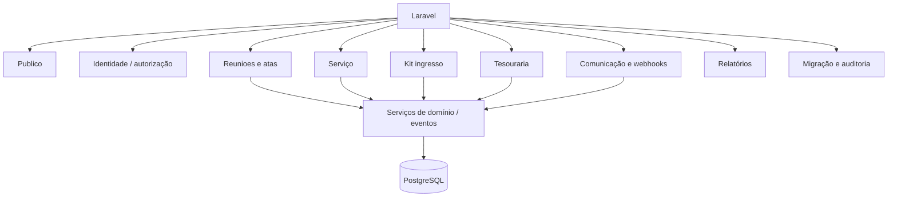

## 3. Contratos arquiteturais entre módulos

| Regra transversal | Implementação orientadora | Não permitir |
|---|---|---|
| Fonte de dados | PostgreSQL autoritativo após cutover; escrita via serviços de domínio | Planilhas/Docs editados como banco paralelo |
| Eventos | Evento interno persistido ou outbox ao confirmar transação | Disparar WhatsApp dentro da transação de ata |
| Webhooks | Autenticar/verificar origem, salvar identificador, deduplicar, enfileirar processamento | Duplicar lançamento ASAAS após retry |
| Autorizações | Policies/Gates sobre recurso, finalidade e papel | Autorizar apenas por menu ou atributo de tela |
| Auditoria | Snapshot mínimo redigido de antes/depois, autor, horário, ação, motivo | Salvar tokens, telefones/endereços em logs técnicos genéricos |
| Contagens Zoom | Eventos efêmeros em área restrita; somente totais sugeridos para ata | Vincular evento automaticamente ao cadastro de pessoa |
| Agendamentos | Definidos por ocorrência e fuso do grupo | Offset fixo ou horário duplicado em views |
| Financeiro | Lançamento automático imediato por evento ASAAS válido; manual imediato apenas pelo tesoureiro; edição/exclusão lógica com rastro | Rascunho ou aprovação intermediária como requisito para lançar; alteração física sem histórico |
| Kit | Máquina de estados com histórico e rastreio deduplicado, acesso exclusivo ao Coordenador Kit em mandato vigente | Expor contato/endereço à mesa ou outros servidores por herança de admin |
| Documentos | Google Drive institucional como storage documentário principal; OAuth/conta de serviço e permissões mínimas, versionamento e metadados PostgreSQL | Planilha ou arquivo Google como banco relacional; link público de ata restrita |
| Integrações | Adaptadores com timeout, retry e circuit breaking básico | Tratar HTTP 200 como prova de mensagem recebida pelo destinatário |
| Migração | Snapshot imutável, batch, origem e reconciliação | Apagar dados históricos antes do aceite |

### Estrutura definida para a derivação do template Laravel (preservar convenções do framework)

**Decisão de arquitetura:** criar **um novo repositório de aplicação derivado** de `cirinho/template-laravel-bmad`, sem alterar o template genérico nem sobrescrever a `main` do site BMAD antigo. Esta é a estrutura alvo obrigatória, com diretórios criados **quando sua primeira classe/feature existir**; não gerar pastas vazias, arquivos placeholder ou “um documento por componente”.

```text
projeto-quarentena/
├── AGENTS.md                      # uma regra canônica curta para agentes
├── .ai/guidelines/                # somente convenções do projeto necessárias ao Boost
├── _bmad-output/planning-artifacts/
│   ├── QuarenteNA.md              # AS-IS, mapeamento de dados e corte
│   ├── ProductBrief.md            # visão aprovada
│   ├── PRD.md                     # requisitos aprovados e IDs estáveis
│   ├── UX-Design.md               # DESIGN + EXPERIENCE aprovados num só documento
│   └── Arquitetura.md             # decisões + dicionário lógico/relacional
├── app/
│   ├── Funcionalidades/           # domínio (regras, consultas, eventos e serviços)
│   │   ├── Identidade/            # usuários, mandatos, permissões, root excepcional
│   │   ├── Reunioes/              # agenda, ocorrências, moderadores, atas regulares
│   │   ├── Servico/               # mesa, designações, atas e consciência coletiva
│   │   ├── KitIngresso/           # ingressos, contato, remessa, Correios
│   │   ├── Tesouraria/            # lançamentos, ASAAS, estorno e saldo
│   │   ├── Comunicacao/           # Evolution, comandos, templates e jobs
│   │   ├── Relatorios/            # agregações seguras e projeções públicas
│   │   └── Integracoes/           # adaptadores Zoom, Correios, Drive e config
│   ├── Http/Controllers/          # controladores web/API e webhooks (Laravel)
│   ├── Models/                    # modelos Eloquent conforme convenção Laravel
│   ├── Policies/                  # autorização em toda ação e registro
│   ├── Jobs/                      # filas (atividades assíncronas quando necessárias)
│   └── Console/Commands/          # importação, verificação e rotinas operacionais
├── bootstrap/                      # manter o esqueleto original Laravel
├── config/                         # drivers/storage/integrations não secretos
├── database/
│   ├── migrations/                 # fonte executável única do schema; nunca prune automático
│   ├── seeders/                    # catálogos e encargos sem contas/PII reais
│   └── schema/pgsql-schema.sql     # snapshot GERADO do PostgreSQL real
├── resources/views/               # Blade público, painel, e-mails/PDFs
├── routes/                        # web.php, api.php, console.php conforme necessário
├── public/                        # assets versionados após homologação da logo
├── tests/Unit/                    # regras puras
├── tests/Feature/                 # fluxos HTTP, autorização e webhooks
├── docs/banco/db.md               # catálogo GERADO do PostgreSQL real
├── docker/                         # Compose/Swarm herdados e adaptados
└── scripts/                        # comandos existentes do template (reutilizar)
```

**Não criar** um diretório próprio `Integracoes/` *e* uma segunda hierarquia duplicada de conectores em `app/Http`; a lógica externa vive num só lugar e os controllers apenas recebem/validam/encaminham. Não criar `app/Events/Listeners/Repositories/Services/` vazios por padrão. `app/Funcionalidades/` é a propriedade dos contratos de domínio; Eloquent permanece no `app/Models/` do framework, evitando duplicidade de modelos. Documentação de API só é adicionada se uma API própria, estável e publicada realmente precisar de contrato distinto.

**Regras de atualização do projeto (repositório derivado):**

| Mudança | Atualizar no mesmo PR/commit, sem arquivo histórico paralelo |
|---|---|
| Requisito/escopo | `PRD.md` e, somente se afetados, `ProductBrief.md`, UX e arquitetura |
| Fluxo/tela | `UX-Design.md`, testes e requisito correspondente no `PRD.md` |
| Decisão de domínio/segurança | `Arquitetura.md`, regras em `AGENTS.md` e testes |
| Banco estrutural | Nova migration + testes PG + `./scripts/banco-atualizar.sh` → `database/schema/pgsql-schema.sql` + `docs/banco/db.md` + **Arquitetura.md** |
| Fonte importada/automações | `QuarenteNA.md` (mapa origem/destino), PRD (se alterar comportamento), testes |
| Implementação de Story | Código, testes e **Story ativa** de BMAD; não reescrever stories históricas |

**Artefatos BMAD mínimos:** somente os cinco documentos acima permanecem canônicos de planejamento do produto; Specs individuais só quando o BMAD exigir um contrato de Epic que não possa ser expresso pela Story, e Stories detalhadas **just in time**, próximas da implementação. `sprint-status.yaml` apenas quando o gate de readiness estiver satisfatório. É proibido criar versões concorrentes `-atualizado`, `-detalhado` ou múltiplos relatórios repetindo decisões. A ferramenta BMAD poderá gerar saídas operacionais temporárias, mas devem ser consolidadas/descartadas ao término da etapa, respeitando os contratos do workflow.

## 4. Adaptação correta do template Laravel BMAD

| Recurso do template `main` | Estado inspecionado | Tratamento no QuarenteNA |
|---|---|---|
| `usuarios` | `nome`, `email` único, `password`, `papel`, `ativo`, timestamps | **Reutilizar**, acrescentando `pessoa_id` opcional em migration; nomes preferencialmente de exibição |
| `password_reset_tokens` | Token de recuperação por email | **Reutilizar**, controlar expiração e mensagens sem vazamento |
| `clientes` | Cadastro comercial PF/PJ com CPF/CNPJ e contato | **Não reaproveitar** para membros ou ingressantes: conceito comercial incompatível |
| `cliente_usuario` | Associação comercial N:N | **Não utilizar** para identidade de serviço; retirar em projeto derivado ainda sem deploy, ou depreciar/migrar sem reescrever migration aplicada |
| `personal_access_tokens` | API Sanctum e tokens com abilities | **Reutilizar** apenas para integrações próprias que precisem de token; não para Zoom/ASAAS quando webhook assinado exigir outro método |
| `jobs`, `job_batches`, `failed_jobs` | Tabelas do driver de fila | **Reutilizar** para jobs; não armazenar payload com PII desnecessária |
| `database/schema/pgsql-schema.sql` | Snapshot real criado por script do template | **Gerar no projeto executável**, jamais substituir pela proposta deste documento |
| `docs/banco/db.md` | Catálogo do banco regenerado do PG | **Gerar após migrations** e versionar junto com snapshot |
| `./scripts/banco-atualizar.sh` | Concilia dump PG com documentação | Executar após cada alteração estrutural testada |
| `./scripts/testar.sh --postgres` | Gate PostgreSQL | Obrigatório para migrations/consultas específicas do PG e antes de release |
| Docker Compose / Swarm | app Apache, PG, profiles de filas e scheduler | Usar volumes e segredos; sem publicar porta PG externa |
| Laravel Boost | Dependência de desenvolvimento; MCP via script | Instalar/ativar via scripts do template e consultar documentação na implementação |
| BMAD | Instalado no projeto derivado, não versionado na base | Adotar **6.12.4** conforme decisão de planejamento e versionar `_bmad-output/` |

### Adaptação de papéis

O template começa com `super_admin`, `admin` e `cliente`. O QuarenteNA **não possui clientes como entidade de negócio**; adaptar para login pessoal e um `root` institucional de emergência. **A fonte de permissão efetiva é a designação de encargo ativa**, complementada por uma exceção autorizada e auditada: o sistema pode materializar flags para performance, mas Policies devem sempre invalidá-las quando o mandato expirar ou for revogado.

- **Coordenador Geral e Secretário Geral:** gestão técnica/administrativa, usuários, escalas, modelos documentais, integrações e auditoria; **sem permissão de edição financeira nem acesso operacional ao Kit Ingresso**.
- **Tesoureiro:** único encargo de edição dos lançamentos e relatórios financeiros privados; eventos ASAAS processados sob identidade de sistema, não sob sessão humana.
- **Coordenador Kit Ingresso:** único encargo com acesso ao módulo e contatos/endereços/remessas.
- **RSG e RSG Suplente:** acesso às atividades de representação, sem privilégios de gestão financeira/kit.
- **Moderadores do dia:** um único tipo de serviço de moderação com duas pessoas escaladas por ocorrência; papéis de voz (coordenador do dia) e chat/ata (secretário do dia) são substituíveis, sem confusão com cargos da Mesa.
- **Root institucional:** conta de quebra-de-vidro exclusiva para bootstrap, recuperação e manutenção de configurações; nunca login padrão. MFA, segredo em cofre, justificativa, operador responsável declarado, logs e revisão posterior. Root não remove o requisito de um login pessoal do servidor para operações cotidianas.

**Acesso:** na gravação da designação, concessão automática; no fim da vigência, policy nega **mesmo se o scheduler estiver atrasado**, e o job remove cache/flags/tokens; entrega ou destituição revoga instantaneamente, termina sessões privilegiadas quando necessário e registra motivo, responsável e instante. Evitar dar permissão perpetuamente em `permissoes_usuario` se derivada de `designacoes_servico`.

**Migrações iniciais:** se o repositório derivado ainda não tiver banco instalado, alterar o conjunto de migrations do **novo repositório** antes da primeira instalação, com revisão explícita. Se migrations já tiverem sido aplicadas em ambiente compartilhado, manter histórico e criar novas migrations (não reescrever as existentes), como exigem `AGENTS.md` e o README da fundação.

## 5. Estratégia de PostgreSQL e modelagem

### Uma instância lógica de dados; vários domínios

Usar **um banco PostgreSQL** por ambiente (`quarentena_dev`, `quarentena_prod` são exemplos de identificação operacional, não nomes obrigatórios), com tabelas separadas por função **dentro do schema `public` por padrão**, permitindo migrations convencionais do Laravel. Separar ambientes e credenciais, nunca criar bancos diferentes por módulo sem necessidade concreta.

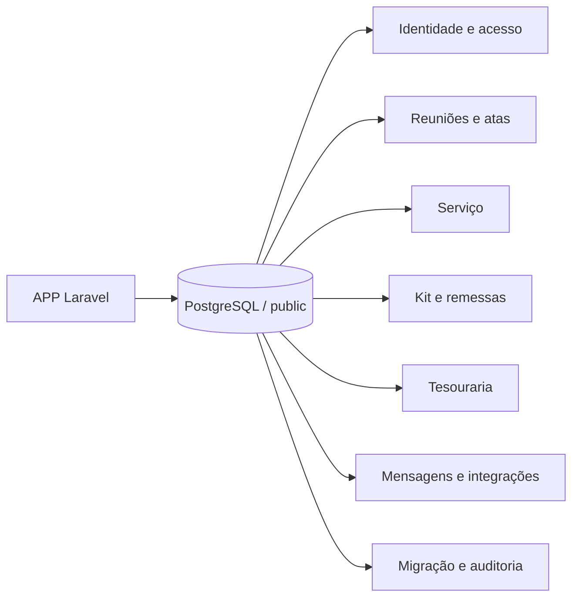

### Convenções transversais propostas

| Tema | Convenção recomendada | Verificação |
|---|---|---|
| Chaves | `id bigint GENERATED ...` via `$table->id()`; UUID de evento externo como string quando couber | FK valida; sem IDs de planilha como PK |
| Tempo | `timestamptz` para eventos; timezone `America/Bahia` em aplicação, com instantes persistidos corretamente | Comparações em DST/timezones e bordas |
| Data de ocorrência | `date` + horário local, e ocorrência com início/fim efetivos | Calendário sem ambiguidades |
| Dinheiro | `numeric(14,2)` ou precisão adequada ao domínio | Proibir float para saldo/valor |
| Dados externos | `external_id`, `provider`, `source_hash` e idempotency key únicos por origem | Replays não duplicam |
| Status | `varchar` validado por constraint/cadastro e enum lógico no domínio | Não salvar texto livre arbitrário |
| Auditoria | Antes/depois redigido, usuário, data, request/correlation id, motivo | Testes de edição/remoção |
| PII | Criptografia de aplicação em campos sensíveis, mascaramento e acesso mínimo | Busca por hash determinístico separado quando estritamente necessário |
| Eliminação | Retenção definida por classe de dado, soft delete com cuidado; preservação financeira/auditável segundo política | Nenhum apagamento destrutivo sem autorização legal |
| Imports | Snapshot de origem com hash, linha e lote | Reexecutável sem duplicação |
| Comentários | Comentários PT-BR em tabelas/colunas próprias | Snapshot + `docs/banco/db.md` sincronizados |
| Integridade | NOT NULL, UNIQUE, FK, CHECK e índices necessários, além da validação Laravel | Tests `--postgres` obrigatórios |

**Classificação do esquema:** `EXISTENTE NO TEMPLATE` (migrations comprovadas) versus `PROPOSTO PELO QUARENTENA` (entidades de domínio). O dicionário a seguir especifica tabelas candidatas e deve evoluir para migrations com testes antes de ser declarado físico/canônico.


## 6. Dicionário de dados — tabelas de domínio propostas

**Leitura:** nomes e tipos são **propostas arquiteturais**; o modelo físico aprovado será o gerado por migrations e documentado pelo banco real. Todo registro mutável recebe `id` e timestamps (`created_at`/`updated_at`) salvo exceção documentada. `FK` aponta uma relação; `?` significa nullable; `cipher` significa valor criptografado no domínio da aplicação, com gestão de chaves fora do banco. Valores de status precisam de CHECK/tabela de domínio/testes, não de texto livre.

### Panorama: quantas tabelas por domínio?

| Domínio | Tabelas propostas | Esforço relativo de modelagem (não é prazo) |
|---|---:|---|
| Identidade e permissões | 4 | Baixo |
| Agenda e ocorrências | 4 | Baixo |
| Atas e indicadores | 10 | Alto |
| Servidores e reuniões de serviço | 9 | Alto |
| Kit ingresso e Correios | 6 | Médio |
| Tesouraria e ASAAS | 5 | Médio |
| Comunicação e eventos de integração | 8 | Alto |
| Migração, governança e operação | 6 | Médio |
| **Total** | **52** | Exclui as tabelas internas já existentes do Laravel |

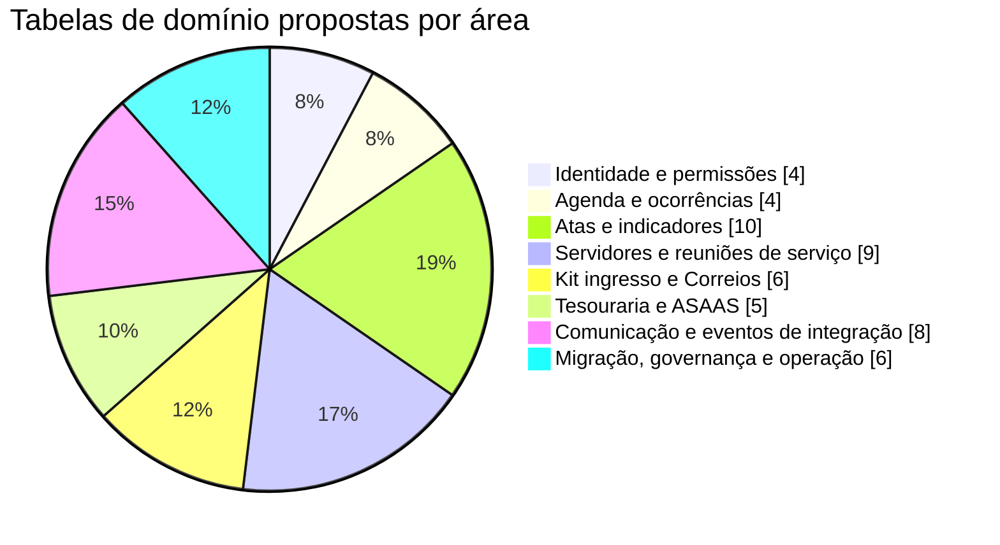

### 6.1. Identidade e permissões

**Matriz efetiva de autorização aprovada** (leitura de indicadores agregados públicos é uma projeção separada; acesso à auditoria não permite editar o dado de negócio):

| Papel/encargo ativo | Usuários e permissões | Ata regular do dia | Ata de serviço e templates | Tesouraria: editar | Kit/PII: acessar | Integrações/configurações |
|---|---|---|---|---|---|---|
| Coordenador Geral | Sim | Suporte e exceção justificada | Gestão administrativa | **Não** | **Não** | Sim |
| Secretário Geral | Sim | Suporte e exceção justificada | **Editar template e atas** | **Não** | **Não** | Sim |
| Tesoureiro | Não por padrão | Se escalado | Consulta autorizada | **Sim, exclusivo** | **Não** | Não |
| RSG / Suplente | Não por padrão | Se escalado | Consulta/representação | **Não** | **Não** | Não |
| Coordenador Kit Ingresso | Não por padrão | Se escalado | Consulta autorizada | **Não** | **Sim, exclusivo** | Não |
| Moderador escalado | Não | **Sim, dentro da ocorrência** | Não por padrão | Não | Não | Não |
| Root institucional | Recuperar administradores, em emergência | Não rotineiro | Não rotineiro | **Não por padrão** | **Não por padrão** | Sim, excepcional |

A matriz é implementada por Laravel Gates/Policies com testes negativos. Sessões root registram também quem retirou/operou a credencial; uma conta compartilhada sem identificação do operador, sozinha, **não comprova autoria humana**.


| Tabela | Finalidade | Relações principais | Privacidade | Fonte da necessidade |
|---|---|---|---|---|
| `pessoas` | Cadastro operacional de servidores/contatos sem login obrigatório | usuarios.pessoa_id opcional; designacoes_servico.pessoa_id | restrito | Cadastros e relações de servidores |
| `permissoes` | Catálogo explícito de capacidades | permissoes_usuario.permissao_id | restrito | Permissões do PRD |
| `permissoes_usuario` | Delegação de permissão extra | usuarios, permissoes | restrito | Permissões extras e serviço |
| `acessos_emergenciais` | Ativação excepcional e auditável de contingência | usuarios; auditorias | muito restrito | Root de contingência |

**Campos e tipos de referência:**

| Tabela | Campo / tipo sugerido | Significado / regra |
|---|---|---|
| `pessoas` | `id bigint PK` | Identificador interno estável; nunca igualar à linha da planilha |
| ↳ | `nome_exibicao text` | Primeiro nome/apelido, preservando grafia exibida |
| ↳ | `nome_busca varchar?` | Chave NFKC + trim/colapso de espaços + casefold para **sugestões**, não identidade única |
| ↳ | `ativo bool` | Estado |
| ↳ | `notas_restritas text?` | Notas com acesso mínimo |
| `permissoes` | `id bigint PK` | Identificador interno estável; nunca igualar à linha da planilha |
| ↳ | `chave varchar UNIQUE` | Ex.: tesouraria.editar |
| ↳ | `descricao text` | Finalidade |
| ↳ | `dominio varchar` | Área de negócio |
| `permissoes_usuario` | `id bigint PK` | Identificador interno estável; nunca igualar à linha da planilha |
| ↳ | `usuario_id FK` | Titular |
| ↳ | `permissao_id FK` | Capacidade |
| ↳ | `concedida_por FK?` | Autor |
| ↳ | `validade timestamptz?` | Fim |
| ↳ | `motivo text?` | Justificativa |
| `acessos_emergenciais` | `id bigint PK` | Identificador interno estável; nunca igualar à linha da planilha |
| ↳ | `usuario_id FK` | Conta root/identidade de sessão |
| ↳ | `operador_identificado_id FK?` | Usuário pessoal responsável pelo uso excepcional (declarado/verificado) |
| ↳ | `aberto_em timestamptz` | Início |
| ↳ | `expira_em timestamptz` | Fim |
| ↳ | `justificativa text` | Motivo |
| ↳ | `aprovado_por FK?` | Responsável |

### 6.2. Agenda e ocorrências

| Tabela | Finalidade | Relações principais | Privacidade | Fonte da necessidade |
|---|---|---|---|---|
| `tipos_reuniao` | Tipos e formatos aprovados | reunioes.tipo_padrao_id | público | Agenda e tipos |
| `reunioes` | Definições estáveis de encontros | tipos_reuniao; horarios_reuniao | misto | Agenda atual |
| `horarios_reuniao` | Regra semanal recorrente | reunioes, ocorrencias_reuniao | público | Form/brief agenda |
| `ocorrencias_reuniao` | Ocorrência específica com instante inequívoco | reunioes; atas; eventos_zoom | público parcial | Data + horário da ata |

**Campos e tipos de referência:**

| Tabela | Campo / tipo sugerido | Significado / regra |
|---|---|---|
| `tipos_reuniao` | `id bigint PK` | Identificador interno estável; nunca igualar à linha da planilha |
| ↳ | `nome varchar UNIQUE` | Abertas/fechadas etc. |
| ↳ | `descricao_publica text` | Elegibilidade |
| ↳ | `ativo bool` | Visibilidade |
| `reunioes` | `id bigint PK` | Identificador interno estável; nunca igualar à linha da planilha |
| ↳ | `titulo varchar` | Nome breve |
| ↳ | `tipo_padrao_id FK` | Tipo |
| ↳ | `zoom_url text` | Link validado HTTPS |
| ↳ | `zoom_meeting_id varchar?` | ID |
| ↳ | `zoom_senha_cipher text?` | Senha protegida |
| `horarios_reuniao` | `id bigint PK` | Identificador interno estável; nunca igualar à linha da planilha |
| ↳ | `reuniao_id FK` | Reunião |
| ↳ | `dia_semana smallint` | 0…6 |
| ↳ | `hora_inicio time` | Hora local |
| ↳ | `hora_fim time?` | Hora local |
| ↳ | `ativo bool` | Ativo |
| `ocorrencias_reuniao` | `id bigint PK` | Identificador interno estável; nunca igualar à linha da planilha |
| ↳ | `reuniao_id FK` | Modelo |
| ↳ | `inicio_em timestamptz` | Início efetivo |
| ↳ | `fim_em timestamptz?` | Fim |
| ↳ | `status varchar` | Prevista/ocorrida/cancelada |
| ↳ | `horario_id FK?` | Regra origem |

### 6.3. Atas e indicadores

| Tabela | Finalidade | Relações principais | Privacidade | Fonte da necessidade |
|---|---|---|---|---|
| `atas` | Registro oficial de uma ocorrência | ocorrencias_reuniao, pessoas, revisoes_ata | restrito; agregados públicos | Form Responses 1 |
| `revisoes_ata` | Histórico imutável de retificações | atas, usuarios | restrito | Correções do formulário |
| `origens_visita` | Dimensão de origem de visitantes | visitas.origem_id | público se agregado | Visitas Looker |
| `visitas` | Contagens de visitantes por ata e origem | atas, origens_visita | restrito; agregado público | Responses/Looker |
| `ingressos` | Registro mínimo do ingresso na reunião | atas; kits_ingresso | sensível | Respostas I/Z, Kit |
| `tipos_conquista` | Catálogo de conquistas/tempo limpo | conquistas.tipo_id | público se agregado | Indicadores de conquistas |
| `conquistas` | Conquistas registradas em reunião | atas, tipos_conquista | restrito; agregado público | Form / Looker Conquistas |
| `tematicas` | Biblioteca de assuntos de reuniões | atas_tematicas.tematica_id | público | Looker Temáticas |
| `atas_tematicas` | Associação de ata e temática | atas, tematicas | restrito | Temáticas e partilhador |
| `resumos_ata` | Texto de resumo e estado de divulgação | atas, mensagens_saida | restrito/publicável após revisão | Script ata-resumo |

**Campos e tipos de referência:**

| Tabela | Campo / tipo sugerido | Significado / regra |
|---|---|---|
| `atas` | `id bigint PK` | Identificador interno estável; nunca igualar à linha da planilha |
| ↳ | `ocorrencia_id FK UNIQUE` | Uma ata oficial lógica por ocorrência |
| ↳ | `secretario_id FK?` | Responsável |
| ↳ | `coordenador_id FK?` | Responsável |
| ↳ | `membros_total integer>` | 0=Contagem |
| ↳ | `partilhas_total integer>` | 0=Contagem |
| ↳ | `status varchar` | Rascunho/enviada/revisada/corrigida/anulada |
| `revisoes_ata` | `id bigint PK` | Identificador interno estável; nunca igualar à linha da planilha |
| ↳ | `ata_id FK` | Registro |
| ↳ | `revisao integer` | Sequência |
| ↳ | `alterado_por FK` | Usuário |
| ↳ | `antes jsonb` | Valores redigidos |
| ↳ | `depois jsonb` | Valores redigidos |
| ↳ | `motivo text` | Justificativa |
| `origens_visita` | `id bigint PK` | Identificador interno estável; nunca igualar à linha da planilha |
| ↳ | `nome varchar UNIQUE` | Origem normalizada |
| ↳ | `ativo bool` | Disponível |
| `visitas` | `id bigint PK` | Identificador interno estável; nunca igualar à linha da planilha |
| ↳ | `ata_id FK` | Ata |
| ↳ | `origem_id FK?` | Origem |
| ↳ | `quantidade integer>` | 0=Total |
| ↳ | `observacao text?` | Contexto aprovado |
| `ingressos` | `id bigint PK` | Identificador interno estável; nunca igualar à linha da planilha |
| ↳ | `ata_id FK` | Ata de origem |
| ↳ | `nome_exibicao varchar?` | Apelido/identificador mínimo |
| ↳ | `confirmado_em timestamptz?` | Data |
| ↳ | `status varchar` | Estado |
| ↳ | `origem_legada varchar?` | Rastreio migração |
| `tipos_conquista` | `id bigint PK` | Identificador interno estável; nunca igualar à linha da planilha |
| ↳ | `nome varchar UNIQUE` | Rótulo |
| ↳ | `ordem integer` | Ordenação |
| ↳ | `ativo bool` | Disponível |
| `conquistas` | `id bigint PK` | Identificador interno estável; nunca igualar à linha da planilha |
| ↳ | `ata_id FK` | Ata |
| ↳ | `tipo_id FK?` | Tipo |
| ↳ | `quantidade integer>` | 0=Contagem |
| ↳ | `referencia_minima varchar?` | Texto permitido |
| `tematicas` | `id bigint PK` | Identificador interno estável; nunca igualar à linha da planilha |
| ↳ | `nome varchar UNIQUE` | Tema |
| ↳ | `descricao text?` | Descrição pública |
| ↳ | `ativo bool` | Status |
| `atas_tematicas` | `id bigint PK` | Identificador interno estável; nunca igualar à linha da planilha |
| ↳ | `ata_id FK` | Ata |
| ↳ | `tematica_id FK` | Tema |
| ↳ | `partilhador_exibicao varchar?` | Primeiro nome/apelido autorizado |
| `resumos_ata` | `id bigint PK` | Identificador interno estável; nunca igualar à linha da planilha |
| ↳ | `ata_id FK` | Ata |
| ↳ | `texto_revisado text` | Corpo publicado |
| ↳ | `status varchar` | Rascunho/revisado/enviado |
| ↳ | `validado_por FK?` | Responsável |

### 6.4. Servidores e reuniões de serviço

| Tabela | Finalidade | Relações principais | Privacidade | Fonte da necessidade |
|---|---|---|---|---|
| `encargos` | Funções de serviço configuráveis | designacoes_servico.encargo_id | público condicionado | Serviço Grupo Quarentena |
| `designacoes_servico` | Mandato e titular de encargo | pessoas, encargos, reunioes | restrito; publicação parcial | Serviço/terminio |
| `escalas_reuniao` | Serviço previsto por ocorrência | ocorrencias_reuniao, designacoes_servico | restrito | Relação de servidores |
| `reunioes_servico` | Reuniões de serviço agendadas | atas_servico, presencas_servico | restrito | Atas de Serviço |
| `atas_servico` | Ata de reunião de serviço | reunioes_servico, arquivos | restrito | Google Docs/PDF e Sheets |
| `presencas_servico` | Presenças/ausências por reunião de serviço | reunioes_servico, pessoas | restrito | Atas de Serviço |
| `decisoes_coletivas` | Deliberações e regras vigentes | reunioes_servico, documentos | misto | Consciências Coletivas |
| `documentos` | Registro de documentos operacionais | arquivos, decisoes_coletivas | misto | VAGO, Relação, PDFs |
| `arquivos` | Metadados do armazenamento privado | atas_servico, documentos, usuarios | restrito | PDFs e anexos históricos |

**Campos e tipos de referência:**

| Tabela | Campo / tipo sugerido | Significado / regra |
|---|---|---|
| `encargos` | `id bigint PK` | Identificador interno estável; nunca igualar à linha da planilha |
| ↳ | `nome varchar UNIQUE` | Encargo |
| ↳ | `tipo varchar` | Escopo |
| ↳ | `duracao_dias integer?` | Duração aprovada |
| ↳ | `ativo bool` | Válido |
| `designacoes_servico` | `id bigint PK` | Identificador interno estável; nunca igualar à linha da planilha |
| ↳ | `pessoa_id FK?` | Titular |
| ↳ | `encargo_id FK` | Encargo |
| ↳ | `reuniao_id FK?` | Reunião |
| ↳ | `inicio date` | Data |
| ↳ | `termino date?` | Data |
| ↳ | `status varchar` | Ativo/concluído/entregue/destituído: **vaga é ausência de designação ativa**, não linha vazia |
| ↳ | `terminado_por_usuario_id FK?` | Administrador que encerrou manualmente |
| ↳ | `motivo_termino text?` | Entrega, destituição, fim automático e justificativa |
| `escalas_reuniao` | `id bigint PK` | Identificador interno estável; nunca igualar à linha da planilha |
| ↳ | `ocorrencia_id FK` | Data/horário |
| ↳ | `designacao_id FK?` | Mandato |
| ↳ | `pessoa_id FK?` | Substituto |
| ↳ | `funcao varchar` | `fala` ou `chat`, **função por ocorrência**, nunca encargo permanente |
| ↳ | `substituiu_escala_id FK?` | Troca de função/substituição auditável entre os dois moderadores |
| `reunioes_servico` | `id bigint PK` | Identificador interno estável; nunca igualar à linha da planilha |
| ↳ | `titulo varchar` | Reunião |
| ↳ | `realizada_em timestamptz` | Instante |
| ↳ | `tipo varchar` | Ordinária/extra etc. |
| ↳ | `status varchar` | Estado |
| `atas_servico` | `id bigint PK` | Identificador interno estável; nunca igualar à linha da planilha |
| ↳ | `reuniao_servico_id FK UNIQUE` | Reunião |
| ↳ | `conteudo text` | Conteúdo da ata de serviço montado pelo template vigente |
| ↳ | `modelo_versao integer?` | Identifica versão do template utilizado pela Secretaria Geral |
| ↳ | `status varchar` | Rascunho/aprovada |
| ↳ | `pdf_arquivo_id FK?` | Documento |
| `presencas_servico` | `id bigint PK` | Identificador interno estável; nunca igualar à linha da planilha |
| ↳ | `reuniao_servico_id FK` | Reunião |
| ↳ | `pessoa_id FK?` | Pessoa |
| ↳ | `situacao varchar` | Presente/ausente/justificada |
| ↳ | `justificativa text?` | Texto restrito |
| `decisoes_coletivas` | `id bigint PK` | Identificador interno estável; nunca igualar à linha da planilha |
| ↳ | `reuniao_servico_id FK?` | Reunião origem |
| ↳ | `assunto varchar` | Tema |
| ↳ | `deliberacao text` | Texto revisado |
| ↳ | `aprovada_em date?` | Data |
| ↳ | `visibilidade varchar` | Privada/pública |
| `documentos` | `id bigint PK` | Identificador interno estável; nunca igualar à linha da planilha |
| ↳ | `titulo varchar` | Descrição |
| ↳ | `categoria varchar` | Tipo |
| ↳ | `versao integer` | Revisão |
| ↳ | `visibilidade varchar` | Controle |
| ↳ | `arquivo_id FK?` | Anexo |
| `arquivos` | `id bigint PK` | Identificador interno estável; nunca igualar à linha da planilha |
| ↳ | `caminho_privado text` | Local no storage |
| ↳ | `mime varchar` | Tipo |
| ↳ | `bytes bigint` | Tamanho |
| ↳ | `sha256 char(64)` | Integridade |
| ↳ | `criado_por FK?` | Autor |

### 6.5. Kit ingresso e Correios

| Tabela | Finalidade | Relações principais | Privacidade | Fonte da necessidade |
|---|---|---|---|---|
| `kits_ingresso` | Processo de atendimento de ingresso acessível só pelo Coordenador Kit | ingressos; enderecos_kit; remessas | sensível | Kit Ingresso Quarentena |
| `enderecos_kit` | Endereço usado somente para entrega | kits_ingresso | muito restrito | Kit + AwesomeAPI CEP |
| `contatos_kit` | Contato para comunicação da entrega | kits_ingresso | muito restrito | Telefone Forms/Kit |
| `remessas` | Expedições efetivas de kits | kits_ingresso, eventos_rastreio | sensível | Planilha Kit / rastreio |
| `eventos_rastreio` | Eventos normalizados dos Correios | remessas | restrito | Serviço correios-rastreamento |
| `historico_kit` | Histórico de transições | kits_ingresso, usuarios | restrito | Status da planilha |

**Campos e tipos de referência:**

| Tabela | Campo / tipo sugerido | Significado / regra |
|---|---|---|
| `kits_ingresso` | `id bigint PK` | Identificador interno estável; nunca igualar à linha da planilha |
| ↳ | `ingresso_id FK UNIQUE` | Origem |
| ↳ | `status varchar` | Verificar/falta_endereco/falta_enviar/enviado/recebido/devolvido/cancelado |
| ↳ | `atribuido_a FK?` | Responsável |
| ↳ | `criado_em timestamptz` | Início |
| `enderecos_kit` | `id bigint PK` | Identificador interno estável; nunca igualar à linha da planilha |
| ↳ | `kit_id FK` | Kit |
| ↳ | `cep_cipher text` | CEP protegido |
| ↳ | `logradouro_cipher text` | Logradouro |
| ↳ | `numero_cipher text` | Número |
| ↳ | `complemento_cipher text?` | Complemento |
| ↳ | `cidade varchar` | Cidade |
| ↳ | `uf char(2)` | Estado |
| ↳ | `atualizado_em timestamptz` | Atualização |
| `contatos_kit` | `id bigint PK` | Identificador interno estável; nunca igualar à linha da planilha |
| ↳ | `kit_id FK` | Kit |
| ↳ | `telefone_cipher text?` | Telefone |
| ↳ | `canal varchar` | WhatsApp/outro |
| ↳ | `consentimento_em timestamptz?` | Autorização registrada |
| `remessas` | `id bigint PK` | Identificador interno estável; nunca igualar à linha da planilha |
| ↳ | `kit_id FK` | Kit |
| ↳ | `codigo_rastreio varchar UNIQUE?` | Código |
| ↳ | `expedido_em timestamptz?` | Postagem |
| ↳ | `status varchar` | Estado |
| ↳ | `ultima_consulta timestamptz?` | Consulta |
| `eventos_rastreio` | `id bigint PK` | Identificador interno estável; nunca igualar à linha da planilha |
| ↳ | `remessa_id FK` | Remessa |
| ↳ | `codigo_evento varchar?` | Código externo |
| ↳ | `ocorrido_em timestamptz` | Data |
| ↳ | `descricao text` | Evento |
| ↳ | `cidade varchar?` | Local |
| ↳ | `uf char(2)?` | UF |
| ↳ | `hash_evento char(64)` | Deduplicação |
| `historico_kit` | `id bigint PK` | Identificador interno estável; nunca igualar à linha da planilha |
| ↳ | `kit_id FK` | Kit |
| ↳ | `estado_anterior varchar?` | Antes |
| ↳ | `estado_novo varchar` | Depois |
| ↳ | `alterado_por FK?` | Usuário ou serviço |
| ↳ | `origem varchar` | Manual/automática |
| ↳ | `instante timestamptz` | Quando |

### 6.6. Tesouraria e ASAAS

| Tabela | Finalidade | Relações principais | Privacidade | Fonte da necessidade |
|---|---|---|---|---|
| `contas_financeiras` | Contas e reservas do grupo | lancamentos_financeiros | muito restrito | Planilha Tesouraria |
| `categorias_financeiras` | Categorias de despesas e entradas | lancamentos_financeiros | restrito/misto | Planilha / Looker |
| `lancamentos_financeiros` | Livro transacional do grupo | contas_financeiras, categorias_financeiras, eventos_asaas | muito restrito | Tesouraria/ASAAS |
| `eventos_asaas` | Inbox idempotente de ASAAS | lancamentos_financeiros | muito restrito | Webhook ASAAS n8n |
| `conciliacoes_financeiras` | Verificação do livro/ASAAS | usuarios, lancamentos_financeiros | muito restrito | Tesouraria / prestação |

**Campos e tipos de referência:**

| Tabela | Campo / tipo sugerido | Significado / regra |
|---|---|---|
| `contas_financeiras` | `id bigint PK` | Identificador interno estável; nunca igualar à linha da planilha |
| ↳ | `nome varchar UNIQUE` | Nome |
| ↳ | `tipo varchar` | Corrente/reserva |
| ↳ | `ativa bool` | Vigente |
| ↳ | `saldo_inicial numeric(14,2)` | Saldo inicial auditado de abertura |
| `categorias_financeiras` | `id bigint PK` | Identificador interno estável; nunca igualar à linha da planilha |
| ↳ | `nome varchar UNIQUE` | 7ª tradição, Zoom etc. |
| ↳ | `natureza varchar` | Entrada/saída/ambos |
| ↳ | `publicavel bool` | Se aceita no relatório |
| `lancamentos_financeiros` | `id bigint PK` | Identificador interno estável; nunca igualar à linha da planilha |
| ↳ | `conta_id FK` | Conta |
| ↳ | `categoria_id FK` | Categoria |
| ↳ | `tipo varchar` | Entrada/saída |
| ↳ | `valor numeric(14,2)>` | 0=Quantia |
| ↳ | `ocorrido_em timestamptz` | Data |
| ↳ | `asaas_evento_id FK?` | Fonte |
| ↳ | `status varchar` | Efetivo/estornado/excluído logicamente; não há rascunho ou pendente de aprovação do lançamento |
| ↳ | `origem varchar` | ASAAS ou manual; ambos lançados imediatamente após validação |
| ↳ | `corrigido_por FK?` | Somente tesoureiro; histórico em `auditorias` |
| ↳ | `excluido_em timestamptz?` | Exclusão lógica, sem sumir com o evento original |
| `eventos_asaas` | `id bigint PK` | Identificador interno estável; nunca igualar à linha da planilha |
| ↳ | `evento_externo_id varchar UNIQUE` | Identificador |
| ↳ | `tipo varchar` | Tipo |
| ↳ | `recebido_em timestamptz` | Instante |
| ↳ | `hash_payload char(64)` | Integridade |
| ↳ | `status varchar` | Processado/erro |
| ↳ | `payload_minimizado jsonb` | Somente campos necessários |
| `conciliacoes_financeiras` | `id bigint PK` | Identificador interno estável; nunca igualar à linha da planilha |
| ↳ | `periodo_inicio date` | Inicial |
| ↳ | `periodo_fim date` | Final |
| ↳ | `conciliado_por FK` | Tesouraria |
| ↳ | `divergencias jsonb` | Ocorrências |
| ↳ | `aprovado_em timestamptz?` | Fechamento |

### 6.7. Comunicação e eventos de integração

| Tabela | Finalidade | Relações principais | Privacidade | Fonte da necessidade |
|---|---|---|---|---|
| `grupos_mensagem` | Destinos autorizados Evolution API | comandos_recebidos, mensagens_saida | muito restrito | n8n Robô / grupos |
| `modelos_mensagem` | Textos versionados de notificação | mensagens_saida | restrito | Apps Script / Docs |
| `mensagens_saida` | Outbox de notificações | modelos_mensagem, grupos_mensagem | muito restrito | n8n e Evolution API |
| `comandos_recebidos` | Comandos WhatsApp processados | grupos_mensagem | restrito | n8n Robô / !vago |
| `eventos_webhook` | Inbox genérica de integrações | eventos_asaas, eventos_zoom | restrito | Endpoints/webhooks |
| `execucoes_rotinas` | Observabilidade de jobs migrados | mensagens_saida, eventos_webhook | restrito | n8n / Apps Script |
| `eventos_zoom` | Eventos temporários de reunião | ocorrencias_reuniao, resumos_zoom | muito restrito/temporário | Webhook Zoom |
| `resumos_zoom` | Indicadores sugeridos para ocorrência | ocorrencias_reuniao, atas | restrito | Contagem Zoom |

**Campos e tipos de referência:**

| Tabela | Campo / tipo sugerido | Significado / regra |
|---|---|---|
| `grupos_mensagem` | `id bigint PK` | Identificador interno estável; nunca igualar à linha da planilha |
| ↳ | `nome varchar` | Apelido |
| ↳ | `identificador_cipher text` | Grupo privado |
| ↳ | `finalidade varchar` | Serviço/membros |
| ↳ | `ativo bool` | Status |
| `modelos_mensagem` | `id bigint PK` | Identificador interno estável; nunca igualar à linha da planilha |
| ↳ | `chave varchar UNIQUE` | Identificador |
| ↳ | `conteudo text` | Template de mensagem com variáveis validadas |
| ↳ | `ativo bool` | Habilitar/desabilitar uso do modelo |
| ↳ | `aprovado_em timestamptz?` | Aprovação |
| ↳ | `versao integer` | Revisão |
| `mensagens_saida` | `id bigint PK` | Identificador interno estável; nunca igualar à linha da planilha |
| ↳ | `modelo_id FK?` | Template |
| ↳ | `grupo_id FK?` | Grupo |
| ↳ | `destinatario_ref varchar?` | Referência protegida |
| ↳ | `status varchar` | Fila/enviando/enviado/falha |
| ↳ | `chave_idempotencia varchar UNIQUE` | Unicidade |
| `comandos_recebidos` | `id bigint PK` | Identificador interno estável; nunca igualar à linha da planilha |
| ↳ | `grupo_id FK` | Origem |
| ↳ | `mensagem_externa_id varchar UNIQUE` | Dedup |
| ↳ | `comando varchar` | Nome |
| ↳ | `recebido_em timestamptz` | Momento |
| ↳ | `resultado varchar` | Estado |
| `eventos_webhook` | `id bigint PK` | Identificador interno estável; nunca igualar à linha da planilha |
| ↳ | `provedor varchar` | Zoom/ASAAS/Evolution |
| ↳ | `identificador varchar` | ID externo |
| ↳ | `recebido_em timestamptz` | Data |
| ↳ | `status varchar` | Novo/processado/erro |
| ↳ | `payload_minimizado jsonb` | Campos permitidos |
| `execucoes_rotinas` | `id bigint PK` | Identificador interno estável; nunca igualar à linha da planilha |
| ↳ | `rotina varchar` | Identificador |
| ↳ | `iniciada_em timestamptz` | Início |
| ↳ | `terminada_em timestamptz?` | Fim |
| ↳ | `status varchar` | Sucesso/erro |
| ↳ | `correlacao varchar` | ID |
| ↳ | `erro_redigido text?` | Erro sem PII |
| `eventos_zoom` | `id bigint PK` | Identificador interno estável; nunca igualar à linha da planilha |
| ↳ | `ocorrencia_id FK?` | Relação |
| ↳ | `external_event_id varchar UNIQUE` | Dedup |
| ↳ | `tipo varchar` | Evento |
| ↳ | `ocorreu_em timestamptz` | Momento |
| ↳ | `participante_ref_hash char(64)?` | Referência temporária |
| ↳ | `expira_em timestamptz` | Retenção |
| `resumos_zoom` | `id bigint PK` | Identificador interno estável; nunca igualar à linha da planilha |
| ↳ | `ocorrencia_id FK UNIQUE` | Reunião |
| ↳ | `participantes_sugeridos integer>` | 0=Total |
| ↳ | `calculado_em timestamptz` | Momento |
| ↳ | `fonte varchar` | Algoritmo/relatório |

### 6.8. Migração, governança e operação

| Tabela | Finalidade | Relações principais | Privacidade | Fonte da necessidade |
|---|---|---|---|---|
| `lotes_importacao` | Auditoria da importação por fonte | registros_importados, usuarios | muito restrito | Exports Sheets/Docs/n8n |
| `registros_importados` | Rastreio por registro migrado | lotes_importacao, entidades de destino | restrito | Planilhas históricas |
| `conflitos_importacao` | Casos de homônimo/erro/dúvida | lotes_importacao, usuarios | sensível | Saneamento e dedup |
| `auditorias` | Trilha de escrita por usuário e serviço | usuarios, entidades versionadas | muito restrito | Operações de escrita |
| `configuracoes` | Configuração institucional sem segredos | usuarios | restrito | Docs e scripts legado |
| `registros_backup` | Evidência dos backups e restores | auditorias | muito restrito | Operação Docker/PG |

**Campos e tipos de referência:**

| Tabela | Campo / tipo sugerido | Significado / regra |
|---|---|---|
| `lotes_importacao` | `id bigint PK` | Identificador interno estável; nunca igualar à linha da planilha |
| ↳ | `fonte varchar` | Origem |
| ↳ | `arquivo_sha256 char(64)` | Hash |
| ↳ | `iniciado_em timestamptz` | Início |
| ↳ | `finalizado_em timestamptz?` | Fim |
| ↳ | `estado varchar` | Em andamento/validado |
| ↳ | `responsavel_id FK` | Quem aprovou |
| `registros_importados` | `id bigint PK` | Identificador interno estável; nunca igualar à linha da planilha |
| ↳ | `lote_id FK` | Lote |
| ↳ | `linha_origem varchar` | ID/linha |
| ↳ | `tabela_destino varchar` | Entidade |
| ↳ | `registro_destino_id bigint?` | ID |
| ↳ | `hash_origem char(64)` | Dedup |
| ↳ | `resultado varchar` | Importado/ignorado/erro |
| `conflitos_importacao` | `id bigint PK` | Identificador interno estável; nunca igualar à linha da planilha |
| ↳ | `lote_id FK` | Lote |
| ↳ | `categoria varchar` | Tipo |
| ↳ | `descricao text` | Motivo |
| ↳ | `decisao text?` | Solução |
| ↳ | `decidido_por FK?` | Humano |
| ↳ | `estado varchar` | Pendente/solucionado |
| `auditorias` | `id bigint PK` | Identificador interno estável; nunca igualar à linha da planilha |
| ↳ | `usuario_id FK?` | Responsável |
| ↳ | `acao varchar` | Operação |
| ↳ | `entidade varchar` | Tabela |
| ↳ | `entidade_id bigint` | Registro |
| ↳ | `antes_redigido jsonb?` | Antes |
| ↳ | `depois_redigido jsonb?` | Depois |
| ↳ | `ocorrido_em timestamptz` | Quando |
| `configuracoes` | `id bigint PK` | Identificador interno estável; nunca igualar à linha da planilha |
| ↳ | `chave varchar UNIQUE` | Nome |
| ↳ | `valor jsonb` | **Somente configuração não secreta**, nunca token/API key em claro |
| ↳ | `editavel_por varchar` | Perfil administrativo autorizado; controle real via Policy |
| ↳ | `escopo varchar` | Institucional |
| ↳ | `modificado_por FK?` | Responsável |
| `registros_backup` | `id bigint PK` | Identificador interno estável; nunca igualar à linha da planilha |
| ↳ | `inicio timestamptz` | Data |
| ↳ | `escopo varchar` | Banco/arquivos |
| ↳ | `hash_arquivo char(64)?` | Integridade |
| ↳ | `armazenamento_ref varchar` | Destino |
| ↳ | `restaurado_em timestamptz?` | Ensaio |

### 6.9. Tabelas técnicas herdadas do template e tratamento

| Tabela (existente no template) | Conteúdo existente confirmado | Diretriz na derivação |
|---|---|---|
| `usuarios` | Identidade de login, email, hash da senha, papel-base, ativo | Reutilizar com `pessoa_id` opcional; sem cadastro automático por Zoom |
| `password_reset_tokens` | Tokens temporários de recuperação | Reutilizar com proteção contra enumeração de contas |
| `personal_access_tokens` | Tokens Sanctum / API v1 | Reutilizar para uso próprio estritamente autorizado |
| `jobs`, `job_batches`, `failed_jobs` | Fila e erros do Laravel | Usar filas sem payload integral de dados pessoais |
| `migrations` | Lotes/histórico de schema Laravel | Não podar ou reescrever histórico aplicado |
| `clientes`, `cliente_usuario` | Cadastro comercial e N:N com usuários | Não mapear para membros/ingressantes; remover/aposentar controladamente no projeto derivado |

### 6.10. Normalização dos nomes e correspondência com as planilhas

**Não existe identificador civil ou de membro de NA que justifique criar cadastro público nominal geral.** O sistema distingue `usuarios.id` (identidade de login), `pessoas.id` (servidor operacional), `ingressos.id` (ocorrência/registro de ingresso) e `contatos_kit.id` (contato protegido de entrega). Não criar unicidade global em primeiro nome/apelido.

| Entrada legada | Exibição preservada | Chave de busca técnica | Efeito correto |
|---|---|---|---|
| `Ciro`, `ciro`, `CIRO`, `Ciro   ` | `Ciro` conforme revisão | `ciro` | Sugerir correspondência com registro existente; não duplicar por variação de caixa/espaço |
| `Círo`, `Ciro` | Forma informada autorizada | `ciro` em chave auxiliar sem acentos | Sugerir possível correspondência, **sem fusão automática** |
| Dois participantes distintos chamados `Ciro` | Primeiro nome/apelido de cada um | `ciro` | Manter dois identificadores estáveis e contextos distintos |
| `Ciro` digitado junto a ingresso novo | Texto do ingresso separado do cadastro operacional | `ciro` | Registrar ingresso; só vincular pessoa com confirmação humana e finalidade |

**Pipeline:** Unicode NFKC → trim Unicode → reduzir espaços internos → Unicode casefold para `nome_busca`; opcionalmente remover diacríticos **somente na chave auxiliar de busca**. Indexar chaves normalizadas de pesquisa, mas sem índice `UNIQUE` sobre nomes de pessoas. Para identidades de login, conservar `usuarios.email` único com canonização adequada e validação de colisão; índices funcionais/collations do PostgreSQL escolhidos e testados no schema real. A documentação PostgreSQL lembra que `citext` depende de locale e que collations ICU não determinísticas podem tratar Unicode/case melhor; decidir pelo PostgreSQL efetivamente instalado, não por heurística.

### 6.11. Mapeamento dos campos reais da ata e da planilha

| Origem no Form / Sheets | Campo relacional alvo | Regra de tratamento e histórico |
|---|---|---|
| Timestamp da resposta (A) | `atas.enviada_em` + `registros_importados` | Preservar timestamp e origem da importação |
| Data (B), horário (C), tipo (W) | `ocorrencias_reuniao` + `reunioes` | Horário local 20h–22h como agenda atual confirmada; tipo de reunião pode variar |
| Total membros (D), partilhas (E) | `atas.membros_total`, `atas.partilhas_total` | Inteiros não negativos, nulo distinto de zero na migração quando a fonte era vazia |
| Visitas (F) e origem (X) | `visitas`, `origens_visita` | Contagem e origens separadas, múltiplas origens estruturadas |
| Ingressos (G), nomes (I) | `atas.ingressos_total` + `ingressos` | Conferir total/linhas; público mostra somente apelido/primeiro nome autorizado |
| Contato do ingressante (Z) | `contatos_kit` | Criptografia, acesso exclusivo ao Coordenador Kit |
| Conquistas (H), nome/tempo (J) | `conquistas`, `tipos_conquista` | Contagem separada de referência nominal mínima autorizada |
| Temática (K), partilhador (L) | `atas_tematicas`, `tematicas` | Normalizar catálogo; texto de referência permitido |
| Observações (M) e informações adicionais (T) | `atas.observacoes`, `atas.informacoes_adicionais` | Campo livre higienizado, com privacidade e histórico |
| Secretário (N), coordenador (O) | `escalas_reuniao`, `atas` | Resolver por usuário/escala real, sem duplicar servidor por grafia; funções alternáveis |
| 7ª Tradição (P), data (Q), despesa (R), discriminação (S) | `lancamentos_financeiros` quando lançamento real; `atas` para informação declarativa | **Não criar transação financeira automaticamente só por total/saldo informado na ata**; distinguir saldo de entrada/saída e conciliar com ASAAS; direitos exclusivos tesoureiro |
| Ata pendente (U) e e-mail (V) | `atas.status`, `usuarios` quando autorizado | Não importar e-mail do formulário como conta com login automaticamente |
| Eleição de encargo (Y) | `designacoes_servico`, `decisoes_coletivas` | Criar mandato com prazo e responsável somente após confirmação de deliberação |
| Google Sheets Atas de Serviço A–G | `atas_servico`, `reunioes_servico`, `presencas_servico`, `arquivos` | PDF no Drive privado; números de presença/falta preservados |
| Google Sheets Serviço Grupo Quarentena | `encargos`, `designacoes_servico`, `escalas_reuniao` | Uma designação por titular/vigência, sem replicar linha histórica “VAGO” |
| Google Sheets Kit A–K | `kits_ingresso`, `contatos_kit`, `enderecos_kit`, `remessas`, `eventos_rastreio`, `historico_kit` | Histórico eventos em linhas, não texto concatenado; PII isolada |
| Google Sheets Tesouraria | `contas_financeiras`, `categorias_financeiras`, `lancamentos_financeiros`, `eventos_asaas` | Valores DECIMAL; guardar origem/estorno e conciliar totals históricos |

**Campos de ata obrigatórios preservados no produto:** data, horário, formato/tipo, dupla (chat e fala), presenças, partilhas, visitas, ingressos, nomes públicos permitidos dos ingressantes, conquistas e tempos informados, temática/partilhador, 7ª Tradição e sua data de referência, despesas/discriminação quando existirem, informações adicionais, eleições e observações. Não misturar telefone/endereço com conteúdo da ata que pode ser exportado/publicado. Dados pessoais de kit entram no fluxo privado vinculado ao ingresso.

**Consultas de relatório:** somente atas oficiais válidas entram em agregações; correção/anulação exige recálculo, e snapshot de importação permite conferir números do Looker antigo.

## 7. Diagramas entidade–relacionamento (ERD)

### Reunião, ata, serviço e pessoas

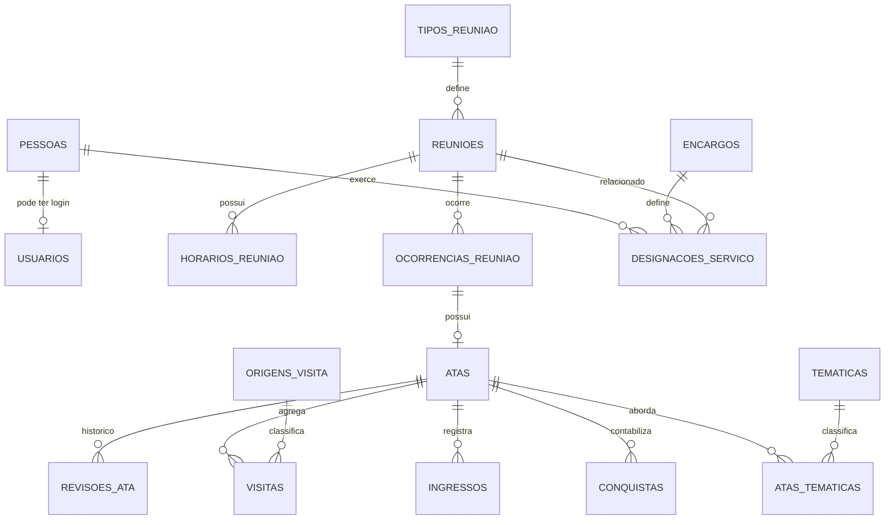

> Cardinalidade de `ATAS` por ocorrência precisa tratar cancelamentos e importações antigas; recomendação de **um registro lógico por ocorrência**, com revisões separadas e histórico de origem imutável.

### Kit, remessa e Correios

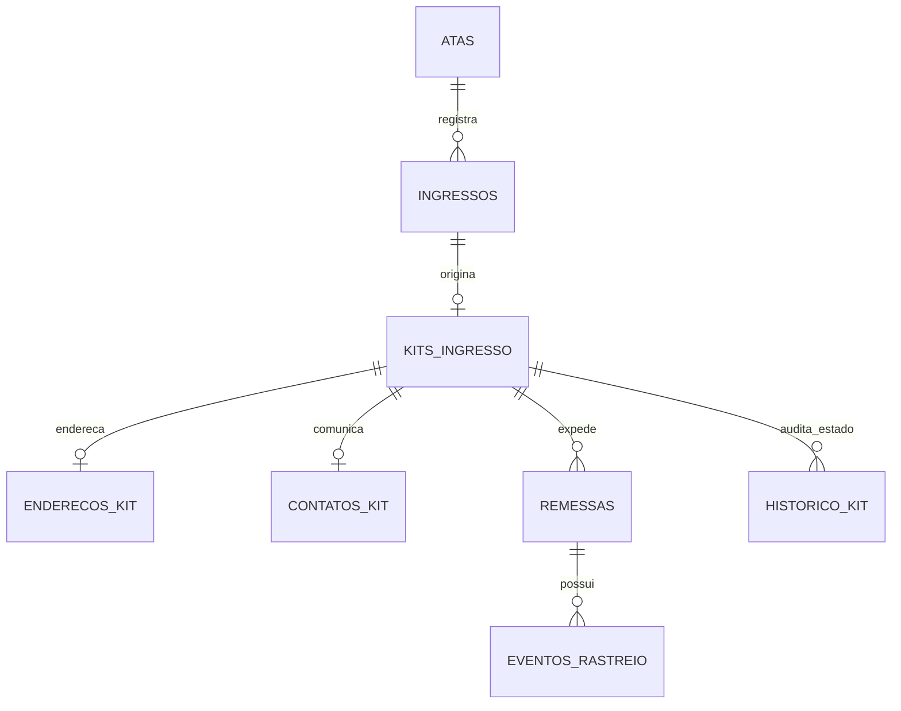

**Por que várias tabelas?** O ingresso identifica o acontecimento da reunião; o kit registra a obrigação operacional; a remessa pode precisar de reenvio após devolução; eventos de rastreio formam linha do tempo; endereço e contato possuem restrição mais rigorosa. Uma planilha única misturava essas informações e dificultava auditoria.

### Tesouraria, mensagens e integrações

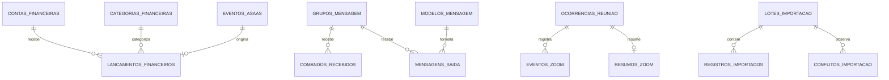

## 8. Contratos de integração e tratamento de falhas

### 8.1. Correios: serviço aprovado para o Kit Ingresso

**Fonte selecionada pelo projeto:** [`opastorello/correios-rastreamento`](https://github.com/opastorello/correios-rastreamento). O serviço é **Python/FastAPI**, não uma biblioteca nativa Laravel; deve ser executado separadamente no Docker e integrado por HTTP autenticado **apenas na rede privada**.

| Contrato | Valor/diretriz extraído do repositório | Regra QuarenteNA |
|---|---|---|
| Objeto único | `POST /rastreamento/objeto` com `{"codigo":"AA000000000BR"}` | Laravel chama com código da remessa permitida |
| Múltiplos | `POST /rastreamento/multiplos`, até 20 códigos por consulta segundo README | Worker agrupa consultas, respeitando limites e sem misturar autorização entre kits |
| Health | `GET /health` | Observabilidade técnica; falha não remove dados existentes |
| Segurança | `API_TOKEN` Bearer opcional; sem token, proteção é desabilitada | Token **obrigatório em produção** + rede privada, segredos Docker |
| Histórico auxiliar | Histórico global em arquivo do serviço | Não usar como fonte oficial; histórico institucional fica em `eventos_rastreio` |
| Limites | README indica 20/min por IP objeto; 10/min múltiplos | Job aplica backoff, circuit breaker, jitter e limite inferior ao necessário |
| Retenção auxiliar | `HISTORY_RETENTION_DAYS`, padrão 90 no README | Isolar/limitar a persistência auxiliar; política final de PII a aprovar operacionalmente |
| Timezone do serviço | `APP_TIMEZONE=America/Sao_Paulo` por padrão | Configurar `America/Bahia` para consistência de exibição; salvar instantes sem ambiguidades |
| Tecnologia | Scraping de Correios + CAPTCHA por rede neural | Dependência frágil frente a mudanças externas; oferecer reconsulta manual e alerta |
| Interface/MCP | Interface web pública e MCP possíveis | Não publicar as rotas do serviço na Internet; usar REST interno e bloquear acesso externo |

#### Sequência idempotente de rastreamento

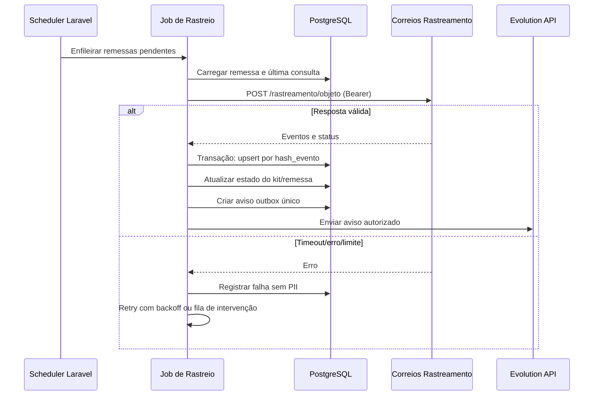

**Salvaguardas:** não realizar consulta em massa desnecessária; avaliar termos dos Correios e estabilidade do scraper; não exibir CPF, telefone, endereço completo ou dados privados no serviço auxiliar; não confiar em `situacao` sem normalizar eventos e datas; registrar `hash_evento` único por remessa e ocorrência.

### 8.2. ASAAS — escrituração imediata e correção posterior

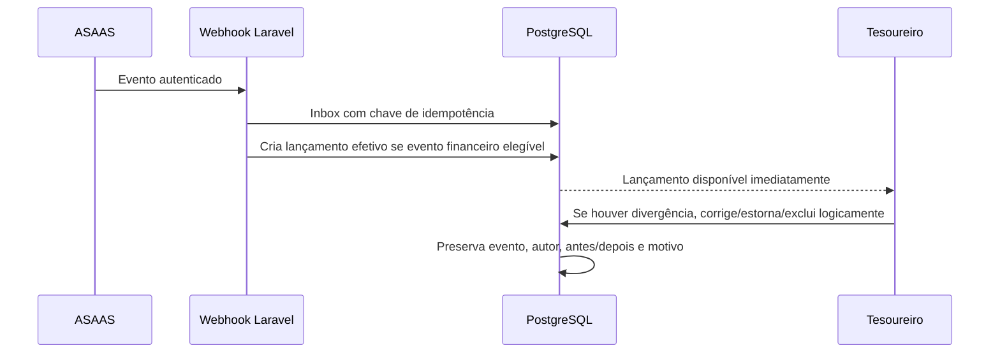

A mensagem recebida não corresponde necessariamente a receita final: mapear tipos de eventos ASAAS que confirmam movimentação, reversão ou estorno, evitando duplicar a mesma transação em eventos de estado sucessivos. Lançamento manual do Tesoureiro também é efetivado no `save`, sem etapa rascunho/aprovação. Processamento técnico/retry no inbox pode estar pendente, **mas o lançamento de negócio não possui estágio “pendente de conferência”**. Correções e exclusões por UI preservam trilha e integridade do livro; para reconciliação externa preferir reversão/retificação em vez de apagar eventos.

### 8.2. ASAAS e conciliação

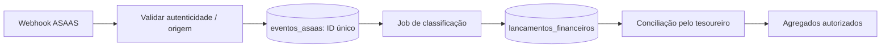

| Problema | Regra arquitetural |
|---|---|
| Evento repetido | `UNIQUE` pelo ID do provedor; transação com `ON CONFLICT`/equivalente |
| Payload fora de ordem | Máquina de estados com validação de transições; guardar referência externa |
| Descrição PIX | Guardar apenas dados necessários e não publicar identificação do pagador |
| Lançamento manual | Origens separadas e auditoria obrigatória |
| Saldo | Derivado de lançamentos/contas conciliados; não manter valor contraditório com o livro |
| Divergência | Criar pendência de conciliação, nunca forçar fechamento automático |

A segurança exata do webhook ASAAS deverá respeitar os mecanismos da documentação e configuração da conta efetiva; não presumir assinatura HMAC específica sem conferência.

### Configuração web de integrações e rotinas

Root excepcional e administração do Coordenador Geral/Secretário Geral podem manter **URLs, nomes de integração, endpoint de webhook, credenciais, rotas, templates, horários, ativação/desativação e parâmetros não secretos** no `/admin`. Secretos devem ficar criptografados via infraestrutura de segredos/driver próprio; UI oferece troca e teste de conectividade, nunca retorno do segredo em claro, log ou export. Todo ajuste identifica conta, operador, hora, campos alterados e teste executado. Habilitar/desabilitar por integração e por rotina; job de cron verifica flag persistida antes de cada envio para evitar mensagens após desligamento. Previews dos templates devem sanitizar dados privados. **Não implementar uma plataforma visual de workflows equivalente ao n8n:** para `!ajuda`, `!vago` e outros, usar roteamento explícito PHP para handlers simples e auditáveis; cron do Apps Script vira `Schedule` + Jobs/Notifications Laravel.

### Google Drive e armazenamento opcional

O **Google Drive é a integração documental principal** para atas de serviço, PDFs, manuais e registros institucionais quando a política do grupo permitir. `documentos`/`arquivos` guardam metadados, hash, versão, `provider=google_drive`, `external_file_id`, localização lógica e visibilidade; o Laravel autentica na Drive API com credencial institucional com escopos mínimos e fornece links de acesso controlado, sem ACL pública por padrão. Drive não guarda tabelas operacionais nem substitui PostgreSQL. **MinIO/S3** é apenas opção posterior para binários privados, se volume/custo/disponibilidade justificar; não subir MinIO obrigatório. **Redis** idem: só habilitar quando fila/cache PostgreSQL demonstrar gargalo e houver definição de backup, HA e operação.

### 8.3. Evolution API: comandos e mensagens

| Operação | Contrato | Proteção |
|---|---|---|
| Receber mensagem | Webhook + ID externo + grupo | Verificação de origem/segredo; dedup por mensagem |
| Identificar comando | `!` + nome + contexto de grupo | Allowlist, escopo do comando, rate limit |
| Ler dados do grupo | Query por serviço interno com Policy | Sem usar respostas públicas para dados do kit/PII |
| Enviar mensagem | `mensagens_saida` (outbox) + job | Sem envio dentro de transação de banco; idempotência |
| Término de mandato | scheduler e regras de data | Notificações por política; evitar mensagem duplicada |
| Resumo de ata | `resumos_ata` aprovado | Nunca publicar pessoas ou lista de Zoom |
| Erro permanente | Status falha + painel de reenvio | Trilha e intervenção manual |

### 8.4. Zoom: somente apoio à ata

| Dado de Zoom | Uso | Regra |
|---|---|---|
| ID de reunião e event ID | Correlacionar e deduplicar | Indexar por identificador de integração |
| Eventos de entrada/saída | Calcular sugestão agregada | Reter somente pelo período tecnicamente necessário |
| Identificadores de participantes | Deduplicação transitória quando imprescindível | Não migrar para `pessoas` nem exibir individualmente a servidores comuns |
| Contagem sugerida | Pré-preenchimento da ata | Secretário pode corrigir com justificativa |
| Falha de evento | Campo de conferência manual | Ata continua utilizável |

## 9. Plano técnico para migrar todas as fontes

### Inventário de origem para destino

| Fonte | Exemplo de dado / função | Tabela ou serviço de destino | Validação de paridade |
|---|---|---|---|
| Google Forms / `Responses` | Data, horário, secretário, coordenador e contagens | `ocorrencias_reuniao`, `atas` | Total por data/horário, checagem de tipos e números |
| Respostas de visitas | Origens, quantidades | `visitas`, `origens_visita` | Soma por período = relatório legado, com exceções justificadas |
| Respostas de ingressos | Nome, contato, data | `ingressos`, `kits_ingresso`, `contatos_kit` | 1 entrada válida = registro coerente, sem obrigar login |
| Respostas de conquistas e temáticas | Tipo, quantidade e tema | `conquistas`, `tipos_conquista`, `tematicas` | Número de conquistas/temas por ocorrência |
| Planilha Kit Ingresso | Contato, CEP, endereço, status e tracking | `kits_ingresso`, `enderecos_kit`, `remessas`, `eventos_rastreio` | Estados e remessas em aberto reconciliados |
| Planilha de Serviço | Titulares, início/fim, vagas | `encargos`, `designacoes_servico`, `escalas_reuniao` | Encarregados, vagas e vencimentos por reunião |
| Atas de Serviço / PDFs | Histórico de reuniões, decisões e anexos | `reunioes_servico`, `atas_servico`, `decisoes_coletivas`, `arquivos` | Documento preservado e vinculado |
| Tesouraria Sheets + ASAAS | Datas, valores, categorias, IDs externos | `lancamentos_financeiros`, `eventos_asaas`, `contas_financeiras` | Totais por período e saldo de abertura/fechamento |
| Docs VAGO / Relação | Visão textual de encargos | Consulta/view sobre `designacoes_servico` | Resultado equivalente sem cópia manual |
| Docs Consciências | Texto aprovado e histórico | `decisoes_coletivas`, `documentos`, `arquivos` | Integridade e visibilidade preservadas |
| Looker Studio | Resumo, Temáticas, Visitas, Kit, Quadro | Consultas/views PostgreSQL + dashboards Laravel | Filtros e fórmulas comparados com captura de referência |
| Apps Script `ata-resumo` | Geração/disparo de resumo | Eventos Laravel + `resumos_ata` + outbox | Mesmo significado e texto com revisão |
| Apps Script `ata-kitingresso` | Criação automática de kit | Service `CriarKitPorIngresso` | 1 kit por ingresso confirmado, sem duplicação |
| Apps Script `kit-ingresso` | CEP, status, mensagem e rastreio | Jobs Kit + Correios REST | Testes da máquina de estados e mensagens |
| Apps Script `servico-terminio` | Avisos 30/15/7/3/2/1 e encerramento | Scheduler Mandatos + Outbox | Datas/avisos/estados equivalentes |
| n8n `Robô` | Comandos WhatsApp | Handler de comandos Laravel | Comandos e permissões por grupo comparados |
| n8n divulgação, resumos e servidores | Notificações periódicas | Jobs + templates + audiência | Envio único, segurança, rastreabilidade |
| n8n tesouraria | Webhook financeiro → planilha | Inbox ASAAS + classificação + reconciliação | Mesmo evento não duplica transação |

### Etapas de importação e virada

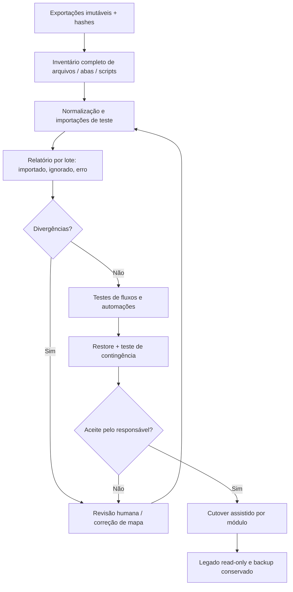

**Invariantes de migração:** `UNIQUE(fonte,linha/hash)` para idempotência por lote; numeração original preservada em tabela de proveniência; normalização não apaga o texto original em snapshot seguro; mesclagem de homônimos precisa de aprovação; relatórios não devem misturar atas em rascunho/anuladas com registros oficiais sem critério expresso.

### Conversão de fórmulas do Looker em métricas explícitas

| Métrica | Definição inicial | Cuidados |
|---|---|---|
| Reuniões | Contagem de atas válidas conforme status | Não confundir reunião agendada com ata enviada |
| Membros por reunião | Média de `membros_total` em atas válidas | Não criar histórico nominal |
| Visitas | Soma de `visitas.quantidade` | Deduplicar linhas importadas e separar origem |
| Ingressos | Contagem de `ingressos` válidos | Visita e ingresso são categorias distintas |
| Conquistas | Soma de `conquistas.quantidade` | Respeitar período e tipo |
| Mandatos vagos | Encargos/escalas sem titular ativo conforme data | Não depender de documento `VAGO` |
| Saldo | Saldo de abertura + entradas conciliadas − saídas conciliadas | Diferenciar pendente, reconciliado e estorno |

As fórmulas concretas do Looker exigem comparação com os relatórios originais durante a migração; estas regras são um **modelo inicial**, não alegação de equivalência já verificada.

## 10. Infraestrutura Docker, Swarm e segurança operacional

| Serviço | Ambiente local | Produção Docker/Swarm | Persistência |
|---|---|---|---|
| Laravel/Apache | Compose `app` | Imagem compilada e versionada imutável | Efêmera; storage compartilhado/externo se necessário |
| PostgreSQL 17 | Compose `postgres` sem porta host por padrão | Serviço persistente / infraestrutura externa já aprovada | Volume cifrado/backup externo testado |
| Queue worker | Compose profile `filas` | Réplica(s) após validação | Jobs no PG; idempotência |
| Scheduler | Compose profile `scheduler` | Coordenar instância responsável | Lock/sem repetição de tarefas |
| Redis | Opcional | Opcional conforme métricas | Não é fonte de negócio |
| Correios Rastreamento | Container auxiliar em rede privada | Serviço privado separado, com API_TOKEN e health check | Histórico auxiliar descartável/controlado |
| Proxy TLS | Proxy existente | Terminação HTTPS e headers | Certificados fora do código |
| Arquivos privados | Volume local protegido | Armazenamento persistente privado | Backup e controle de acesso |
| Backup | Teste `pg_dump` + arquivos | Rotina independente com verificação e ensaio de restore | Fora do volume único e fora da rede pública |

### Regras do template a respeitar

**Diretriz documental:** documentação **permanente** de implementação vive em `AGENTS.md` e `docs/banco/db.md` (gerado), decisões do produto em apenas cinco Markdown. Não criar pastas `docs/research`, `docs/decisions`, `docs/status`, duplicatas de arquitectura, nem dezenas de logs narrativos por agente. Histórico exato das mudanças já existe no Git/PRs e nas migrations. Os workflows BMAD podem usar arquivos temporários operacionais durante execução, mas devem manter como canônico apenas o material indispensável ao handoff.


- Manter `America/Bahia` como timezone IANA em PHP, Laravel, testes e containers; usar timestamps adequados no PostgreSQL, nunca offset fixo em configuração de regra de negócio.
- `postgres:5432` via DNS interno Compose; **não publicar 5432** em rede pública.
- `database/schema/pgsql-schema.sql` e `docs/banco/db.md` são **gerados do PostgreSQL real** após migrations, por `./scripts/banco-atualizar.sh`, não copiados deste documento.
- Nunca executar `schema:dump --prune` automaticamente e nunca alterar uma migration já aplicada para esconder evolução.
- Gates: `./scripts/testar.sh` (Pint, Larastan/PHPStan, Unit, Feature); `./scripts/testar.sh --postgres` em mudanças de banco e release; `git diff --check`.
- Laravel Boost: usar o wrapper oficial do template em ambiente compatível, manter guidelines `.ai/` e `AGENTS.md`, sem duplicar instruções conflitantes.
- BMAD: arquivos derivados em `_bmad-output/`, instalação do pacote em `_bmad/` recriável e não versionada; não tratar saída textual desta conversa como execução dos workflows.
- Separar dev/prod, proteger `.env` e Docker Secrets; logs não carregam segredos, dados de contato, código de acesso financeiro ou eventos Zoom não necessários.

## 11. Segurança, ameaças e controles

| Ameaça | Limite afetado | Controle verificável |
|---|---|---|
| Exposição de telefone/endereço | Kit ingresso | Colunas criptografadas, Policies, logs redigidos e teste de acesso negado |
| Reuso de token API | Integrações | Segredo separado por ambiente, rotação e identidade do chamador |
| Eventos ASAAS repetidos | Tesouraria | `UNIQUE` externo + transação única + replay test |
| Open redirect pelo domínio público | Links externos | HTTPS/host autorizado; não aceitar URL arbitrária do usuário em redirect |
| Falsa identificação Zoom | Atas/privacidade | Proibir merge Zoom→pessoa; contagem apenas sugerida |
| Falha ou mudança no scraper Correios | Kit | Timeout, retries, monitoramento e consulta manual |
| Conta técnica usada indevidamente | Administração | Break-glass temporal, 2º fator conforme solução, auditoria e revisão de concessões |
| Alteração financeira sem justificativa | Tesouraria | Registros imutáveis de ajuste, histórico, segregação de função |
| Job duplicado | Mensagens/mandatos/kit | Chave de idempotência, lock e transação para estado oficial |
| Planilha de origem alterada após export | Migração | Hash do snapshot e metadados do lote |
| Exposição pública por consulta/cache | Relatórios | Projeções públicas explícitas, views aprovadas, testes de dados ausentes |
| Backup inacessível | Continuidade | Restore periódico em ambiente isolado, inventário dos artefatos |

A base normativa da proteção de dados pessoais inclui a **LGPD** (Lei 13.709/2018) e os princípios de anonimato do grupo. É necessário documentar finalidade, acesso, duração de guarda e descarte por classe de informação, especialmente dados de ingressantes e eventos Zoom. O documento não inventa período de retenção sem decisão de governança.

## 12. Estratégia de testes e aceitação

| Nível | Exemplos | Evidência |
|---|---|---|
| Unit | Status de ata, cálculo de prazo, composição de resumos, mapeamento de evento Correios | Tests Unit |
| Feature | Login, permissão, edição, formulário de ata, painel/relatórios | Tests Feature |
| Integration PG | FK/UNIQUE/CHECK, retries, concorrência de webhook, idempotência de kit | Teste PostgreSQL descartável |
| Contrato API | Respostas simuladas Zoom/ASAAS/Evolution/Correios e timeout | Fixtures anonimizadas |
| Segurança | 403, cache, cross-user, escopo de kit e finanças | Testes positivos/negativos |
| Migração | CSV/JSON de legado com homônimos e dados faltantes | Comparação de totais e hashes |
| E2E/UX | Ata no smartphone, correção, relatório e integração indisponível | Ensaio observado com servidores |
| Recuperação | Restore de PG + storage e recálculo de indicadores | Relatório de exercício |
| Release | `testar.sh` + `--postgres`, migração staged, exportação e contingência | Checklist de readiness |

### Critérios de saída por domínio

| Domínio | Gate mínimo |
|---|---|
| Público | Zoom encontrado sem JS e sem login; links confiáveis; acessibilidade ensaiada |
| Atas | Revisão + envio único + correção/auditoria + rascunho persistido |
| Kit | Dados privados restritos; rastreio via Correios integrado; falhas recuperáveis |
| Tesouraria | Sem duplicidade financeira, conciliação e agregados sem contribuinte |
| Serviço | Vagas, mandatos e alertas equivalentes ao legado |
| Comunicação | Comandos autorizados, mensagens idempotentes, sem exposição de contatos |
| Migração | Todas as fontes ativas inventariadas, perdas explicadas, paridade aprovada |
| Operação | Restore, backup, segredos e health checks documentados e testados |

## 13. Decisões registradas e pontos de confirmação técnica

| Decisão | Estado | Referência |
|---|---|---|
| Laravel adaptado do template fornecido | **Definida pelo usuário** | Repositório `cirinho/template-laravel-bmad` |
| PostgreSQL como fonte de verdade | **Definida pelo usuário** | Brief/PRD aprovados |
| Docker para produção | **Definida pelo usuário** | Brief/PRD aprovados |
| BMAD 6.12.4 e Laravel Boost | **Definida pelo usuário** | Template e método |
| Correios `opastorello/correios-rastreamento` | **Definida pelo usuário** | Repositório do serviço |
| PHP 8.5, Laravel 13, PostgreSQL 17 | **Herdada do template inspecionado** | Conferir commit/lock na criação do projeto |
| Modular monolith e banco único | **Recomendação técnica** | Evita complexidade distribuída precoce |
| Queue via PostgreSQL inicialmente | **Recomendação técnica** | Reavaliar por volume e confiabilidade |
| 52 tabelas de domínio candidatas | **Modelo de domínio aprovado, sujeito à verificação por migrations** | Tabelas físicas só existem após implementação e testes PostgreSQL |
| Paleta visual/estrutura de navegação | **UX aprovado** | Logo original preservada; exportações vetoriais requerem revisão de fidelidade |
| Permissões de encargos/fluxos financeiros e do kit | **Aprovadas pelo usuário** | Políticas de retenção e detalhes de contingência continuam configuráveis |

## 14. Próximo passo BMAD

`Arquitetura.md` constitui o **spine aprovado** e catálogo de dados para alimentar os próximos contratos de implementação, mas **não é resultado de executar `bmad-architecture` dentro do repositório**. Em implementação, a saída oficial do workflow deve herdar as decisões transversais aqui registradas, fazer inspeção do commit do template efetivamente adotado e citar as migrations geradas.

Na sequência: consolidar/validar UX em interação com usuários → revisar arquitetura e segurança → executar `bmad-spec` para contratos de Epic (sem replicar todo este catálogo) → `bmad-create-epics-and-stories` → gate `bmad-sprint-planning` com resultado PASS/CONCERNS/FAIL. Não iniciar deploy nem migração definitiva só pela aprovação documental.

**Referências:** [BMAD 6.12.4 — arquitetura e UX](https://github.com/bmad-code-org/BMAD-METHOD/blob/v6.12.4/docs/plan/design-ux-and-architecture.md), [requisitos/specs](https://github.com/bmad-code-org/BMAD-METHOD/blob/v6.12.4/docs/plan/define-requirements-and-a-specification.md), [readiness](https://github.com/bmad-code-org/BMAD-METHOD/blob/v6.12.4/docs/plan/break-work-into-stories-and-track-it.md), [template](https://github.com/cirinho/template-laravel-bmad), [Correios rastreamento](https://github.com/opastorello/correios-rastreamento).
