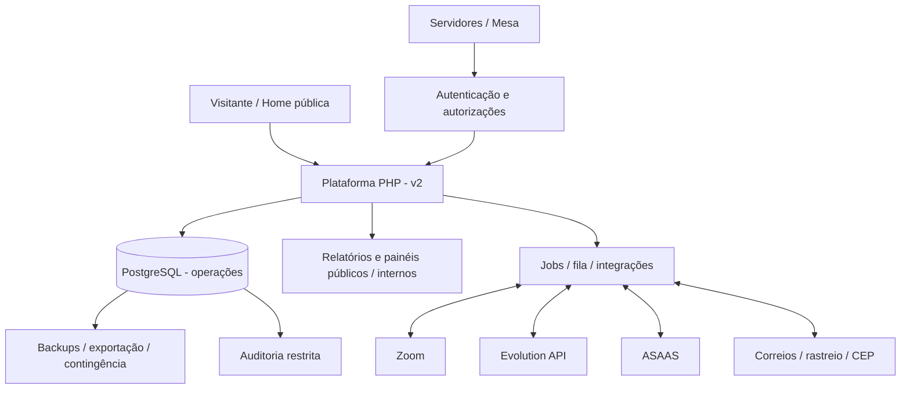
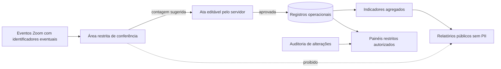
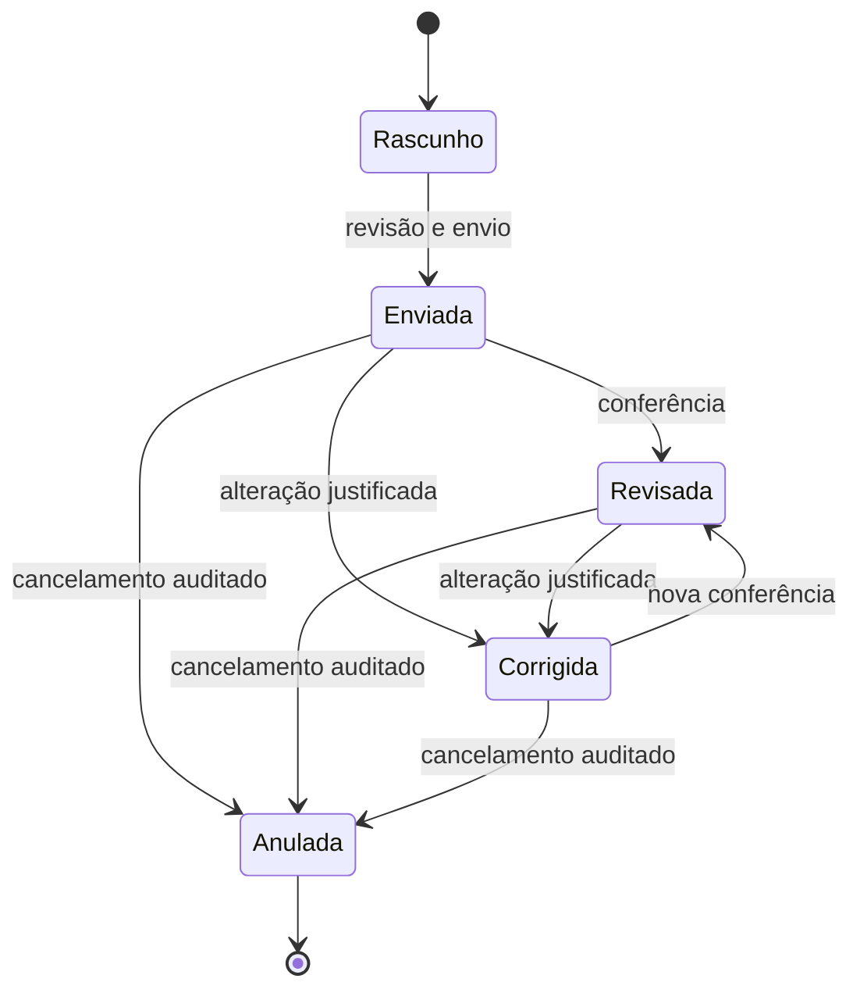
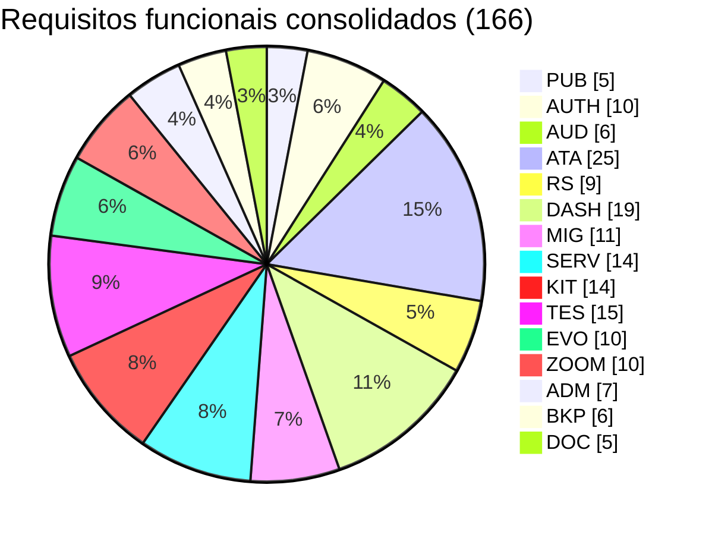
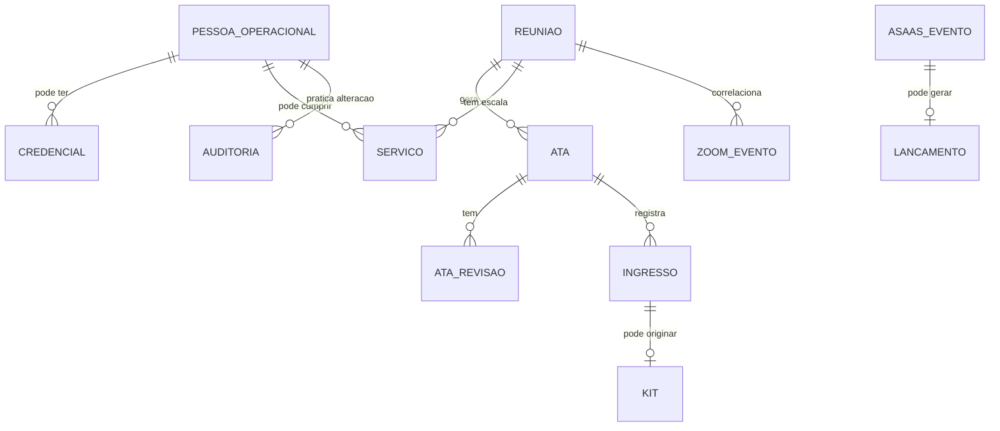
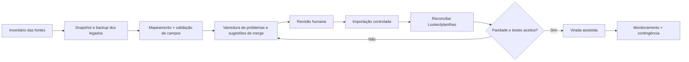

# PRD.md — Requisitos consolidados da Plataforma QuarenteNA v2

> **Situação:** artefato consolidado para revisão. Não constitui homologação de requisitos, validação em produção, inspeção das instâncias em execução nem execução automatizada dos workflows BMAD. Documento canônico de requisitos da v2; versões antigas e revisões não são copiadas com IDs contraditórios.

## 1. Declaração do produto, escopo e status

A plataforma v2 terá **home pública sem autenticação** e **painel `/admin` protegido**, consolidando os processos de ata, serviço, kit ingresso, tesouraria, relatórios, permissões e integrações atualmente distribuídos. O objetivo é um produto operacional completo, a ser construído por incrementos verificáveis e ativado somente após a migração/reconciliação.

**Status de aprovação: DRAFT / requisitos a validar com servidores e mesa.** Este documento define *o quê, para quem e com qual condição de aceite*. PHP + PostgreSQL + Docker são restrições de produto já expressas nas fontes; framework, ORM, schema físico, organização de classes, implantação específica e escolha de filas ficam para a arquitetura. Não executar migração nem expor dados particulares por inferência documental.

### Princípios e objetivos mandatórios

| Princípio | Interpretação de requisito |
|---|---|
| Serviço e consciência coletiva | Software não toma decisões sociais/espirituais em lugar do grupo |
| Site acessível | Zoom e agenda encontram-se sem login e sem depender de API externa na renderização crítica |
| Fonte autoritativa | Alteração operacional refletida nos módulos interessados sem cópias manuais conflitantes |
| Cadastro contextual | Pessoa operacional não precisa ser membro Zoom nem ter credenciais |
| Dados mínimos | Exposição pública limitada a números agregados e material aprovado |
| Auditabilidade | Operações de escrita produzem histórico autorizável/consultável |
| Reversibilidade | Exportação e restore reais, não apenas documentação de backup |
| Automação humana | Sugestão e automação nunca impossibilitam revisão humana |
| Uso móvel | Secretário conclui ata pelo celular, sem manipular planilhas |
| Single-group | Reuso por fork, não multi-tenancy/SaaS nesta entrega |

### Alcance por papel

| Papel / entidade | Acesso geral esperado | Restrições |
|---|---|---|
| Visitante ou membro público | Home, informações, links e relatórios autorizados | Sem cadastro necessário; nenhuma lista nominal |
| Pessoa no cadastro operacional | Registro de contexto | Não possui login por padrão |
| Servidor autenticado | Ata/consulta e módulos conforme encargo | Sem acesso automático a kit ou finanças |
| Mesa | Gestão e supervisão do grupo | Auditoria e controles proporcionais; não elimina separação de deveres |
| Tesoureiro / responsável kit / RSG / Secretário Geral | Acesso por permissão adicional e finalidade | Apenas domínios necessários |
| SuperAdmin técnico | Configuração e manutenção conforme delegação | Não substitui poder deliberativo da mesa |
| Conta institucional de contingência | Recuperação controlada | Procedimento break-glass, controles fortes e trilha específica |

### Diagrama de contexto funcional

### Fluxo de dados e limites de visibilidade

## 2. Jornadas essenciais e casos de uso

| Jornada | Gatilho | Resultado e controles |
|---|---|---|
| Recém-chegado | Acessa domínio público | Localiza próximo horário, tipo, Zoom e orientações sem login |
| Secretário | Reunião terminou ou está ocorrendo | Ata abre com sugestões; altera, guarda rascunho, revisa e envia |
| Mesa | Precisa corrigir ata ou encargo | Edição rastreável, justificativa e reflexo nas métricas |
| Tesoureiro | Chega evento ASAAS | Evento validado/deduplicado; lançamento preliminar revisto pelo responsável |
| Kit ingresso | Ata registra ingresso | Pendência criada; dados privados consultados só por autorizado; expedição acompanhada |
| Membro WhatsApp | Envia comando permitido | Resposta coerente com dados atuais, com controle de grupo, permissão e abuso |
| Responsável técnico | Falha operação ou serviço externo | Recupera estado, analisa logs, exporta, reconcilia ou aciona contingência |

### Máquina de estados de uma ata (modelo funcional proposto)

> A máquina de estados organiza descrições do PRD revisado, **não comprova** que todas as transições tenham sido aprovadas pela consciência coletiva. Autorizações, edição de status e efeitos nos indicadores devem ser validados.

## 3. Catálogo funcional canônico — IDs estáveis nesta consolidação

**Método de resolução de versões:** prevalece a semântica de `PRD_atualizado(1).md` (revisão 23/05/2026) sempre que um mesmo ID mudou de significado. Requisitos exclusivos de `PRD_detalhado_atualizado(1).md` (versão com complemento) são preservados sob seu ID original quando não existe colisão; detalhes equivalentes não são duplicados. **166 IDs distintos**, divididos em 15 famílias. Esta é a *numeração consolidada proposta*, ainda sujeita à validação humana antes de abrir epics/stories.

| Família | Área | Nº de requisitos |
|---|---|---:|
| `RF-PUB` | Portal e conteúdo público | 5 |
| `RF-AUTH` | Identidade, autenticação e autorizações | 10 |
| `RF-AUD` | Auditoria | 6 |
| `RF-ATA` | Ata das reuniões regulares | 25 |
| `RF-RS` | Ata e reuniões de serviço | 9 |
| `RF-DASH` | Dashboards e relatórios | 19 |
| `RF-MIG` | Migração e reconciliação | 11 |
| `RF-SERV` | Servidores, mandatos e escalas | 14 |
| `RF-KIT` | Kit ingresso | 14 |
| `RF-TES` | Tesouraria e ASAAS | 15 |
| `RF-EVO` | WhatsApp / Evolution API | 10 |
| `RF-ZOOM` | Zoom e eventos | 10 |
| `RF-ADM` | Administração e configurações | 7 |
| `RF-BKP` | Backup, recuperação e operações | 6 |
| `RF-DOC` | Documentação e replicabilidade | 5 |
| **Total** | | **166** |

### Distribuição dos requisitos por domínio (contagem, não percentagem de progresso)

### RF-PUB — Portal e conteúdo público (5)

| ID | Capacidade | Condição/requisito da fonte consolidada |
|---|---|---|
| `RF-PUB-001` | Landing page pública | O sistema deve possuir uma página pública em GrupoQuarenteNA.org. |
| `RF-PUB-002` | Informações de reunião | A landing page deve exibir dias, horários e link do Zoom. |
| `RF-PUB-003` | Links públicos | A página pública deve conter links para relatórios/dashboard públicos permitidos. |
| `RF-PUB-004` | Acesso ao painel | A página pública deve permitir acesso ao painel administrativo em /admin. |
| `RF-PUB-005` | Mobile-first | A página pública e o painel devem ser responsivos e priorizar boa experiência em celular. |

### RF-AUTH — Identidade, autenticação e autorizações (10)

| ID | Capacidade | Condição/requisito da fonte consolidada |
|---|---|---|
| `RF-AUTH-001` | Login | O sistema deve permitir login para usuários com senha cadastrada e status ativo. |
| `RF-AUTH-002` | Logout | O sistema deve permitir logout seguro. |
| `RF-AUTH-003` | Redefinição de senha | O sistema deve permitir redefinir senha por fluxo administrativo, e futuramente por e-mail se configurado. |
| `RF-AUTH-004` | Usuário sem senha | O sistema deve permitir registros em usuarios sem senha, para pessoas cadastradas apenas como referência operacional. |
| `RF-AUTH-005` | Gestão de usuários | Usuários com permissão de mesa, SuperAdmin ou root devem poder criar e editar registros em usuarios. |
| `RF-AUTH-006` | Proteção do root | O usuário root id 1 não pode ser apagado. |
| `RF-AUTH-007` | Proteção de SuperAdmin | A remoção ou rebaixamento de SuperAdmin deve exigir permissão adequada, auditoria explícita e validação de contingência técnica. |
| `RF-AUTH-008` | Permissões extras | O sistema deve permitir atribuir permissões extras a usuários, como tesouraria, kit ingresso, revisão de atas, RSG, Secretário Geral, administração técnica e outras. |
| `RF-AUTH-009` | Controle por módulo | Cada módulo deve verificar permissão antes de permitir visualização, criação, edição, exclusão, exportação ou acesso a dados sensíveis. |
| `RF-AUTH-010` | Relatórios públicos | O sistema deve permitir relatórios públicos sem login, desde que definidos como públicos e sem dados sensíveis. |

### RF-AUD — Auditoria (6)

| ID | Capacidade | Condição/requisito da fonte consolidada |
|---|---|---|
| `RF-AUD-001` | Auditar toda modificação | Toda operação que altere o banco de dados deve gerar registro de auditoria. |
| `RF-AUD-002` | Dados mínimos do log | Cada log deve registrar: ; usuário responsável; ; data e hora; ; IP ou origem da requisição quando disponível; ; user-agent quando disponível; ; módulo; ; entidade; ; id do registro; ; ação realizada; ; valores anteriores; ; valores novos; ; justificativa quando aplicável. |
| `RF-AUD-003` | Justificativa em edição posterior | Edições em registros oficiais já enviados, como atas enviadas, devem exigir justificativa. |
| `RF-AUD-004` | Consulta de auditoria | Usuários mesa, SuperAdmin e root devem poder consultar logs de auditoria. |
| `RF-AUD-005` | Auditoria de automações | Ações feitas por jobs, webhooks ou integrações devem ser registradas como ações de sistema, identificando origem como ASAAS, Zoom, Evolution API, job de rastreamento, job de serviços etc. |
| `RF-AUD-006` | Auditoria não editável | Logs de auditoria não devem ser editáveis pela interface comum. |

### RF-ATA — Ata das reuniões regulares (25)

| ID | Capacidade | Condição/requisito da fonte consolidada |
|---|---|---|
| `RF-ATA-001` | Criar ata | Usuários mesa ou servidores com login podem criar uma ata. |
| `RF-ATA-002` | Ata pré-preenchida | O formulário de ata deve vir pré-preenchido quando houver dados disponíveis. Campos candidatos para pré-preenchimento: ; data atual ou data da reunião selecionada; ; horário padrão; ; tipo/formato da reunião; ; secretário provável; ; coordenador provável; ; presença total sugerida pelo Zoom; ; lista de participantes capturada pelo Zoom, apenas para conferência restrita; ; informações adicionais padrão; ; dados relacionados à 7ª tradição quando aplicável. |
| `RF-ATA-003` | Editar dados pré-preenchidos | Todo dado pré-preenchido deve ser editável antes do envio. |
| `RF-ATA-004` | Secretário sugerido | Quem se logar para preencher a ata provavelmente deve ser sugerido como secretário da reunião. |
| `RF-ATA-005` | Coordenador sugerido | Se houver outro servidor escalado para o dia/horário, ele pode ser sugerido como coordenador. Se houver apenas um servidor e outro encargo estiver vago, o mesmo servidor pode ser sugerido como secretário e coordenador. |
| `RF-ATA-006` | Presença sugerida pelo Zoom | O sistema pode sugerir total de presenças com base nos participantes capturados pelo Zoom, mas o servidor pode modificar se julgar pertinente. |
| `RF-ATA-007` | Conferência antes de envio | Antes do envio oficial, o sistema deve exibir uma tela de revisão/rascunho para conferência. |
| `RF-ATA-008` | Rascunho automático | Ao iniciar o preenchimento, o sistema deve salvar automaticamente como rascunho e atualizar o rascunho durante o preenchimento. |
| `RF-ATA-009` | Envio oficial | Após conferência, o usuário pode enviar oficialmente a ata. |
| `RF-ATA-010` | Editar ata enviada | A ata enviada pode ser editada pelo próprio usuário que enviou ou por mesa/admin, com justificativa obrigatória e auditoria. |
| `RF-ATA-011` | Status da ata | A ata deve suportar status: ; rascunho; ; enviada; ; revisada; ; corrigida; ; anulada/cancelada. Regras: ; revisada: conferida pelo próprio servidor que preencheu; ; corrigida: alterada por outro servidor ou mesa; ; anulada/cancelada: permanece no banco, mas não aparece nos relatórios oficiais; ; rascunho: não aparece nos relatórios oficiais. |
| `RF-ATA-012` | Campos numéricos | O sistema deve validar campos numéricos, como presenças, partilhas, visitas, ingressos, conquistas e valores financeiros, impedindo valores inválidos. |
| `RF-ATA-013` | Campos estruturados | Campos objetivos devem usar seletores, cadastros ou opções controladas. |
| `RF-ATA-014` | Campos subjetivos | Campos como observações e informações adicionais podem ser texto livre. |
| `RF-ATA-015` | Opção “outro” | Quando necessário, seletores devem permitir opção “outro” com campo adicional de texto. |
| `RF-ATA-016` | Relação visita/ingresso | Sempre que houver ingresso, objetivamente houve visita. Pode haver visita sem ingresso. O sistema pode sugerir coerência, mas não deve impedir visita sem ingresso. |
| `RF-ATA-017` | Ingressos | Quando houver ingressos na ata, o sistema deve permitir relacionar ou cadastrar usuários correspondentes. |
| `RF-ATA-018` | Kit ingresso automático | Ao registrar ingresso, o sistema deve gerar pendência no módulo kit ingresso quando aplicável. |
| `RF-ATA-019` | Conquistas | Quando houver conquistas, o sistema deve permitir registrar quantidade e, opcionalmente, relacionar usuários e tempo limpo. |
| `RF-ATA-020` | Visitas | Quando houver visitas, o sistema deve registrar quantidade, origem da visita e informações textuais quando necessário. |
| `RF-ATA-021` | Temáticas | Quando a reunião for temática, o sistema deve registrar título da temática e partilhador, preferencialmente relacionado a um usuário. |
| `RF-ATA-022` | Resumo automático | Após envio oficial, o sistema deve poder gerar resumo da ata para WhatsApp/Telegram conforme configuração. |
| `RF-ATA-023` | Envio de resumo | O sistema deve poder enviar o resumo da ata via Evolution API e/ou Telegram, se configurado. |
| `RF-ATA-024` | Histórico | O sistema deve permitir consultar histórico de atas por período, tipo, dia, horário, servidor, visitas, ingressos, conquistas e outros filtros. |
| `RF-ATA-025` | Exportação | O sistema deve permitir exportar atas em CSV e gerar relatório imprimível. |

### RF-RS — Ata e reuniões de serviço (9)

| ID | Capacidade | Condição/requisito da fonte consolidada |
|---|---|---|
| `RF-RS-001` | Criar ata de serviço | O sistema deve permitir criar ata de reunião de serviço. |
| `RF-RS-002` | Template padrão | A ata de serviço deve possuir template padrão configurável. |
| `RF-RS-003` | Pré-preenchimento | Algumas informações podem vir pré-preenchidas, como data, tipo de reunião, servidores esperados, pauta padrão e dados do calendário. |
| `RF-RS-004` | Rascunho | A ata de serviço deve ser salva como rascunho antes do envio oficial. |
| `RF-RS-005` | Geração de PDF | Ao enviar oficialmente, o sistema deve gerar PDF automático da ata de serviço. |
| `RF-RS-006` | Dados da reunião de serviço | A ata de serviço deve registrar servidores presentes, faltas, justificativas, membros interessados, decisões e links/documentos relacionados. |
| `RF-RS-007` | Histórico e relatórios | O sistema deve permitir consultar reuniões de serviço por data, tipo, presença, faltas, justificativas e decisões. |
| `RF-RS-008` | Decisões e consciências **[LEGADO EXCLUSIVO]** | O sistema deve permitir registrar decisões ou consciências coletivas, com data, contexto e link de ata. |
| `RF-RS-009` | Consulta pública ou restrita **[LEGADO EXCLUSIVO]** | Algumas decisões podem ser públicas; dados internos de faltas e justificativas devem ser restritos. |

### RF-DASH — Dashboards e relatórios (19)

| ID | Capacidade | Condição/requisito da fonte consolidada |
|---|---|---|
| `RF-DASH-001` | Substituir Looker Studio | O sistema deve substituir o dashboard atual do Looker Studio por páginas PHP. |
| `RF-DASH-002` | Relatório clássico | O sistema deve oferecer visão equivalente ao Looker atual para validação dos números históricos. |
| `RF-DASH-003` | Dashboard melhorado | O sistema deve oferecer dashboard melhorado com filtros, cards, gráficos e tabelas mais confiáveis. |
| `RF-DASH-004` | Filtros | O dashboard deve permitir filtros por período, dia da semana, horário, tipo/formato de reunião, visitas, ingressos, conquistas, temática, servidor e status. |
| `RF-DASH-005` | Página Resumo | Deve existir página de resumo com indicadores principais de reuniões, presenças, partilhas, visitas, ingressos e conquistas. |
| `RF-DASH-006` | Página Dados da Reunião | Deve existir listagem detalhada de atas e reuniões. |
| `RF-DASH-007` | Página Conquistas e Ingressos | Deve existir relatório específico para conquistas e ingressos. |
| `RF-DASH-008` | Página Temáticas | Deve existir relatório de reuniões temáticas, títulos, partilhadores e presenças. |
| `RF-DASH-009` | Página Visitas | Deve existir relatório de visitas, origem e relação com ingressos. |
| `RF-DASH-010` | Página Quadro de Serviços | Deve existir relatório de servidores, encargos, vagas, histórico, conclusão, entrega e destituição. |
| `RF-DASH-011` | Página Reuniões de Serviço | Deve existir relatório de reuniões de serviço, atas, PDFs, participantes, faltas, justificativas e decisões. |
| `RF-DASH-012` | Página Tesouraria | Deve existir dashboard financeiro com entradas, saídas, categorias, saldos, reserva prudente, média de contribuição e projeções de autossustentabilidade. |
| `RF-DASH-013` | Página Kit Ingresso | Deve existir relatório de kit ingresso, status de envio, pendências, rastreamento e responsáveis. |
| `RF-DASH-014` | Página Participantes Zoom | A página de participantes Zoom, quando existir, deve ser restrita à mesa ou permissões específicas. Não deve ser relatório público ou acessível a servidores comuns. |
| `RF-DASH-015` | Relatórios públicos | Alguns relatórios agregados devem poder ser disponibilizados por link público sem login. |
| `RF-DASH-016` | Proteção de dados sensíveis | Relatórios públicos não devem expor telefone, endereço, lista nominal de participantes do Zoom, logs, dados internos do kit ou informações restritas. |
| `RF-DASH-017` | Relatório financeiro público | O relatório financeiro pode ser público como prestação de contas, exibindo data, valor, categorias e saldo, mas sem expor nomes de contribuintes. |
| `RF-DASH-018` | Exportação | Relatórios devem poder ser exportados em CSV quando autorizado. |
| `RF-DASH-019` | Impressão/PDF via navegador | Relatórios devem ter visualização amigável para impressão ou geração de PDF pelo navegador. |

### RF-MIG — Migração e reconciliação (11)

| ID | Capacidade | Condição/requisito da fonte consolidada |
|---|---|---|
| `RF-MIG-001` | Importar planilha de atas | O sistema deve importar histórico da planilha “Reuniões Grupo QuarenteNA Bahia (Responses)”. |
| `RF-MIG-002` | Importar kit ingresso | O sistema deve importar histórico da planilha Kit Ingresso. |
| `RF-MIG-003` | Importar tesouraria | O sistema deve importar histórico da planilha de tesouraria e reserva prudente, quando disponível. |
| `RF-MIG-004` | Importar quadro de serviços | O sistema deve importar quadro de servidores, cargos, início, término e histórico. |
| `RF-MIG-005` | Importar atas de serviço | O sistema deve importar ou referenciar atas de serviço e links PDF. |
| `RF-MIG-006` | Mapeamento de colunas | A importação deve permitir mapear colunas das planilhas para campos do sistema. |
| `RF-MIG-007` | Varredura prévia | Antes da migração, o sistema deve permitir varrer as planilhas atuais e identificar problemas, inconsistências, campos quebrados, duplicidades e conflitos. |
| `RF-MIG-008` | Normalização e mesclagem sugerida | A importação deve identificar possíveis duplicidades por apelido, nome, telefone, variações de acento, caixa e espaços, sugerindo mesclar/unir registros com revisão humana. |
| `RF-MIG-009` | Revisão manual | O sistema deve permitir revisão manual de conflitos e duplicidades antes de consolidar. |
| `RF-MIG-010` | Relatório de importação | Cada importação deve gerar relatório com total de linhas, linhas importadas, erros, avisos, duplicidades e decisões manuais. |
| `RF-MIG-011` | Validação contra relatórios atuais | Os totais importados devem ser comparáveis com planilhas e Looker atual antes da virada. |

### RF-SERV — Servidores, mandatos e escalas (14)

| ID | Capacidade | Condição/requisito da fonte consolidada |
|---|---|---|
| `RF-SERV-001` | Cadastro de encargos | O sistema deve permitir cadastrar encargos e funções de serviço. |
| `RF-SERV-002` | Cadastro de reuniões/horários | O sistema deve permitir cadastrar dias, horários e tipos de reunião vinculados a encargos. Hoje há reunião principal às 20h, mas o sistema deve suportar múltiplos horários no mesmo dia. |
| `RF-SERV-003` | Encargos configuráveis | O sistema deve permitir criar, extinguir e reativar encargos, como ocorreu com Kit Ingresso, Secretário Geral e Coordenador Geral. |
| `RF-SERV-004` | Associação de servidor | O sistema deve associar um usuário servidor a um encargo, dia, horário e reunião. |
| `RF-SERV-005` | Datas de serviço | A associação deve registrar data de início e previsão/data de término. |
| `RF-SERV-006` | Status do serviço | O serviço deve ter status como ativo, vago, temporário, concluído, entregue, destituído e suspenso. |
| `RF-SERV-007` | Histórico | O sistema deve manter histórico de servidores por encargo. |
| `RF-SERV-008` | Vagas | O sistema deve gerar automaticamente lista de vagas. |
| `RF-SERV-009` | Relação de servidores | O sistema deve gerar automaticamente relação de servidores por dia, horário e encargo. |
| `RF-SERV-010` | Avisos de término | O sistema deve enviar avisos automáticos de término de serviço em marcos configuráveis, como 30, 15, 7, 3, 2 e 1 dia. |
| `RF-SERV-011` | Notificação privada e grupo | Avisos podem ser enviados ao servidor e ao grupo de serviço via Evolution API. |
| `RF-SERV-012` | Encargo concluído, entregue ou destituído | Quando o encargo termina, é entregue ou há destituição, a mesa deve poder registrar o motivo, manter histórico e atualizar a vaga. |
| `RF-SERV-013` | Comando !vago | O comando !vago deve retornar dados gerados do banco, não de Google Docs manual. |
| `RF-SERV-014` | Comando !servidores | O comando !servidores deve retornar relação atual de servidores gerada do banco. |

### RF-KIT — Kit ingresso (14)

| ID | Capacidade | Condição/requisito da fonte consolidada |
|---|---|---|
| `RF-KIT-001` | Criar pendência de kit | Quando uma ata registrar ingresso, o sistema deve criar pendência de kit ingresso. |
| `RF-KIT-002` | Relacionar ingressante | Cada pendência deve estar relacionada a um usuário cadastrado. |
| `RF-KIT-003` | Dados do ingressante | O módulo deve permitir registrar telefone, CEP, endereço, status, observações, responsáveis e código de rastreio. |
| `RF-KIT-004` | Busca de CEP | O sistema deve permitir buscar/preencher endereço com base no CEP, quando integração estiver disponível. |
| `RF-KIT-005` | Status do kit | O status deve suportar verificar, falta endereço, falta enviar, enviado, recebido, devolvido e cancelado. |
| `RF-KIT-006` | Mensagem solicitando endereço | O sistema deve poder enviar mensagem ao ingressante solicitando endereço. |
| `RF-KIT-007` | Mensagem de falta enviar | O sistema deve poder notificar grupo/responsáveis e ingressante quando o kit estiver pronto para envio. |
| `RF-KIT-008` | Mensagem de enviado | O sistema deve poder notificar código de rastreio. |
| `RF-KIT-009` | Rastreamento | O sistema deve consultar rastreamento de objetos enviados por job configurado. |
| `RF-KIT-010` | Eventos de rastreio | Eventos de rastreio devem ser armazenados no banco. |
| `RF-KIT-011` | Atualização automática de status | Quando rastreamento indicar entrega, devolução ou evento relevante, o sistema deve atualizar status e notificar. |
| `RF-KIT-012` | Permissão de edição | Apenas mesa, SuperAdmin, root ou usuários com permissão extra de kit ingresso podem editar dados do kit. |
| `RF-KIT-013` | Proteção de telefone e endereço | Telefone e endereço do ingressante devem ser visíveis apenas para usuários autorizados. Nem todos os servidores devem ter acesso. |
| `RF-KIT-014` | Auditoria | Toda alteração em kit ingresso deve gerar auditoria. |

### RF-TES — Tesouraria e ASAAS (15)

| ID | Capacidade | Condição/requisito da fonte consolidada |
|---|---|---|
| `RF-TES-001` | Receber webhook ASAAS | O sistema deve receber eventos financeiros do ASAAS via webhook. |
| `RF-TES-002` | Registrar eventos automáticos | Eventos ASAAS devem gerar lançamentos financeiros automáticos. |
| `RF-TES-003` | Evitar duplicidade | O sistema deve usar identificador externo do ASAAS para evitar lançamento duplicado. |
| `RF-TES-004` | Tipos de lançamento | O sistema deve suportar entradas e saídas. |
| `RF-TES-005` | Descrição e categorização automática | Quando o webhook enviar descrição do PIX recebido ou enviado, essa descrição deve alimentar automaticamente a categorização inicial do lançamento, permitindo edição posterior pelo tesoureiro. |
| `RF-TES-006` | Categorias | Lançamentos devem ter categorias, como 7ª Tradição, literatura, reserva prudente, despesas, Zoom, doação, transferência e outras definidas pela mesa/tesoureiro. |
| `RF-TES-007` | Revisão pelo tesoureiro | Usuários com permissão de tesouraria devem poder revisar e categorizar lançamentos. |
| `RF-TES-008` | Edição com auditoria | Qualquer edição em lançamento financeiro deve gerar auditoria com valor anterior, valor novo e justificativa quando aplicável. |
| `RF-TES-009` | Lançamento manual | O sistema deve permitir lançamentos manuais. |
| `RF-TES-010` | Reserva prudente | O sistema deve controlar reserva prudente, inclusive lançamentos manuais, pois essa parte pode não ter webhook. |
| `RF-TES-011` | Saldo | O sistema deve calcular saldo por período, conta, categoria e visão geral. |
| `RF-TES-012` | Dashboard financeiro | O sistema deve exibir dashboard financeiro com entradas, saídas, saldo, categorias, evolução, média de contribuição e projeções de autossustentabilidade. |
| `RF-TES-013` | Visualização restrita | Servidores e usuários comuns podem visualizar apenas relatórios permitidos. Edição é restrita a tesouraria, mesa, root e SuperAdmin. |
| `RF-TES-014` | Relatório financeiro público | O relatório financeiro público deve omitir nomes de contribuintes, exibindo apenas informações agregadas ou transacionais permitidas, como data, valor, categoria e saldo. |
| `RF-TES-015` | Comando !saldo | O comando !saldo deve responder com saldo ou relatório resumido autorizado, sem expor dados restritos indevidos. |

### RF-EVO — WhatsApp / Evolution API (10)

| ID | Capacidade | Condição/requisito da fonte consolidada |
|---|---|---|
| `RF-EVO-001` | Receber webhook Evolution API | O sistema deve receber mensagens de WhatsApp via webhook da Evolution API. |
| `RF-EVO-002` | Identificar grupo de origem | O sistema deve identificar se a mensagem veio do grupo de serviço, grupo de membros ou outro grupo configurado. |
| `RF-EVO-003` | Processar comandos | Mensagens iniciadas com ! devem ser processadas como comandos. |
| `RF-EVO-004` | Comandos do grupo de serviço | O sistema deve suportar ou reformular comandos do grupo de serviço, incluindo !ajuda, !ata, !coletiva, !diretriz, !link, !kit, !gbatepapo, !gingresso, !participantes, !relatorio, !resumo, !saldo, !script, !senha, !servidores, !setima, !telas, !tematica, !textos e !vago. |
| `RF-EVO-005` | Comandos do grupo de membros | O sistema deve suportar ou reformular comandos do grupo de membros, incluindo !ajuda, !coletiva, !diretriz, !link_cpsanto, !link_quarentena, !link_novaera, !relatorio, !saldo, !servidores, !setima, !zap_cpsanto, !zap_novaera e !zap_quarentena. |
| `RF-EVO-006` | Dados vindos do banco | Comandos como !vago, !servidores, !saldo, !relatorio, !ata e !resumo devem preferencialmente responder com dados estruturados do banco. |
| `RF-EVO-007` | Logs | Mensagens recebidas, comandos processados e respostas enviadas devem gerar logs técnicos conforme política de retenção. |
| `RF-EVO-008` | Proteção contra abuso | O sistema deve ter algum mecanismo de proteção contra uso excessivo ou chamadas repetitivas. |
| `RF-EVO-009` | Logs de mensagens **[LEGADO EXCLUSIVO]** | O sistema deve registrar logs de mensagens enviadas por automação. |
| `RF-EVO-010` | Rate limit e falhas **[LEGADO EXCLUSIVO]** | Falhas de envio devem ser registradas e, quando possível, reenviadas ou marcadas como pendentes. |

### RF-ZOOM — Zoom e eventos (10)

| ID | Capacidade | Condição/requisito da fonte consolidada |
|---|---|---|
| `RF-ZOOM-001` | Receber webhook Zoom | O sistema deve receber eventos do Zoom via webhook. |
| `RF-ZOOM-002` | Validar webhook | O sistema deve validar o endpoint e a origem conforme exigências técnicas do Zoom. |
| `RF-ZOOM-003` | Evento participant_joined | O sistema deve suportar o evento meeting.participant_joined, capturando campos úteis como evento, timestamp, reunião, tópico, duração, timezone, usuário, email, ids e horário de entrada. |
| `RF-ZOOM-004` | Campos úteis | A arquitetura deve avaliar os campos efetivamente permitidos no payload Zoom: `event`, `event_ts`, `payload.account_id`, identificador e UUID da reunião, `host_id`, `topic`, `type`, `start_time`, `duration`, `timezone`, além dos campos de participante `user_name`, `id`, `user_id`, `customer_key`, `join_time`, `email` e `registrant_id`. **Disponibilidade e necessidade de cada campo devem ser verificadas**; dados identificáveis exigem retenção mínima, propósito legítimo e acesso restrito. |
| `RF-ZOOM-005` | Salvar eventos | Eventos de participantes devem ser salvos em tabela própria, separada de usuarios. |
| `RF-ZOOM-006` | Sugerir presença total | O sistema deve usar eventos do Zoom para sugerir presença total na ata. |
| `RF-ZOOM-007` | Permitir correção manual | A presença sugerida pelo Zoom deve poder ser alterada pelo servidor responsável pela ata. |
| `RF-ZOOM-008` | Restringir lista nominal | Lista nominal de participantes Zoom deve ser restrita à mesa ou usuários com permissão específica. |
| `RF-ZOOM-009` | Não vigilância individual | O sistema não deve usar dados do Zoom para criar controle público ou operacional comum de frequência individual de membros. |
| `RF-ZOOM-010` | Pesquisa técnica futura | Na fase de arquitetura, deve-se consultar a documentação atual do Zoom para verificar outros eventos úteis além de participant_joined. |

### RF-ADM — Administração e configurações (7)

| ID | Capacidade | Condição/requisito da fonte consolidada |
|---|---|---|
| `RF-ADM-001` | Configurações do grupo **[LEGADO EXCLUSIVO]** | O sistema deve permitir configurar dados do grupo, como nome, links, horários, reuniões, textos padrão e contatos. |
| `RF-ADM-002` | Tipos de reunião **[LEGADO EXCLUSIVO]** | O sistema deve permitir configurar tipos/formato de reunião. |
| `RF-ADM-003` | Horários **[LEGADO EXCLUSIVO]** | O sistema deve permitir configurar horários padrão. |
| `RF-ADM-004` | Textos de comandos **[LEGADO EXCLUSIVO]** | O sistema deve permitir configurar textos retornados por comandos WhatsApp quando aplicável. |
| `RF-ADM-005` | Integrações **[LEGADO EXCLUSIVO]** | O sistema deve permitir configurar credenciais e status de integrações em ambiente seguro, sem expor segredos publicamente. |
| `RF-ADM-006` | Jobs **[LEGADO EXCLUSIVO]** | O sistema deve permitir ver status de jobs automáticos, como rastreamento, avisos de serviço e backups. |
| `RF-ADM-007` | Logs técnicos **[LEGADO EXCLUSIVO]** | SuperAdmin/root devem poder consultar logs técnicos relevantes. |

### RF-BKP — Backup, recuperação e operações (6)

| ID | Capacidade | Condição/requisito da fonte consolidada |
|---|---|---|
| `RF-BKP-001` | Backup do banco **[LEGADO EXCLUSIVO]** | O sistema deve ter procedimento documentado para backup do PostgreSQL. |
| `RF-BKP-002` | Restauração **[LEGADO EXCLUSIVO]** | O sistema deve ter procedimento documentado para restaurar backup. |
| `RF-BKP-003` | Backup antes da migração **[LEGADO EXCLUSIVO]** | Antes da virada oficial, deve existir backup dos dados importados e dos arquivos históricos. |
| `RF-BKP-004` | Documentação de instalação **[LEGADO EXCLUSIVO]** | O sistema deve ter documentação para instalação via Docker. |
| `RF-BKP-005` | Documentação operacional **[LEGADO EXCLUSIVO]** | O sistema deve ter documentação para servidores usarem painel, ata, relatórios, kit ingresso, tesouraria e comandos. |
| `RF-BKP-006` | Documentação técnica **[LEGADO EXCLUSIVO]** | O sistema deve ter documentação de arquitetura, variáveis de ambiente, jobs, webhooks, integrações, backup e deploy. |

### RF-DOC — Documentação e replicabilidade (5)

| ID | Capacidade | Condição/requisito da fonte consolidada |
|---|---|---|
| `RF-DOC-001` | Documentação para iniciantes | O sistema deve incluir documentação simples para novos servidores. |
| `RF-DOC-002` | Documentação por módulo | Deve haver orientações para ata, tesouraria, kit ingresso, serviços, relatórios, comandos e painel. |
| `RF-DOC-003` | Documentação administrativa | Mesa/admin deve ter documentação de usuários, permissões, auditoria, migração e correções. |
| `RF-DOC-004` | Documentação técnica | Responsáveis técnicos devem ter documentação de instalação, deploy, backup, restore, jobs, webhooks e variáveis de ambiente. |
| `RF-DOC-005` | Adaptação para outro grupo | Deve existir um documento futuro, como ADAPTAR_PARA_OUTRO_GRUPO.md, explicando como adaptar um fork para outro grupo, alterando nome, domínio, e-mail, Zoom, Evolution API, ASAAS, textos, links, cores, logo, .env, usuário root e configurações iniciais. |

## 4. Requisitos não funcionais e limites de proteção

| ID | Resultado esperado | Evidência de aceite / limiar |
|---|---|---|
| RNF-01 | HTTPS e sessões protegidas; não vazar segredos em repositório/HTML | Análise de configurações e testes de autenticação; parâmetros em arquitetura |
| RNF-02 | Senhas armazenadas como hash apropriado, política de recuperação | Revisão de segurança e testes positivos/negativos |
| RNF-03 | Autorização no servidor em toda rota/dado sensível | Matriz RBAC/ABAC validada por mesa; testes de acesso negado |
| RNF-04 | Auditoria de escrita sem expor segredos | Testes insert/update/delete, comparação de valores e retenção aprovada |
| RNF-05 | Minimização LGPD/anonimato, segregação Zoom, kit e finanças | Inventário de dados, regras de finalidade e testes de acesso/exportação |
| RNF-06 | Interface mobile-first acessível por teclado e leitor de tela | Testes em viewport pequeno e auditoria WCAG 2.1 AA como alvo proposto |
| RNF-07 | Home pública utilizável sem dependência de APIs/JS para dado crítico | Testes de bloqueio de terceiros e JS desligado |
| RNF-08 | Falhas e duplicações de webhook não geram lançamentos duplicados | Replay controlado, idempotência e testes de evento fora de ordem |
| RNF-09 | Tarefas/jobs podem falhar e retomar sem perda de integridade | Retries idempotentes, logs e tratamento de falha |
| RNF-10 | Tráfego de WhatsApp é limitado e estritamente autorizado | Testes de origem, frequência e comandos por grupo |
| RNF-11 | Backup/restauração utilizáveis | Restore de amostra e teste de recuperação em ambiente isolado |
| RNF-12 | Migração verificável e reversível | Reconciliação por total/entidade e relatório de divergências |
| RNF-13 | Documentação para servidores não técnicos | Teste de tarefa assistida apenas pelo material publicado |
| RNF-14 | Desempenho aceitável em conexão móvel e cargas típicas | Metas de tempo e tamanho **a estabelecer após baseline** |
| RNF-15 | Observabilidade sem vigilância individual | Logs e dashboards sem ranking nominal de presença |
| RNF-16 | Exportação em formatos abertos e controle de contingência | Amostra importável de export e procedimento operacional revisado |
| RNF-17 | Painel público não expõe registros privados via cache/consulta | Testes de consulta, exportação, índices de busca e cache |
| RNF-18 | Sistema single-group configurável e documentado para forks | Instalação limpa e parametrização sem códigos/credenciais do QuarenteNA |

**Importante:** esta tabela reorganiza os 15 RNFs históricos e os limites acrescidos na revisão posterior. IDs `RNF-01…18` são novos e propostos para evitar misturar numerações/documentos anteriores. O alvo WCAG 2.1 AA retoma o planejamento público antigo e exige decisão explícita de aceite. SLA, RTO, RPO, retenção, volumes e p95 não foram definidos nos arquivos; não foram inventados.

## 5. Regras de negócio transversais

| Código | Regra e implicação |
|---|---|
| RB-01 | Ata oficial depende de autenticação e permissão; rascunhos não entram em indicadores oficiais |
| RB-02 | Dados sugeridos pelo Zoom nunca se tornam prova de presença pessoal; usuário corrige a contagem |
| RB-03 | Entrada/visita são conceitos distintos, com vínculo/contagem esclarecidos antes do relatório |
| RB-04 | Corrigir, anular ou revisar ata preserva origem, justificativa, autor e anterior/posterior |
| RB-05 | Usuário cadastrado operacionalmente pode não ter login; não autogerar contas por participação Zoom |
| RB-06 | Root institucional é contingência protegida; dados nominais/IDs fixos devem ser revisados fora de material público |
| RB-07 | Kit ingresso usa dados de contato/endereço apenas para cumprimento da finalidade operacional e autorização específica |
| RB-08 | ASAAS pode sugerir categoria; conciliação e retificação dependem de tesouraria com trilha |
| RB-09 | Comandos respondem dentro de grupo e permissões configuradas; `!saldo` não pode vazar detalhes proibidos |
| RB-10 | Publicação de relatórios exige revisão editorial de privacidade; apenas agregados públicos aprovados |
| RB-11 | Encargos podem ser criados, encerrados, entregues ou destituídos, com histórico sem exclusão destrutiva |
| RB-12 | `n8n`, Sheets, Apps Script e Looker perdem papel de fonte operacional **após** cutover aceito, não antes |
| RB-13 | Nenhum fluxo automático substitui decisão de consciência coletiva ou validação humana sensível |
| RB-14 | Cadastro/fusão de pessoas demanda prevenção de colisão e validação, especialmente homônimos |

## 6. Casos de aceitação ponta a ponta

| CA | Dado / cenário | Aceitação demonstrável |
|---|---|---|
| CA-01 | Visitante sem login em smartphone | Vê agenda, tipo, horário e CTA de Zoom; terceiros indisponíveis não bloqueiam |
| CA-02 | Secretário inicia ata, perde conexão e retorna | Rascunho preservado ou falha explicitada sem perda silenciosa; revisão e envio registrados |
| CA-03 | Zoom indisponível ou sugere contagem incorreta | Secretário pode inserir/corrigir presença; público não recebe lista nominal |
| CA-04 | Mesma mensagem ASAAS reapresentada | Um evento lógico não cria lançamentos duplicados; erro auditável |
| CA-05 | Usuário sem permissão acessa kit/tesouraria/Zoom | Acesso recusado em interface e endpoint; sem dados sensíveis em logs públicos |
| CA-06 | Ata enviada corrigida com justificativa | Alteração anterior/nova registrada; indicadores recalculados com status correto |
| CA-07 | Ingresso gera pendência de kit | Responsável autorizado acompanha pendência e expedição; dados pessoais invisíveis aos demais |
| CA-08 | Encargo se encerra ou está vago | Escala e comandos `!vago`/`!servidores` refletem estado atual |
| CA-09 | Importação com homônimos/datas faltantes | Sistema destaca conflitos e exige decisão humana; relatório mostra divergências |
| CA-10 | Relatório público financeiro | Agregados concisos visíveis sem identidade nem referência indevida a contribuintes |
| CA-11 | Webhook Evolution falso/duplicado | Mensagem rejeitada ou deduplicada; nenhum comando indevido executado |
| CA-12 | Incidente exige restauração | Backup restaurado em ambiente isolado, dados comparados e modo de contingência documentado |
| CA-13 | Novo servidor com celular | Conclui ata e consulta documentação sem instrução de planilhas, com observação de UX |
| CA-14 | Registros migrados de Sheets/Looker | Totais por período reconciliados; exceções assinadas pelo responsável |
| CA-15 | Instalação por fork para outro grupo | Configura nome, domínio, integrações e identidade sem herdar credenciais ou dados reais |

## 7. Entidades conceituais (NÃO é o schema físico)

| Domínio | Entidades candidatas / relacionamentos | Proteção |
|---|---|---|
| Acesso | Pessoa operacional, credencial opcional, papel, autorização extra, sessão | Cadastro não equivale a participante Zoom |
| Agenda | Reunião/tipo/horário, ocorrência, escala e serviço | Metadados públicos mínimos |
| Ata | Ata, status, revisões, ingressos, conquistas, visitas, temáticas | Relatórios agregados |
| Serviço | Encargo, mandato, reunião de serviço, ata, consciência coletiva | Restrições pela mesa |
| Kit | Pendência, destino de expedição, eventos de rastreio | Endereço/telefone restritos |
| Tesouraria | Lançamento, categoria, evento ASAAS, reconciliação | Dados do pagador restritos |
| Comunicação | Comando, grupos, mensagens, eventos e falhas | Conteúdo e retenção minimizados |
| Zoom | Evento de participante, referência de reunião, contador derivado | Dados brutos restritos/temporários |
| Governança | Auditoria, importação, erros, arquivos, backup, configuração | Segregação e trilha |

## 8. Integrações, falhas e fronteiras

| Integração | Entrada ou saída | Dado mínimo necessário | Regras de falha |
|---|---|---|---|
| Zoom | Eventos de reunião/participante | Identificador evento/reunião, horário e contagem derivada | Validar origem; deduplicar; não criar usuário nem perfil de presença |
| ASAAS | Eventos financeiros | Identificador transação/evento, valor, status e categoria preliminar | Assinatura/autenticidade, idempotência e revisão de divergência |
| Evolution API | Mensagens e comandos por grupo | Grupo autorizado, comando, resultado e status | Autenticidade, controle de acesso, rate limit, retry e logs minimizados |
| Correios/rastreio/CEP | Endereço e eventos de expedição | CEP e código quando necessários | Consentimento/finalidade, indisponibilidade e reconsulta manual |
| Google legado | Importação somente até o cutover | Export de cada planilha/documento com versão | Read-only, snapshot, reconciliação e conservação de evidências |
| Dashboard público | Saída agregada do sistema | Indicadores aprovados | Nenhum acesso direto a PII ou export restrito |

## 9. Migração e virada operacional

| Gate | Critério mínimo de saída |
|---|---|
| M-1 Inventário | Fontes, responsáveis, fluxos e campos críticos conhecidos |
| M-2 Normalização | Inconsistências classificadas; merges apenas com confirmação humana |
| M-3 Migração | Logs e relatório por entidade, erro e import batch; backups íntegros |
| M-4 Paridade | Totais amostrais por reunião/data/valor conferidos com fontes antigas |
| M-5 Segurança | Permissões, webhooks, exposição pública e exportação testados |
| M-6 Operação | Servidores executam ata, kit, tesouraria e consulta sem planilhas |
| M-7 Reversibilidade | Restore exercitado; procedimento para retorno manual validado |
| M-8 Aprovação | Mesa registra aceite e responsáveis pela virada |

**Nota:** substituir o ecossistema principal é objetivo final. Os documentos não definem data de cutover, taxa máxima de erro aceitável nem duração de operação assistida; esses parâmetros não devem ser inventados.

## 10. Riscos e decisões em aberto

| ID | Questão que bloqueia finalização | Estado |
|---|---|---|
| DEC-01 | Agenda exata, tipos e definição de ocorrência para múltiplos horários | Validar |
| DEC-02 | Matriz de acesso por mesa, servidor, RSG, Tesouraria, Kit e SuperAdmin | Validar |
| DEC-03 | Política de retenção e finalidade de Zoom, mensagens e PII de ingressantes | Validar |
| DEC-04 | Modelo institucional de conta root / gestão de segredos / seed nominal | Segurança/arquitetura |
| DEC-05 | Conciliação de visitas × ingresso × conquista e regra para homônimos | Validar |
| DEC-06 | Critérios de correção/anulação de ata e quóruns/fluxos de aprovação | Validar |
| DEC-07 | Categorias e publicação de dados financeiros agregados | Tesouraria/Mesa |
| DEC-08 | Inventário integral de comandos WhatsApp e resposta por grupo | Validar |
| DEC-09 | Formatos, acesso e aceite da migração das fontes históricas | Validar |
| DEC-10 | Domínio final, conteúdo público e ownership técnico | Validar |
| DEC-11 | Métricas e metas quantitativas (UX, p95, backup, disponibilidade) | Baseline pendente |
| DEC-12 | Limites legítimos de listas nominais e informes Zoom | Privacidade/Mesa |
| DEC-13 | Limites de ação e poder de acesso das contas técnicas | Mesa/Técnico |

## 11. Rastreabilidade de versões e IDs

| Fonte | Tratamento |
|---|---|
| `PRD(2).md` v1.0 | Referência histórica para lacunas e sequência inicial |
| `PRD_detalhado_atualizado(1).md` | 150 requisitos originais + revisões sem renumeração completa; 17 IDs preservados por exclusividade |
| `PRD_atualizado(1).md` v1.1 | **Fonte prioritária de semântica** dos 149 requisitos revisados |
| `ProductBrief_atualizado(1).md` e detalhado | Contexto/visão do produto, sem sobrepor decisões de PRD |
| `QuarenteNA_atualizado(1).md` e detalhado | Descrição de fatos e hipóteses do sistema anterior |
| `prd(1).md` + BMAD março | **Outro produto/escopo anterior**; não fundir numerações de FR1–FR33 à v2 |

### Identificadores reciclados com significados divergentes

**60 IDs** da base detalhada pré-revisão recebem títulos/semânticas diferentes na revisão posterior. Prevalece a revisão posterior; tabelas abaixo registram a divergência para agentes não recuperarem o requisito errado por memória histórica.

| ID | Significado no detalhado anterior | Significado na revisão posterior (canônico) |
|---|---|---|
| `RF-ATA-004` | Coordenador sugerido | **Secretário sugerido** |
| `RF-ATA-005` | Secretário sugerido | **Coordenador sugerido** |
| `RF-ATA-008` | Rascunho e salvamento automático | **Rascunho automático** |
| `RF-ATA-016` | Ingressos | **Relação visita/ingresso** |
| `RF-ATA-017` | Kit ingresso automático | **Ingressos** |
| `RF-ATA-018` | Conquistas | **Kit ingresso automático** |
| `RF-ATA-019` | Visitas | **Conquistas** |
| `RF-ATA-020` | Temáticas | **Visitas** |
| `RF-ATA-021` | Resumo automático | **Temáticas** |
| `RF-ATA-022` | Envio de resumo | **Resumo automático** |
| `RF-ATA-023` | Histórico | **Envio de resumo** |
| `RF-ATA-024` | Exportação | **Histórico** |
| `RF-AUTH-003` | Recuperação ou redefinição de senha | **Redefinição de senha** |
| `RF-DASH-014` | Página Participantes Zoom restrita | **Página Participantes Zoom** |
| `RF-DASH-017` | Exportação | **Relatório financeiro público** |
| `RF-DASH-018` | Impressão/PDF via navegador | **Exportação** |
| `RF-EVO-006` | Respostas por configuração | **Dados vindos do banco** |
| `RF-EVO-007` | Respostas baseadas no banco | **Logs** |
| `RF-EVO-008` | Envio de mensagens | **Proteção contra abuso** |
| `RF-MIG-007` | Varredura prévia e normalização | **Varredura prévia** |
| `RF-MIG-008` | Revisão manual e sugestão de mesclagem | **Normalização e mesclagem sugerida** |
| `RF-MIG-009` | Relatório de importação | **Revisão manual** |
| `RF-MIG-010` | Validação contra relatórios atuais | **Relatório de importação** |
| `RF-RS-001` | Cadastro de reunião de serviço | **Criar ata de serviço** |
| `RF-RS-002` | Link da ata | **Template padrão** |
| `RF-RS-003` | Tipo da reunião | **Pré-preenchimento** |
| `RF-RS-004` | Servidores presentes | **Rascunho** |
| `RF-RS-005` | Faltas e justificativas | **Geração de PDF** |
| `RF-RS-006` | Membros interessados | **Dados da reunião de serviço** |
| `RF-RS-007` | Percentual de ausência | **Histórico e relatórios** |
| `RF-SERV-003` | Associação de servidor e criação de encargos | **Encargos configuráveis** |
| `RF-SERV-004` | Datas de serviço | **Associação de servidor** |
| `RF-SERV-005` | Status do serviço | **Datas de serviço** |
| `RF-SERV-006` | Histórico | **Status do serviço** |
| `RF-SERV-007` | Vagas | **Histórico** |
| `RF-SERV-008` | Relação de servidores | **Vagas** |
| `RF-SERV-009` | Avisos de término | **Relação de servidores** |
| `RF-SERV-010` | Notificação privada e grupo | **Avisos de término** |
| `RF-SERV-011` | Encargo concluído | **Notificação privada e grupo** |
| `RF-SERV-012` | Comando !vago | **Encargo concluído, entregue ou destituído** |
| `RF-SERV-013` | Comando !servidores | **Comando !vago** |
| `RF-TES-005` | Categorias e descrição automática do ASAAS | **Descrição e categorização automática** |
| `RF-TES-006` | Revisão pelo tesoureiro | **Categorias** |
| `RF-TES-007` | Edição com auditoria | **Revisão pelo tesoureiro** |
| `RF-TES-008` | Lançamento manual | **Edição com auditoria** |
| `RF-TES-009` | Reserva prudente | **Lançamento manual** |
| `RF-TES-010` | Saldo | **Reserva prudente** |
| `RF-TES-011` | Dashboard financeiro | **Saldo** |
| `RF-TES-012` | Visualização restrita | **Dashboard financeiro** |
| `RF-TES-013` | Comando !saldo | **Visualização restrita** |
| `RF-ZOOM-001` | Validar webhook Zoom | **Receber webhook Zoom** |
| `RF-ZOOM-002` | Receber eventos do Zoom | **Validar webhook** |
| `RF-ZOOM-003` | Registrar participante | **Evento participant_joined** |
| `RF-ZOOM-004` | Deduplicação por consulta | **Campos úteis** |
| `RF-ZOOM-005` | Consulta por período | **Salvar eventos** |
| `RF-ZOOM-006` | Lista de presença | **Sugerir presença total** |
| `RF-ZOOM-007` | Apoio à ata | **Permitir correção manual** |
| `RF-ZOOM-008` | Correção manual | **Restringir lista nominal** |
| `RF-ZOOM-009` | Relação opcional com usuários | **Não vigilância individual** |
| `RF-ZOOM-010` | Relatório de frequência | **Pesquisa técnica futura** |

### Requisitos exclusivos recuperados do detalhado

Os 17 itens a seguir não existiam com o mesmo ID na revisão mais recente; foram preservados **sem sobreescrever** outro requisito:

- `RF-RS-008` — Decisões e consciências
- `RF-RS-009` — Consulta pública ou restrita
- `RF-EVO-009` — Logs de mensagens
- `RF-EVO-010` — Rate limit e falhas
- `RF-ADM-001` — Configurações do grupo
- `RF-ADM-002` — Tipos de reunião
- `RF-ADM-003` — Horários
- `RF-ADM-004` — Textos de comandos
- `RF-ADM-005` — Integrações
- `RF-ADM-006` — Jobs
- `RF-ADM-007` — Logs técnicos
- `RF-BKP-001` — Backup do banco
- `RF-BKP-002` — Restauração
- `RF-BKP-003` — Backup antes da migração
- `RF-BKP-004` — Documentação de instalação
- `RF-BKP-005` — Documentação operacional
- `RF-BKP-006` — Documentação técnica

### Regras de mudança do catálogo

- IDs consolidados não devem ser reciclados: alterar descrição com change log e rastreabilidade, não renumerar silenciosamente.
- Se houver descoberta que altera a capacidade, criar novo ID e mapear dependências.
- Títulos divergentes entre v1.0 e v1.1 são decisão explícita de consolidação, **não** prova de aceite externo.
- A futura arquitetura decide implementação; não deslocar a responsabilidade de requisitos para o banco ou para a UI.

## 12. Critérios para validação BMAD e próximos entregáveis

| Etapa | Evidência necessária | Estado nesta entrega |
|---|---|---|
| Analysis / contexto | Inventário, fronteiras, histórico e conflitos marcados | Consolidado documentalmente |
| Product Brief | Problema, público, valor, metas e não objetivos | Elaborado, aprovação pendente |
| PRD | Funcionalidades com IDs, regras, RNFs e casos de aceite | Elaborado, validação pendente |
| PRD validation | Revisão crítica com mesa/servidores e riscos de privacidade | Não executada com stakeholders |
| UX Design | Fluxos/telas e acessibilidade de áreas público e admin | Próxima fase, não criada |
| Architecture | Decisões de runtime, banco, APIs, permissão, deploy, webhooks e recuperação | Próxima fase, não criada |
| Epics/stories | Slicing de ponta a ponta a partir de PRD **aprovado** | Não gerados nesta entrega |
| Implementation | Construção, testes, migração e cutover | Não iniciada por estes artefatos |

**Fontes BMAD:** [Pacote 6.12.4](https://www.npmjs.com/package/bmad-method/v/6.12.4), [documentação oficial](https://docs.bmad-method.org/) e [repositório](https://github.com/bmad-code-org/BMAD-METHOD). Usaram-se princípios de separação Analysis → Requirements → UX/Architecture → Stories e revisão explícita de divergências; o pacote não foi instalado nem executado.
