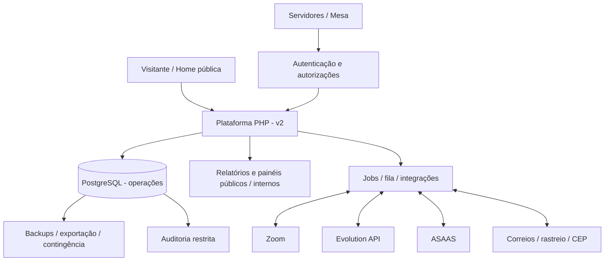
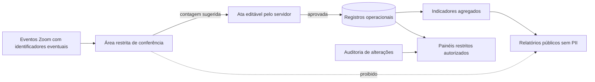
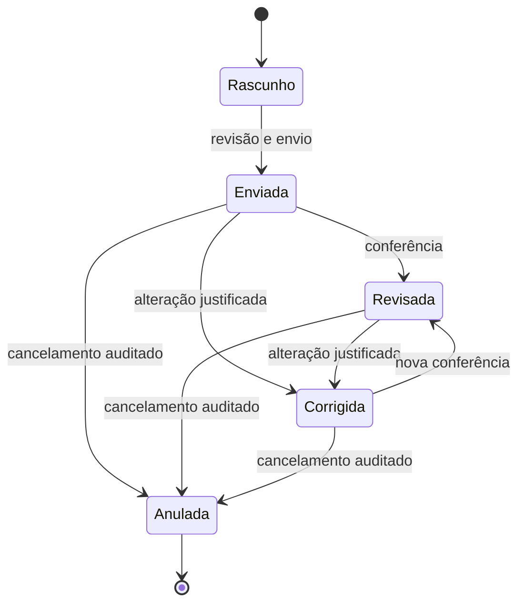
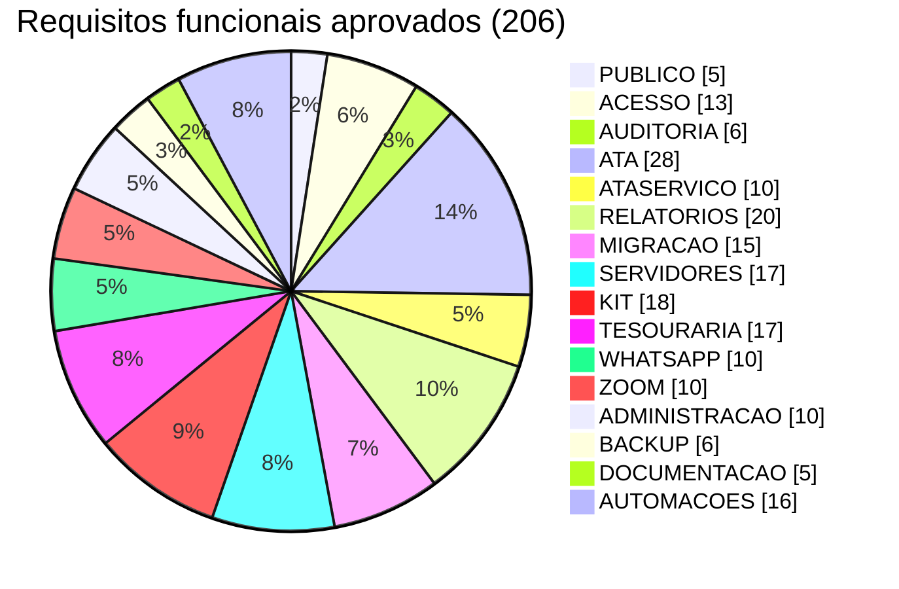
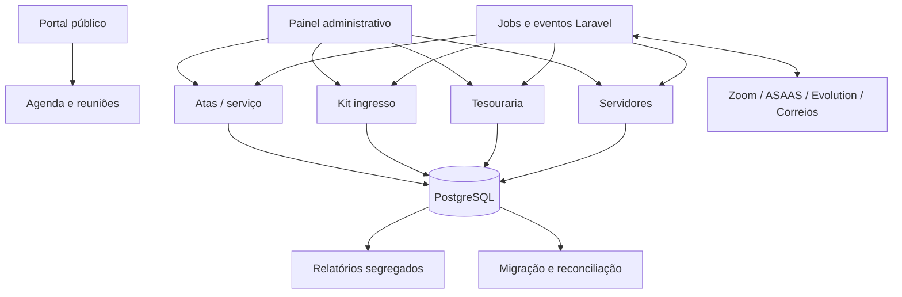
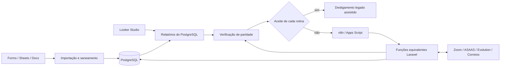
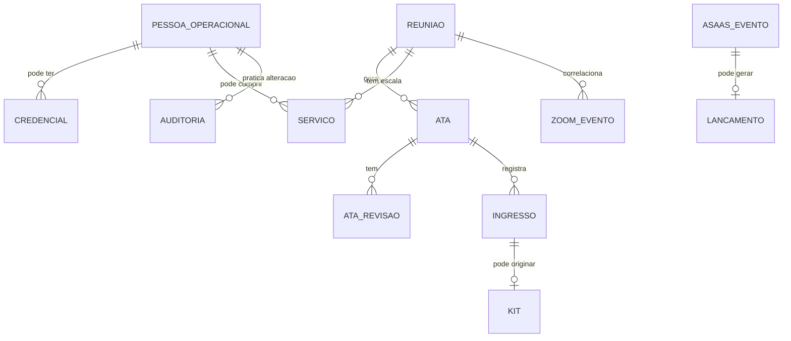
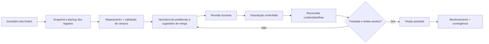

# PRD.md — Requisitos da Plataforma QuarenteNA

> **Situação: APROVADO.** Documento único e canônico de requisitos. Aprovação do escopo não substitui comprovação de execução, homologação das integrações, testes de segurança nem validação operacional da migração.

## 1. Declaração do produto, escopo e status

A plataforma terá **home pública sem autenticação** e **painel `/admin` protegido**, consolidando os processos de ata, serviço, kit ingresso, tesouraria, relatórios, permissões e integrações atualmente distribuídos. O objetivo é um produto operacional completo, a ser construído por incrementos verificáveis e ativado somente após migração/reconciliação; **todo fluxo de planilha, script ou automação legada com função ativa deve ter equivalente ou descontinuação formal aprovada**.

**Status de aprovação: APROVADO.** Este documento define *o quê, para quem e com qual condição de aceite*. Laravel (adaptado do template oficial indicado pelo projeto), PostgreSQL e Docker são decisões de tecnologia aprovadas; schema físico, limites de domínio, filas e infraestrutura são detalhados em `Arquitetura.md`. Não executar migração nem expor dados particulares por inferência documental.

### Princípios e objetivos mandatórios

| Princípio | Interpretação de requisito |
|---|---|
| Serviço e consciência coletiva | Software não toma decisões sociais/espirituais em lugar do grupo |
| Site acessível | Zoom e agenda encontram-se sem login e sem depender de API externa na renderização crítica |
| Fonte autoritativa | Alteração operacional refletida nos módulos interessados sem cópias manuais conflitantes |
| Cadastro contextual | Pessoa operacional não precisa ser membro Zoom nem ter credenciais |
| Dados mínimos | Exposição pública limitada a agregados e primeiro nome/apelido de ingressante editorialmente permitido; nunca contato/endereço |
| Auditabilidade | Operações de escrita produzem histórico autorizável/consultável |
| Reversibilidade | Exportação e restore reais, não apenas documentação de backup |
| Automação humana | Sugestão e automação nunca impossibilitam revisão humana |
| Uso móvel | Secretário conclui ata pelo celular, sem manipular planilhas |
| Single-group | Reuso por fork, não multi-tenancy/SaaS nesta entrega |

### Alcance por papel

| Papel / entidade | Acesso geral esperado | Restrições |
|---|---|---|
| Visitante ou membro público | Home, informações, links e relatórios autorizados | Sem cadastro; somente apelidos/primeiros nomes de ingressantes autorizados, sem contato/endereço |
| Pessoa no cadastro operacional | Registro de contexto | Não possui login por padrão |
| Servidor autenticado | Ata/consulta e módulos conforme encargo | Sem acesso automático a kit ou finanças |
| Mesa | Gestão e supervisão do grupo | Auditoria e controles proporcionais; não elimina separação de deveres |
| Tesoureiro / Coordenador Kit / RSG / RSG Suplente | Capacidades estritamente vinculadas à designação vigente | Tesoureiro exclusivo em finanças; Coordenador Kit exclusivo no kit |
| Admin técnico (Coordenador Geral/Secretário Geral) | Usuários, integrações, configurações e auditoria | Não tem edição financeira nem acesso operacional ao kit |
| Conta institucional de contingência | Recuperação controlada | Procedimento break-glass, controles fortes e trilha específica |

### Diagrama de contexto funcional

### Fluxo de dados e limites de visibilidade

## 2. Jornadas essenciais e casos de uso

| Jornada | Gatilho | Resultado e controles |
|---|---|---|
| Recém-chegado | Acessa domínio público | Localiza próximo horário, tipo, Zoom e orientações sem login |
| Secretário | Reunião terminou ou está ocorrendo | Ata abre com sugestões; altera, guarda rascunho, revisa e envia |
| Mesa | Precisa corrigir ata ou encargo | Edição rastreável, justificativa e reflexo nas métricas |
| Tesoureiro | Chega evento ASAAS | Evento validado/deduplicado; lançamento preliminar revisto pelo responsável |
| Kit ingresso | Ata registra ingresso | Pendência criada; dados privados consultados só por autorizado; expedição acompanhada |
| Membro WhatsApp | Envia comando permitido | Resposta coerente com dados atuais, com controle de grupo, permissão e abuso |
| Responsável técnico | Falha operação ou serviço externo | Recupera estado, analisa logs, exporta, reconcilia ou aciona contingência |

### Máquina de estados de uma ata (modelo funcional proposto)

> A máquina de estados é o contrato funcional adotado para desenho e testes. A matriz de permissões operacional e condições específicas de alteração serão configuradas conforme as regras vigentes do grupo, sem inventar poderes deliberativos.

## 3. Requisitos funcionais — catálogo canônico

**Convenção utilizada:** `RF` significa **Requisito Funcional**; `RNF` significa **Requisito Não Funcional**; `RB` significa **Regra de Negócio**; `CA` significa **Caso de Aceite**. Esses são termos comuns de engenharia de requisitos, **não identificadores obrigatórios nem exclusivos do BMAD**. A segunda parte do identificador é sempre um nome português legível do domínio (`RF-ATASERVICO-001`, por exemplo). O número é sequencial dentro do domínio e não deve ser reaproveitado com outro significado. Esses IDs permitem ligar requisitos a UX, arquitetura, testes e Stories.

Este é o **único PRD canônico**. A tabela seguinte apresenta seus domínios e a distribuição dos requisitos; não existe dependência de arquivos intermediários.

| Família | Área | Nº de requisitos |
|---|---|---:|
| `RF-PUBLICO` | Portal e conteúdo público | 5 |
| `RF-ACESSO` | Identidade, autenticação e autorizações | 13 |
| `RF-AUDITORIA` | Auditoria | 6 |
| `RF-ATA` | Ata das reuniões regulares | 28 |
| `RF-ATASERVICO` | Ata e reuniões de serviço | 10 |
| `RF-RELATORIOS` | Dashboards e relatórios | 20 |
| `RF-MIGRACAO` | Migração e reconciliação | 15 |
| `RF-SERVIDORES` | Servidores, mandatos e escalas | 17 |
| `RF-KIT` | Kit ingresso | 18 |
| `RF-TESOURARIA` | Tesouraria e ASAAS | 17 |
| `RF-WHATSAPP` | WhatsApp / Evolution API | 10 |
| `RF-ZOOM` | Zoom e eventos | 10 |
| `RF-ADMINISTRACAO` | Administração e configurações | 10 |
| `RF-BACKUP` | Backup, recuperação e operações | 6 |
| `RF-DOCUMENTACAO` | Documentação e replicabilidade | 5 |
| `RF-AUTOMACOES` | Rotinas operacionais migradas | 16 |
| **Total** | | **206** |

### Distribuição dos requisitos por domínio (contagem, não percentagem de progresso)

### Mapa visual de domínios, dados e automações

### RF-PUBLICO — Portal e conteúdo público (5)

| ID | Capacidade | Condição/requisito da fonte consolidada |
|---|---|---|
| `RF-PUBLICO-001` | Landing page pública | O sistema deve possuir uma página pública em GrupoQuarenteNA.org. |
| `RF-PUBLICO-002` | Informações de reunião | A landing page deve exibir dias, horários e link do Zoom. |
| `RF-PUBLICO-003` | Links públicos | A página pública deve conter links para relatórios/dashboard públicos permitidos. |
| `RF-PUBLICO-004` | Acesso ao painel | A página pública deve permitir acesso ao painel administrativo em /admin. |
| `RF-PUBLICO-005` | Mobile-first | A página pública e o painel devem ser responsivos e priorizar boa experiência em celular. |

### RF-ACESSO — Identidade, autenticação e autorizações (13)

| ID | Capacidade | Condição/requisito da fonte consolidada |
|---|---|---|
| `RF-ACESSO-001` | Login | O sistema deve permitir login para usuários com senha cadastrada e status ativo. |
| `RF-ACESSO-002` | Logout | O sistema deve permitir logout seguro. |
| `RF-ACESSO-003` | Redefinição de senha | O sistema deve permitir redefinir senha por fluxo administrativo, e futuramente por e-mail se configurado. |
| `RF-ACESSO-004` | Usuário sem senha | Pessoas operacionais sem login ficam em `pessoas`, separadas de `usuarios` (login exige credencial); não gerar contas de login por ingresso ou Zoom. |
| `RF-ACESSO-005` | Gestão de usuários | Coordenador Geral e Secretário Geral podem administrar usuários e mandatos; root institucional atua apenas em contingência justificada, sem uso cotidiano. |
| `RF-ACESSO-006` | Proteção do root | A conta institucional root de contingência é única e protegida contra exclusão/bloqueio acidental; não depender de ID numérico fixo, com MFA e auditoria. |
| `RF-ACESSO-007` | Proteção de SuperAdmin | A remoção ou rebaixamento de admin técnico ou root exige permissão específica, auditoria e garantia de recuperação institucional; papéis técnicos não concedem poderes de Tesouraria ou Kit. |
| `RF-ACESSO-008` | Permissões extras | O sistema atribui capacidades automaticamente por encargo ativo; delegações excepcionais exigem prazo, justificativa e auditoria, sem contornar exclusividade de Tesouraria e Kit. |
| `RF-ACESSO-009` | Controle por módulo | Toda operação deve usar Policy/Gate e encargo **vigente**; tesouraria com edição exclusiva do tesoureiro e kit com acesso exclusivo do coordenador kit; contas administrativas não recebem acesso por padrão. |
| `RF-ACESSO-010` | Relatórios públicos | O sistema deve permitir relatórios públicos sem login, desde que definidos como públicos e sem dados sensíveis. |
| `RF-ACESSO-011` | Privilégios por mandato vigente | Ao nomear servidor para encargo, conceder automaticamente capacidades daquele encargo; encerramento por prazo, entrega ou destituição revoga acesso imediatamente na Policy e remove flags/cache/sessões privilegiadas. |
| `RF-ACESSO-012` | Root institucional excepcional | Prover conta genérica `root` protegida por MFA/segredo guardado, apenas para recuperação de administradores da mesa ou manutenção técnica excepcional; registrar operador, justificativa e alerta de sessão. |
| `RF-ACESSO-013` | Segregação de encargos | Coordenador Geral e Secretário Geral administram acessos e integrações, mas não herdam edição financeira nem acesso operacional ao kit; tesoureiro edita finanças; Coordenador Kit é o único que vê e gere dados privados do kit. |

### RF-AUDITORIA — Auditoria (6)

| ID | Capacidade | Condição/requisito da fonte consolidada |
|---|---|---|
| `RF-AUDITORIA-001` | Auditar toda modificação | Toda operação que altere o banco de dados deve gerar registro de auditoria. |
| `RF-AUDITORIA-002` | Dados mínimos do log | Cada log deve registrar: ; usuário responsável; ; data e hora; ; IP ou origem da requisição quando disponível; ; user-agent quando disponível; ; módulo; ; entidade; ; id do registro; ; ação realizada; ; valores anteriores; ; valores novos; ; justificativa quando aplicável. |
| `RF-AUDITORIA-003` | Justificativa em edição posterior | Edições em registros oficiais já enviados, como atas enviadas, devem exigir justificativa. |
| `RF-AUDITORIA-004` | Consulta de auditoria | Coordenador Geral e Secretário Geral podem consultar auditoria institucional; root apenas excepcionalmente, e Tesoureiro apenas registros financeiros pertinentes ao seu serviço. Logs do Kit permanecem sem PII para terceiros. |
| `RF-AUDITORIA-005` | Auditoria de automações | Ações feitas por jobs, webhooks ou integrações devem ser registradas como ações de sistema, identificando origem como ASAAS, Zoom, Evolution API, job de rastreamento, job de serviços etc. |
| `RF-AUDITORIA-006` | Auditoria não editável | Logs de auditoria não devem ser editáveis pela interface comum. |

### RF-ATA — Ata das reuniões regulares (28)

| ID | Capacidade | Condição/requisito da fonte consolidada |
|---|---|---|
| `RF-ATA-001` | Criar ata | A dupla moderadora escalada para a ocorrência, ou administrador em contingência justificada, pode criar a ata; autenticação pessoal e mandato/escala vigente são obrigatórios. |
| `RF-ATA-002` | Ata pré-preenchida | O formulário de ata deve vir pré-preenchido quando houver dados disponíveis. Campos candidatos para pré-preenchimento: ; data atual ou data da reunião selecionada; ; horário padrão; ; tipo/formato da reunião; ; secretário provável; ; coordenador provável; ; presença total sugerida pelo Zoom; ; lista de participantes capturada pelo Zoom, apenas para conferência restrita; ; informações adicionais padrão; ; dados relacionados à 7ª tradição quando aplicável. |
| `RF-ATA-003` | Editar dados pré-preenchidos | Todo dado pré-preenchido deve ser editável antes do envio. |
| `RF-ATA-004` | Secretário sugerido | Sugerir a função de chat/secretaria da ocorrência conforme escala, com possibilidade de troca entre os dois moderadores. |
| `RF-ATA-005` | Coordenador sugerido | Escalar sempre dupla de moderadores quando houver cobertura; designar por ocorrência as funções de fala (coordenação) e chat/ata (secretaria), intercambiáveis em caso de substituição. |
| `RF-ATA-006` | Presença sugerida pelo Zoom | O sistema pode sugerir total de presenças com base nos participantes capturados pelo Zoom, mas o servidor pode modificar se julgar pertinente. |
| `RF-ATA-007` | Conferência antes de envio | Antes do envio oficial, o sistema deve exibir uma tela de revisão/rascunho para conferência. |
| `RF-ATA-008` | Rascunho automático | Ao iniciar o preenchimento, o sistema deve salvar automaticamente como rascunho e atualizar o rascunho durante o preenchimento. |
| `RF-ATA-009` | Envio oficial | Após conferência, o usuário pode enviar oficialmente a ata. |
| `RF-ATA-010` | Editar ata enviada | A ata enviada pode ser editada pelo próprio usuário que enviou ou por mesa/admin, com justificativa obrigatória e auditoria. |
| `RF-ATA-011` | Status da ata | A ata deve suportar status: ; rascunho; ; enviada; ; revisada; ; corrigida; ; anulada/cancelada. Regras: ; revisada: conferida pelo próprio servidor que preencheu; ; corrigida: alterada por outro servidor ou mesa; ; anulada/cancelada: permanece no banco, mas não aparece nos relatórios oficiais; ; rascunho: não aparece nos relatórios oficiais. |
| `RF-ATA-012` | Campos numéricos | O sistema deve validar campos numéricos, como presenças, partilhas, visitas, ingressos, conquistas e valores financeiros, impedindo valores inválidos. |
| `RF-ATA-013` | Campos estruturados | Campos objetivos devem usar seletores, cadastros ou opções controladas. |
| `RF-ATA-014` | Campos subjetivos | Campos como observações e informações adicionais podem ser texto livre. |
| `RF-ATA-015` | Opção “outro” | Quando necessário, seletores devem permitir opção “outro” com campo adicional de texto. |
| `RF-ATA-016` | Relação visita/ingresso | Sempre que houver ingresso, objetivamente houve visita. Pode haver visita sem ingresso. O sistema pode sugerir coerência, mas não deve impedir visita sem ingresso. |
| `RF-ATA-017` | Ingressos | Quando houver ingresso, registrar apelido/primeiro nome em `ingressos` sem criar login automaticamente; vínculo com pessoa já conhecida exige confirmação humana contextual. |
| `RF-ATA-018` | Kit ingresso automático | Ao registrar ingresso, o sistema deve gerar pendência no módulo kit ingresso quando aplicável. |
| `RF-ATA-019` | Conquistas | Quando houver conquistas, o sistema deve permitir registrar quantidade e, opcionalmente, relacionar usuários e tempo limpo. |
| `RF-ATA-020` | Visitas | Quando houver visitas, o sistema deve registrar quantidade, origem da visita e informações textuais quando necessário. |
| `RF-ATA-021` | Temáticas | Quando a reunião for temática, o sistema deve registrar título da temática e partilhador, preferencialmente relacionado a um usuário. |
| `RF-ATA-022` | Resumo automático | Após envio oficial, o sistema deve poder gerar resumo da ata para WhatsApp/Telegram conforme configuração. |
| `RF-ATA-023` | Envio de resumo | O sistema deve poder enviar o resumo da ata via Evolution API e/ou Telegram, se configurado. |
| `RF-ATA-024` | Histórico | O sistema deve permitir consultar histórico de atas por período, tipo, dia, horário, servidor, visitas, ingressos, conquistas e outros filtros. |
| `RF-ATA-025` | Exportação | O sistema deve permitir exportar atas em CSV e gerar relatório imprimível. |
| `RF-ATA-026` | Dupla de moderação e substituição | A reunião regular diária 20h–22h possui dois moderadores treinados; um responde por fala/coordenação e outro por chat/ata, funções intercambiáveis sem criação de dois encargos fixos. |
| `RF-ATA-027` | Identidade e nomes normalizados | Selecionar servidor por cadastro/escala, não por texto livre; sugerir reconciliação de nomes com caixa/espaços/acentos divergentes sem fundir homônimos automaticamente. |
| `RF-ATA-028` | Paridade com formulário antigo | Preservar data, horário, tipo, presenças, partilhas, visitas/origens, ingressos/nomes, conquistas/tempo, temática/partilhador, 7ª Tradição/referência, despesas, adicionais, eleições e observações; PII de contatos permanece só no Kit restrito. |

### RF-ATASERVICO — Ata e reuniões de serviço (10)

| ID | Capacidade | Condição/requisito da fonte consolidada |
|---|---|---|
| `RF-ATASERVICO-001` | Criar ata de serviço | O sistema deve permitir criar ata de reunião de serviço. |
| `RF-ATASERVICO-002` | Template padrão | A ata de serviço deve possuir template padrão configurável. |
| `RF-ATASERVICO-003` | Pré-preenchimento | Algumas informações podem vir pré-preenchidas, como data, tipo de reunião, servidores esperados, pauta padrão e dados do calendário. |
| `RF-ATASERVICO-004` | Rascunho | A ata de serviço deve ser salva como rascunho antes do envio oficial. |
| `RF-ATASERVICO-005` | Geração de PDF | Ao enviar oficialmente, o sistema deve gerar PDF automático da ata de serviço. |
| `RF-ATASERVICO-006` | Dados da reunião de serviço | A ata de serviço deve registrar servidores presentes, faltas, justificativas, membros interessados, decisões e links/documentos relacionados. |
| `RF-ATASERVICO-007` | Histórico e relatórios | O sistema deve permitir consultar reuniões de serviço por data, tipo, presença, faltas, justificativas e decisões. |
| `RF-ATASERVICO-008` | Decisões e consciências  | O sistema deve permitir registrar decisões ou consciências coletivas, com data, contexto e link de ata. |
| `RF-ATASERVICO-009` | Consulta pública ou restrita  | Decisões autorizadas podem ser públicas, mas dados internos de faltas e justificativas são restritos; PDF e versão oficial devem permanecer vinculados ao Google Drive institucional. |
| `RF-ATASERVICO-010` | Template editável da Secretaria Geral | Secretário Geral mantém modelo padronizado de ata de serviço com histórico de versões, prévia, geração de PDF e arquivamento privado no Google Drive institucional. |

### RF-RELATORIOS — Dashboards e relatórios (20)

| ID | Capacidade | Condição/requisito da fonte consolidada |
|---|---|---|
| `RF-RELATORIOS-001` | Substituir Looker Studio | O sistema deve substituir o dashboard atual do Looker Studio por páginas PHP. |
| `RF-RELATORIOS-002` | Relatório clássico | O sistema deve oferecer visão equivalente ao Looker atual para validação dos números históricos. |
| `RF-RELATORIOS-003` | Dashboard melhorado | O sistema deve oferecer dashboard melhorado com filtros, cards, gráficos e tabelas mais confiáveis. |
| `RF-RELATORIOS-004` | Filtros | O dashboard deve permitir filtros por período, dia da semana, horário, tipo/formato de reunião, visitas, ingressos, conquistas, temática, servidor e status. |
| `RF-RELATORIOS-005` | Página Resumo | Deve existir página de resumo com indicadores principais de reuniões, presenças, partilhas, visitas, ingressos e conquistas. |
| `RF-RELATORIOS-006` | Página Dados da Reunião | Deve existir listagem detalhada de atas e reuniões. |
| `RF-RELATORIOS-007` | Página Conquistas e Ingressos | Deve existir relatório específico para conquistas e ingressos. |
| `RF-RELATORIOS-008` | Página Temáticas | Deve existir relatório de reuniões temáticas, títulos, partilhadores e presenças. |
| `RF-RELATORIOS-009` | Página Visitas | Deve existir relatório de visitas, origem e relação com ingressos. |
| `RF-RELATORIOS-010` | Página Quadro de Serviços | Deve existir relatório de servidores, encargos, vagas, histórico, conclusão, entrega e destituição. |
| `RF-RELATORIOS-011` | Página Reuniões de Serviço | Deve existir relatório de reuniões de serviço, atas, PDFs, participantes, faltas, justificativas e decisões. |
| `RF-RELATORIOS-012` | Página Tesouraria | Deve existir dashboard financeiro com entradas, saídas, categorias, saldos, reserva prudente, média de contribuição e projeções de autossustentabilidade. |
| `RF-RELATORIOS-013` | Página Kit Ingresso | Deve existir relatório de kit ingresso, status de envio, pendências, rastreamento e responsáveis. |
| `RF-RELATORIOS-014` | Página Participantes Zoom | A página de participantes Zoom, quando existir, deve ser restrita à mesa ou permissões específicas. Não deve ser relatório público ou acessível a servidores comuns. |
| `RF-RELATORIOS-015` | Relatórios públicos | Alguns relatórios agregados devem poder ser disponibilizados por link público sem login. |
| `RF-RELATORIOS-016` | Proteção de dados sensíveis | Relatórios públicos não devem expor telefone, endereço, lista nominal de participantes do Zoom, logs, dados internos do kit ou informações restritas. |
| `RF-RELATORIOS-017` | Relatório financeiro público | O relatório financeiro pode ser público como prestação de contas, exibindo data, valor, categorias e saldo, mas sem expor nomes de contribuintes. |
| `RF-RELATORIOS-018` | Exportação | Relatórios devem poder ser exportados em CSV quando autorizado. |
| `RF-RELATORIOS-019` | Impressão/PDF via navegador | Relatórios devem ter visualização amigável para impressão ou geração de PDF pelo navegador. |
| `RF-RELATORIOS-020` | Nomes permitidos no relatório de ingresso | Relatórios públicos podem mostrar apenas primeiro nome ou apelido de ingressante autorizado pelo grupo, sem telefone/endereço, contato privado ou informação do kit. |

### RF-MIGRACAO — Migração e reconciliação (15)

| ID | Capacidade | Condição/requisito da fonte consolidada |
|---|---|---|
| `RF-MIGRACAO-001` | Importar planilha de atas | O sistema deve importar histórico da planilha “Reuniões Grupo QuarenteNA Bahia (Responses)”. |
| `RF-MIGRACAO-002` | Importar kit ingresso | O sistema deve importar histórico da planilha Kit Ingresso. |
| `RF-MIGRACAO-003` | Importar tesouraria | O sistema deve importar histórico da planilha de tesouraria e reserva prudente, quando disponível. |
| `RF-MIGRACAO-004` | Importar quadro de serviços | O sistema deve importar quadro de servidores, cargos, início, término e histórico. |
| `RF-MIGRACAO-005` | Importar atas de serviço | O sistema deve importar ou referenciar atas de serviço e links PDF. |
| `RF-MIGRACAO-006` | Mapeamento de colunas | A importação deve permitir mapear colunas das planilhas para campos do sistema. |
| `RF-MIGRACAO-007` | Varredura prévia | Antes da migração, o sistema deve permitir varrer as planilhas atuais e identificar problemas, inconsistências, campos quebrados, duplicidades e conflitos. |
| `RF-MIGRACAO-008` | Normalização e mesclagem sugerida | A importação deve identificar possíveis duplicidades por apelido, nome, telefone, variações de acento, caixa e espaços, sugerindo mesclar/unir registros com revisão humana. |
| `RF-MIGRACAO-009` | Revisão manual | O sistema deve permitir revisão manual de conflitos e duplicidades antes de consolidar. |
| `RF-MIGRACAO-010` | Relatório de importação | Cada importação deve gerar relatório com total de linhas, linhas importadas, erros, avisos, duplicidades e decisões manuais. |
| `RF-MIGRACAO-011` | Validação contra relatórios atuais | Os totais importados devem ser comparáveis com planilhas e Looker atual antes da virada. |

| `RF-MIGRACAO-012` | Migração integral das planilhas | Inventariar e migrar todas as planilhas, abas, colunas, fórmulas com efeito operacional e relacionamentos relevantes, identificando o destino de cada regra/campo. |
| `RF-MIGRACAO-013` | Migração de scripts Google Apps Script | Reproduzir em Laravel funções de `ata-resumo`, `ata-kitingresso`, `kit-ingresso` e `servico-terminio`, com testes de comportamento e tratamento de exceções. |
| `RF-MIGRACAO-014` | Migração de workflows n8n | Exportar, catalogar e substituir cada workflow ativo por endpoints, eventos, jobs, comandos ou telas próprias; documentar fluxos descontinuados e motivo. |
| `RF-MIGRACAO-015` | Substituição de visões Google Docs/Looker | Reconstituir `VAGO`, `Relação de Servidores`, documentos operacionais e relatórios/dashboards a partir dos dados normalizados, sem cópias manuais. |

### RF-SERVIDORES — Servidores, mandatos e escalas (17)

| ID | Capacidade | Condição/requisito da fonte consolidada |
|---|---|---|
| `RF-SERVIDORES-001` | Cadastro de encargos | O sistema deve permitir cadastrar encargos e funções de serviço. |
| `RF-SERVIDORES-002` | Cadastro de reuniões/horários | O sistema deve permitir cadastrar dias, horários e tipos de reunião vinculados a encargos. Hoje há reunião principal às 20h, mas o sistema deve suportar múltiplos horários no mesmo dia. |
| `RF-SERVIDORES-003` | Encargos configuráveis | O sistema permite cadastrar e gerir encargos preservando seis cargos atuais da mesa: Coordenador Geral, Secretário Geral, Tesoureiro, RSG, RSG Suplente e Coordenador Kit Ingresso; mudanças futuras exigem decisão registrada. |
| `RF-SERVIDORES-004` | Associação de servidor | O sistema deve associar um usuário servidor a um encargo, dia, horário e reunião. |
| `RF-SERVIDORES-005` | Datas de serviço | A associação deve registrar data de início e previsão/data de término. |
| `RF-SERVIDORES-006` | Status do serviço | O serviço deve ter status como ativo, vago, temporário, concluído, entregue, destituído e suspenso. |
| `RF-SERVIDORES-007` | Histórico | O sistema deve manter histórico de servidores por encargo. |
| `RF-SERVIDORES-008` | Vagas | O sistema deve gerar automaticamente lista de vagas. |
| `RF-SERVIDORES-009` | Relação de servidores | O sistema deve gerar automaticamente relação de servidores por dia, horário e encargo. |
| `RF-SERVIDORES-010` | Avisos de término | O sistema deve enviar avisos automáticos de término de serviço em marcos configuráveis, como 30, 15, 7, 3, 2 e 1 dia. |
| `RF-SERVIDORES-011` | Notificação privada e grupo | Avisos podem ser enviados ao servidor e ao grupo de serviço via Evolution API. |
| `RF-SERVIDORES-012` | Encargo concluído, entregue ou destituído | Quando o encargo termina, é entregue ou há destituição, a mesa deve poder registrar o motivo, manter histórico e atualizar a vaga. |
| `RF-SERVIDORES-013` | Comando !vago | O comando !vago deve retornar dados gerados do banco, não de Google Docs manual. |
| `RF-SERVIDORES-014` | Comando !servidores | O comando !servidores deve retornar relação atual de servidores gerada do banco. |
| `RF-SERVIDORES-015` | Encargos da mesa | Cadastrar Coordenador Geral, Secretário Geral, Tesoureiro, RSG, RSG Suplente e Coordenador Kit Ingresso como encargos distintos com responsabilidades/mandatos definidos. |
| `RF-SERVIDORES-016` | Moderação diária em dupla | Modelar moderador de reunião como função de serviço com duas pessoas por ocorrência, alternando papéis de fala e chat; não confundir cargos gerais da mesa com papéis do dia. |
| `RF-SERVIDORES-017` | Término e destituição com revogação | Conceder permissões pelo encargo quando ativado; expiração automática ou entrega/destituição manual revoga direito na mesma operação, guardando autor, motivo, data e histórico. |

### RF-KIT — Kit ingresso (18)

| ID | Capacidade | Condição/requisito da fonte consolidada |
|---|---|---|
| `RF-KIT-001` | Criar pendência de kit | Quando uma ata registrar ingresso, o sistema deve criar pendência de kit ingresso. |
| `RF-KIT-002` | Relacionar ingressante | Cada pendência deve estar vinculada ao registro de ingresso; o ingressante não precisa ter conta de login em `usuarios`. |
| `RF-KIT-003` | Dados do ingressante | O módulo deve permitir registrar telefone, CEP, endereço, status, observações, responsáveis e código de rastreio. |
| `RF-KIT-004` | Busca de CEP | O sistema deve permitir buscar/preencher endereço com base no CEP, quando integração estiver disponível. |
| `RF-KIT-005` | Status do kit | O status deve suportar verificar, falta endereço, falta enviar, enviado, recebido, devolvido e cancelado. |
| `RF-KIT-006` | Mensagem solicitando endereço | O sistema deve poder enviar mensagem ao ingressante solicitando endereço. |
| `RF-KIT-007` | Mensagem de falta enviar | O sistema deve poder notificar grupo/responsáveis e ingressante quando o kit estiver pronto para envio. |
| `RF-KIT-008` | Mensagem de enviado | O sistema deve poder notificar código de rastreio. |
| `RF-KIT-009` | Rastreamento | O sistema deve consultar rastreamento de objetos enviados por job configurado. |
| `RF-KIT-010` | Eventos de rastreio | Eventos de rastreio devem ser armazenados no banco. |
| `RF-KIT-011` | Atualização automática de status | Quando rastreamento indicar entrega, devolução ou evento relevante, o sistema deve atualizar status e notificar. |
| `RF-KIT-012` | Permissão de edição | **Somente o Coordenador Kit Ingresso com mandato ativo** pode acessar e modificar dados operacionais do kit. Administradores gerais e root não herdam esse acesso. |
| `RF-KIT-013` | Proteção de telefone e endereço | Telefone e endereço do ingressante devem ser visíveis exclusivamente ao Coordenador Kit Ingresso em mandato vigente, sob justificativa de finalidade e trilha de acesso. |
| `RF-KIT-014` | Auditoria | Toda alteração em kit ingresso deve gerar auditoria. |

| `RF-KIT-015` | Serviço dedicado de rastreamento | Integrar o serviço [opastorello/correios-rastreamento](https://github.com/opastorello/correios-rastreamento) por API REST autenticada em rede privada; as informações oficiais de remessa permanecem no PostgreSQL do QuarenteNA. |
| `RF-KIT-016` | Atualização agendada e reprocessamento | Consultar periodicamente remessas não finalizadas com idempotência, limites, tratamento de falhas e mecanismo de reconsulta manual. |
| `RF-KIT-017` | Proteção e consistência do rastreio | Normalizar eventos, rejeitar duplicatas, registrar data/hora e não divulgar destinatário, endereço ou telefone em interfaces e logs públicos. |
| `RF-KIT-018` | Exclusividade do coordenador do kit | Somente Coordenador Kit Ingresso com mandato vigente pode acessar filas, contatos, endereços e remessas; mesa e root não possuem acesso de negócio ordinário. |

### RF-TESOURARIA — Tesouraria e ASAAS (17)

| ID | Capacidade | Condição/requisito da fonte consolidada |
|---|---|---|
| `RF-TESOURARIA-001` | Receber webhook ASAAS | O sistema deve receber eventos financeiros do ASAAS via webhook. |
| `RF-TESOURARIA-002` | Registrar eventos automáticos | Eventos ASAAS devem gerar lançamentos financeiros automáticos. |
| `RF-TESOURARIA-003` | Evitar duplicidade | O sistema deve usar identificador externo do ASAAS para evitar lançamento duplicado. |
| `RF-TESOURARIA-004` | Tipos de lançamento | O sistema deve suportar entradas e saídas. |
| `RF-TESOURARIA-005` | Descrição e categorização automática | Quando o webhook enviar descrição do PIX recebido ou enviado, essa descrição deve alimentar automaticamente a categorização inicial do lançamento, permitindo edição posterior pelo tesoureiro. |
| `RF-TESOURARIA-006` | Categorias | Lançamentos devem ter categorias, como 7ª Tradição, literatura, reserva prudente, despesas, Zoom, doação, transferência e outras definidas pela mesa/tesoureiro. |
| `RF-TESOURARIA-007` | Revisão pelo tesoureiro | Somente o Tesoureiro com designação ativa pode corrigir ou categorizar lançamentos já efetivados, com auditoria. |
| `RF-TESOURARIA-008` | Edição com auditoria | Qualquer edição em lançamento financeiro deve gerar auditoria com valor anterior, valor novo e justificativa quando aplicável. |
| `RF-TESOURARIA-009` | Lançamento manual | Somente o Tesoureiro pode criar lançamento manual com efeito imediato após salvar, sem rascunho ou conferência obrigatória. |
| `RF-TESOURARIA-010` | Reserva prudente | O sistema deve controlar reserva prudente, inclusive lançamentos manuais, pois essa parte pode não ter webhook. |
| `RF-TESOURARIA-011` | Saldo | O sistema deve calcular saldo por período, conta, categoria e visão geral. |
| `RF-TESOURARIA-012` | Dashboard financeiro | O sistema deve exibir dashboard financeiro com entradas, saídas, saldo, categorias, evolução, média de contribuição e projeções de autossustentabilidade. |
| `RF-TESOURARIA-013` | Visualização restrita | Servidores podem consultar apenas projeções autorizadas. A edição financeira é **exclusiva do Tesoureiro com encargo vigente**, sem herança por Mesa, root ou administrador técnico. |
| `RF-TESOURARIA-014` | Relatório financeiro público | O relatório financeiro público deve omitir nomes de contribuintes, exibindo apenas informações agregadas ou transacionais permitidas, como data, valor, categoria e saldo. |
| `RF-TESOURARIA-015` | Comando !saldo | O comando !saldo deve responder com saldo ou relatório resumido autorizado, sem expor dados restritos indevidos. |
| `RF-TESOURARIA-016` | Lançamento financeiro imediato | Evento ASAAS autenticado e financeiramente elegível gera lançamento confirmado idempotente; formulário manual salvo pelo tesoureiro gera lançamento direto, sem rascunho ou etapa de aprovação. |
| `RF-TESOURARIA-017` | Correção, estorno e exclusão auditáveis | Somente tesoureiro edita, estorna ou exclui logicamente lançamento; preservar origem, evento, valores antes/depois, responsável, motivo e impacto no saldo. |

### RF-WHATSAPP — WhatsApp / Evolution API (10)

| ID | Capacidade | Condição/requisito da fonte consolidada |
|---|---|---|
| `RF-WHATSAPP-001` | Receber webhook Evolution API | O sistema deve receber mensagens de WhatsApp via webhook da Evolution API. |
| `RF-WHATSAPP-002` | Identificar grupo de origem | O sistema deve identificar se a mensagem veio do grupo de serviço, grupo de membros ou outro grupo configurado. |
| `RF-WHATSAPP-003` | Processar comandos | Mensagens iniciadas com ! devem ser processadas como comandos. |
| `RF-WHATSAPP-004` | Comandos do grupo de serviço | O sistema deve suportar ou reformular comandos do grupo de serviço, incluindo !ajuda, !ata, !coletiva, !diretriz, !link, !kit, !gbatepapo, !gingresso, !participantes, !relatorio, !resumo, !saldo, !script, !senha, !servidores, !setima, !telas, !tematica, !textos e !vago. |
| `RF-WHATSAPP-005` | Comandos do grupo de membros | O sistema deve suportar ou reformular comandos do grupo de membros, incluindo !ajuda, !coletiva, !diretriz, !link_cpsanto, !link_quarentena, !link_novaera, !relatorio, !saldo, !servidores, !setima, !zap_cpsanto, !zap_novaera e !zap_quarentena. |
| `RF-WHATSAPP-006` | Dados vindos do banco | Comandos como !vago, !servidores, !saldo, !relatorio, !ata e !resumo devem preferencialmente responder com dados estruturados do banco. |
| `RF-WHATSAPP-007` | Logs | Mensagens recebidas, comandos processados e respostas enviadas devem gerar logs técnicos conforme política de retenção. |
| `RF-WHATSAPP-008` | Proteção contra abuso | O sistema deve ter algum mecanismo de proteção contra uso excessivo ou chamadas repetitivas. |
| `RF-WHATSAPP-009` | Logs de mensagens  | O sistema deve registrar logs de mensagens enviadas por automação. |
| `RF-WHATSAPP-010` | Rate limit e falhas  | Falhas de envio devem ser registradas e, quando possível, reenviadas ou marcadas como pendentes. |

### RF-ZOOM — Zoom e eventos (10)

| ID | Capacidade | Condição/requisito da fonte consolidada |
|---|---|---|
| `RF-ZOOM-001` | Receber webhook Zoom | O sistema deve receber eventos do Zoom via webhook. |
| `RF-ZOOM-002` | Validar webhook | O sistema deve validar o endpoint e a origem conforme exigências técnicas do Zoom. |
| `RF-ZOOM-003` | Evento participant_joined | O sistema deve suportar o evento meeting.participant_joined, capturando campos úteis como evento, timestamp, reunião, tópico, duração, timezone, usuário, email, ids e horário de entrada. |
| `RF-ZOOM-004` | Campos úteis | A arquitetura deve avaliar os campos efetivamente permitidos no payload Zoom: `event`, `event_ts`, `payload.account_id`, identificador e UUID da reunião, `host_id`, `topic`, `type`, `start_time`, `duration`, `timezone`, além dos campos de participante `user_name`, `id`, `user_id`, `customer_key`, `join_time`, `email` e `registrant_id`. **Disponibilidade e necessidade de cada campo devem ser verificadas**; dados identificáveis exigem retenção mínima, propósito legítimo e acesso restrito. |
| `RF-ZOOM-005` | Salvar eventos | Eventos de participantes devem ser salvos em tabela própria, separada de usuarios. |
| `RF-ZOOM-006` | Sugerir presença total | O sistema deve usar eventos do Zoom para sugerir presença total na ata. |
| `RF-ZOOM-007` | Permitir correção manual | A presença sugerida pelo Zoom deve poder ser alterada pelo servidor responsável pela ata. |
| `RF-ZOOM-008` | Restringir lista nominal | Lista nominal de participantes Zoom deve ser restrita à mesa ou usuários com permissão específica. |
| `RF-ZOOM-009` | Não vigilância individual | O sistema não deve usar dados do Zoom para criar controle público ou operacional comum de frequência individual de membros. |
| `RF-ZOOM-010` | Pesquisa técnica futura | Na fase de arquitetura, deve-se consultar a documentação atual do Zoom para verificar outros eventos úteis além de participant_joined. |

### RF-ADMINISTRACAO — Administração e configurações (10)

| ID | Capacidade | Condição/requisito da fonte consolidada |
|---|---|---|
| `RF-ADMINISTRACAO-001` | Configurações do grupo  | O sistema deve permitir configurar dados do grupo, como nome, links, horários, reuniões, textos padrão e contatos. |
| `RF-ADMINISTRACAO-002` | Tipos de reunião  | O sistema deve permitir configurar tipos/formato de reunião. |
| `RF-ADMINISTRACAO-003` | Horários  | O sistema deve permitir configurar horários padrão. |
| `RF-ADMINISTRACAO-004` | Textos de comandos  | O sistema deve permitir configurar textos retornados por comandos WhatsApp quando aplicável. |
| `RF-ADMINISTRACAO-005` | Integrações  | O sistema deve permitir configurar credenciais e status de integrações em ambiente seguro, sem expor segredos publicamente. |
| `RF-ADMINISTRACAO-006` | Jobs  | O sistema deve permitir ver status de jobs automáticos, como rastreamento, avisos de serviço e backups. |
| `RF-ADMINISTRACAO-007` | Logs técnicos  | Coordenador Geral e Secretário Geral podem consultar logs técnicos; root somente em sessão excepcional registrada. Nenhuma dessas permissões expõe dados privados de kit ou tesouraria. |
| `RF-ADMINISTRACAO-008` | Painel de integrações | Coordenador Geral, Secretário Geral e root excepcional podem configurar URL, API, webhook, parâmetros e testes; segredos mascarados/criptografados e alteração auditada. |
| `RF-ADMINISTRACAO-009` | Armazenamento Google Drive | Documentos institucionais e PDFs devem ser armazenados no Google Drive com controles de acesso e metadados no PostgreSQL; Drive não substitui o banco. |
| `RF-ADMINISTRACAO-010` | Serviços opcionais | Usar MinIO/S3 e Redis apenas se houver necessidade medida; configuração e falhas aparecem na administração quando habilitados. |

### RF-BACKUP — Backup, recuperação e operações (6)

| ID | Capacidade | Condição/requisito da fonte consolidada |
|---|---|---|
| `RF-BACKUP-001` | Backup do banco  | O sistema deve ter procedimento documentado para backup do PostgreSQL. |
| `RF-BACKUP-002` | Restauração  | O sistema deve ter procedimento documentado para restaurar backup. |
| `RF-BACKUP-003` | Backup antes da migração  | Antes da virada oficial, deve existir backup dos dados importados e dos arquivos históricos. |
| `RF-BACKUP-004` | Documentação de instalação  | O sistema deve ter documentação para instalação via Docker. |
| `RF-BACKUP-005` | Documentação operacional  | O sistema deve ter documentação para servidores usarem painel, ata, relatórios, kit ingresso, tesouraria e comandos. |
| `RF-BACKUP-006` | Documentação técnica  | O sistema deve ter documentação de arquitetura, variáveis de ambiente, jobs, webhooks, integrações, backup e deploy. |

### RF-DOCUMENTACAO — Documentação e replicabilidade (5)

| ID | Capacidade | Condição/requisito da fonte consolidada |
|---|---|---|
| `RF-DOCUMENTACAO-001` | Documentação para iniciantes | O sistema deve incluir documentação simples para novos servidores. |
| `RF-DOCUMENTACAO-002` | Documentação por módulo | Deve haver orientações para ata, tesouraria, kit ingresso, serviços, relatórios, comandos e painel. |
| `RF-DOCUMENTACAO-003` | Documentação administrativa | Mesa/admin deve ter documentação de usuários, permissões, auditoria, migração e correções. |
| `RF-DOCUMENTACAO-004` | Documentação técnica | Responsáveis técnicos devem ter documentação de instalação, deploy, backup, restore, jobs, webhooks e variáveis de ambiente. |
| `RF-DOCUMENTACAO-005` | Adaptação para outro grupo | O projeto deve incluir instruções versionadas para adaptação por fork, explicando como adaptar um fork para outro grupo, alterando nome, domínio, e-mail, Zoom, Evolution API, ASAAS, textos, links, cores, logo, .env, usuário root e configurações iniciais. |

### RF-AUTOMACOES — Migração de rotinas e integrações operacionais (16)

Os itens abaixo formalizam a decisão aprovada de migrar **todas as funções ativas** hoje dependentes de n8n, Sheets e Apps Script para o sistema, sem copiar literalmente scripts inseguros. Cada rotina deve ter origem, gatilho, destino, entradas, saídas, tratamento de erro, testes e responsável.

| ID | Capacidade | Critério funcional |
|---|---|---|
| `RF-AUTOMACOES-001` | Inventário verificável | Catalogar fluxos e funções legados ativos com trigger, credenciais referenciadas, payload, dependências e critério de migração. |
| `RF-AUTOMACOES-002` | Resumo da ata | Reproduzir a geração e revisão de resumos atualmente associadas a `ata-resumo`, com envio autorizado pelo sistema. |
| `RF-AUTOMACOES-003` | Ingresso para kit | Ao confirmar ingresso em ata, criar pendência de kit de modo idempotente, substituindo `ata-kitingresso`. |
| `RF-AUTOMACOES-004` | Solicitação de endereço | Substituir automações de `kit-ingresso` para solicitar endereço ao destinatário somente pelo canal autorizado. |
| `RF-AUTOMACOES-005` | CEP e expedição | Substituir formatação de CEP, consulta de endereço, status de envio e mensagens previstas nos scripts. |
| `RF-AUTOMACOES-006` | Rastreio postal | Usar `correios-rastreamento` no lugar das integrações de rastreio dispersas e registrar eventos únicos. |
| `RF-AUTOMACOES-007` | Término de serviço | Reproduzir avisos previstos em `servico-terminio` (30, 15, 7, 3, 2, 1 dia) com regras configuráveis. |
| `RF-AUTOMACOES-008` | Encargos concluídos | Encerrar encargos por regra aprovada, preservar histórico e refletir `VAGO` sem duplicar linhas. |
| `RF-AUTOMACOES-009` | Robô WhatsApp | Migrar o workflow n8n `Robô` para processamento de comandos autenticado/autorizado. |
| `RF-AUTOMACOES-010` | Divulgação de reuniões | Migrar avisos automáticos de agenda do n8n para jobs/templates parametrizados. |
| `RF-AUTOMACOES-011` | Mensagens de servidores | Migrar mensagens em grupo/individuais para notificações direcionadas com consentimento, limites e histórico mínimo. |
| `RF-AUTOMACOES-012` | Tesouraria/ASAAS | Substituir o fluxo n8n de entrada ASAAS para lançamentos/conciliação auditáveis. |
| `RF-AUTOMACOES-013` | Dashboards e relatórios | Reproduzir agregações, filtros e cálculos atualmente usados no Looker e Sheets com rastreabilidade de fórmula. |
| `RF-AUTOMACOES-014` | Mensageria Telegram | Manter equivalência do resumo para Telegram quando a operação confirmar esse canal como ativo. |
| `RF-AUTOMACOES-015` | Desativação segura | Desligar cada workflow/script legado somente após comparação funcional, backup, reprocessamento e aceite específico. |
| `RF-AUTOMACOES-016` | Rotinas e modelos configuráveis | Cada cron/job migrado deve permitir ativar/desativar, editar modelo de mensagem, frequência e destinos permitidos, inspecionar execução e reprocessar falhas sem duplicar envios; comandos Evolution tratados por handlers Laravel. |

## 4. Requisitos não funcionais e limites de proteção

| ID | Resultado esperado | Evidência de aceite / limiar |
|---|---|---|
| RNF-01 | HTTPS e sessões protegidas; não vazar segredos em repositório/HTML | Análise de configurações e testes de autenticação; parâmetros em arquitetura |
| RNF-02 | Senhas armazenadas como hash apropriado, política de recuperação | Revisão de segurança e testes positivos/negativos |
| RNF-03 | Autorização no servidor em toda rota/dado sensível | Matriz RBAC/ABAC validada por mesa; testes de acesso negado |
| RNF-04 | Auditoria de escrita sem expor segredos | Testes insert/update/delete, comparação de valores e retenção aprovada |
| RNF-05 | Minimização LGPD/anonimato, segregação Zoom, kit e finanças | Inventário de dados, regras de finalidade e testes de acesso/exportação |
| RNF-06 | Interface mobile-first acessível por teclado e leitor de tela | Testes em viewport pequeno e auditoria WCAG 2.1 AA como alvo proposto |
| RNF-07 | Home pública utilizável sem dependência de APIs/JS para dado crítico | Testes de bloqueio de terceiros e JS desligado |
| RNF-08 | Falhas e duplicações de webhook não geram lançamentos duplicados | Replay controlado, idempotência e testes de evento fora de ordem |
| RNF-09 | Tarefas/jobs podem falhar e retomar sem perda de integridade | Retries idempotentes, logs e tratamento de falha |
| RNF-10 | Tráfego de WhatsApp é limitado e estritamente autorizado | Testes de origem, frequência e comandos por grupo |
| RNF-11 | Backup/restauração utilizáveis | Restore de amostra e teste de recuperação em ambiente isolado |
| RNF-12 | Migração verificável e reversível | Reconciliação por total/entidade e relatório de divergências |
| RNF-13 | Documentação para servidores não técnicos | Teste de tarefa assistida apenas pelo material publicado |
| RNF-14 | Desempenho aceitável em conexão móvel e cargas típicas | Metas de tempo e tamanho **a estabelecer após baseline** |
| RNF-15 | Observabilidade sem vigilância individual | Logs e dashboards sem ranking nominal de presença |
| RNF-16 | Exportação em formatos abertos e controle de contingência | Amostra importável de export e procedimento operacional revisado |
| RNF-17 | Painel público não expõe registros privados via cache/consulta | Testes de consulta, exportação, índices de busca e cache |
| RNF-18 | Sistema single-group configurável e documentado para forks | Instalação limpa e parametrização sem códigos/credenciais do QuarenteNA |

**Importante:** os IDs `RNF-01` a `RNF-18` identificam requisitos não funcionais do único PRD, para rastreabilidade e testes. Acessibilidade equivalente a WCAG 2.1 AA constitui objetivo verificável de qualidade, sujeito a auditoria. SLA, RTO, RPO, retenção, volumes e p95 não foram definidos nos arquivos; não foram inventados.

## 5. Regras de negócio transversais

| Código | Regra e implicação |
|---|---|
| RB-01 | Ata oficial depende de autenticação e permissão; rascunhos não entram em indicadores oficiais |
| RB-02 | Dados sugeridos pelo Zoom nunca se tornam prova de presença pessoal; usuário corrige a contagem |
| RB-03 | Entrada/visita são conceitos distintos, com vínculo/contagem esclarecidos antes do relatório |
| RB-04 | Corrigir, anular ou revisar ata preserva origem, justificativa, autor e anterior/posterior |
| RB-05 | Usuário cadastrado operacionalmente pode não ter login; não autogerar contas por participação Zoom |
| RB-06 | Root institucional é contingência protegida; dados nominais/IDs fixos devem ser revisados fora de material público |
| RB-07 | Kit ingresso usa contato/endereço exclusivamente para entrega, com acesso restrito ao Coordenador Kit; relatório público de ingressos admite nome/apelido autorizado, não PII de entrega |
| RB-08 | ASAAS gera lançamento financeiro efetivo por evento validado; divergências/correções posteriores competem somente ao tesoureiro com trilha |
| RB-09 | Comandos respondem dentro de grupo e permissões configuradas; `!saldo` não pode vazar detalhes proibidos |
| RB-10 | Publicação de relatórios exige revisão editorial de privacidade; apenas agregados públicos aprovados |
| RB-11 | Encargos podem ser criados, encerrados, entregues ou destituídos, com histórico sem exclusão destrutiva |
| RB-12 | Todos os dados, tabelas, scripts, funções, workflows e relatórios ativos são transferidos para operações nativas e auditáveis; `n8n`, Sheets, Apps Script e Looker perdem função operacional **após** cutover aceito, não antes |
| RB-13 | Nenhum fluxo automático substitui decisão de consciência coletiva ou validação humana sensível |
| RB-14 | Cadastro/fusão de pessoas demanda prevenção de colisão e validação, especialmente homônimos |

| RB-15 | Mesa = Coordenador Geral, Secretário Geral, Tesoureiro, RSG, RSG Suplente e Coordenador Kit. Moderadores do dia compõem dupla escalada e podem alternar fala/chat, sem cargos fixos independentes |
| RB-16 | Permissão é derivada de encargo vigente: concessão na designação, revogação automática no término e imediata na entrega/destituição; usuário usa conta pessoal |
| RB-17 | Apenas tesoureiro altera finanças; apenas Coordenador Kit lê/gerencia contatos, endereços e remessas; admins da mesa/root cuidam de acessos, mas não ganham esses privilégios rotineiros |
| RB-18 | Root genérico institucional é excepcional para recuperação/configuração, com MFA, sessão justificada e operador identificado; jamais substituir login nominal habitual |
| RB-19 | Financeiro: salvar lança; ASAAS validado lança; alteração/exclusão lógica posterior gera auditoria completa, sem rascunho ou pendência de aprovação |
| RB-20 | Nome/apelido de ingressante pode aparecer no relatório público autorizado; telefone, endereço e dados do kit não podem ser públicos |
| RB-21 | Ciro/ciro/CIRO e espaços divergentes são equivalências de busca, não identidade única; homônimos não são mesclados automaticamente |
| RB-22 | Modelo de ata de serviço editável pelo Secretário Geral; documentos no Google Drive institucional, com PostgreSQL autoritativo para metadados e regras |
| RB-23 | Rotinas de Apps Script/n8n migram para jobs/handlers Laravel com flags, agendamento e template editável; Redis/MinIO não são serviços obrigatórios |

## 6. Casos de aceitação ponta a ponta

| CA | Dado / cenário | Aceitação demonstrável |
|---|---|---|
| CA-01 | Visitante sem login em smartphone | Vê agenda, tipo, horário e CTA de Zoom; terceiros indisponíveis não bloqueiam |
| CA-02 | Secretário inicia ata, perde conexão e retorna | Rascunho preservado ou falha explicitada sem perda silenciosa; revisão e envio registrados |
| CA-03 | Zoom indisponível ou sugere contagem incorreta | Secretário pode inserir/corrigir presença; público não recebe lista nominal |
| CA-04 | Mesma mensagem ASAAS reapresentada | Um evento lógico não cria lançamentos duplicados; erro auditável |
| CA-05 | Usuário sem encargo vigente acessa kit/tesouraria/Zoom | Policies recusam leitura de kit e escrita financeira em interface e endpoint, inclusive para administração geral; sem PII nos logs |
| CA-06 | Ata enviada corrigida com justificativa | Alteração anterior/nova registrada; indicadores recalculados com status correto |
| CA-07 | Ingresso gera pendência de kit | Responsável autorizado acompanha pendência e expedição; dados pessoais invisíveis aos demais |
| CA-08 | Encargo se encerra ou está vago | Escala e comandos `!vago`/`!servidores` refletem estado atual |
| CA-09 | Importação com homônimos/datas faltantes | Sistema destaca conflitos e exige decisão humana; relatório mostra divergências |
| CA-10 | Relatório público financeiro | Agregados concisos visíveis sem identidade nem referência indevida a contribuintes |
| CA-11 | Webhook Evolution falso/duplicado | Mensagem rejeitada ou deduplicada; nenhum comando indevido executado |
| CA-12 | Incidente exige restauração | Backup restaurado em ambiente isolado, dados comparados e modo de contingência documentado |
| CA-13 | Novo servidor com celular | Conclui ata e consulta documentação sem instrução de planilhas, com observação de UX |
| CA-14 | Registros migrados de Sheets/Looker | Totais por período reconciliados; exceções assinadas pelo responsável |
| CA-15 | Instalação por fork para outro grupo | Configura nome, domínio, integrações e identidade sem herdar credenciais ou dados reais |

| CA-16 | Rastreamento de remessa com serviço indisponível | A consulta entra em retry controlado; kit continua acessível e atualizável; não há duplicidade de eventos nem vazamento de endereço. |
| CA-17 | Workflow migrado de n8n e Apps Script | A mesma entrada produz resultado equivalente e rastreável; erros geram incidentes reprocessáveis; fluxo anterior só é desligado após aceite. |
| CA-18 | Planilha com fórmulas e abas adicionais | Cada aba/campo/regra ativa é mapeada para destino ou descarte justificado; totais e cálculo do dashboard são comparados com a fonte. |

| CA-19 | Designação, fim e destituição de encargo | Atribuição habilita funções certas; prazo encerra direito mesmo sem execução de cron; entrega/destituição revoga imediatamente; histórico íntegro. |
| CA-20 | Dupla de moderadores da reunião diária | Dois escalados aptos a fala/chat alternam funções na ocorrência; ata usa usuários estáveis e nomes não duplicam cadastro. |
| CA-21 | Financeiro ASAAS e manual | Webhook válido contabiliza uma única vez; tesoureiro salva lançamento manual com efeito imediato; correção/exclusão lógica preserva antes/depois sem outro usuário conseguir editar. |
| CA-22 | Kit e relatório público | Apenas Coordenador Kit vê telefone/endereço; relatório público pode mostrar apelido/primeiro nome editorialmente permitido, jamais contato/destino. |
| CA-23 | Administração técnica e root | Admins da mesa configuram APIs/webhooks com segredos mascarados; root usado só excepcionalmente com MFA, justificativa e operador identificável. |
| CA-24 | Template de serviço e Drive | Secretário Geral edita modelo, gera ata/PDF, armazena no Drive privado e vê versão; PostgreSQL mantém ID/metadados. |
| CA-25 | Rotinas Laravel substituem cron e n8n | Desabilitar rotina impede envio; editar template altera próxima mensagem; `!ajuda`/`!vago` são roteados pelo webhook Evolution; replays não duplicam ações. |

## 7. Entidades conceituais (NÃO é o schema físico)

| Domínio | Entidades candidatas / relacionamentos | Proteção |
|---|---|---|
| Acesso | Pessoa operacional, credencial opcional, papel, autorização extra, sessão | Cadastro não equivale a participante Zoom |
| Agenda | Reunião/tipo/horário, ocorrência, escala e serviço | Metadados públicos mínimos |
| Ata | Ata, status, revisões, ingressos, conquistas, visitas, temáticas | Relatórios agregados |
| Serviço | Encargo, mandato, reunião de serviço, ata, consciência coletiva | Restrições pela mesa |
| Kit | Pendência, destino de expedição, eventos de rastreio | Endereço/telefone restritos |
| Tesouraria | Lançamento, categoria, evento ASAAS, reconciliação | Dados do pagador restritos |
| Comunicação | Comando, grupos, mensagens, eventos e falhas | Conteúdo e retenção minimizados |
| Zoom | Evento de participante, referência de reunião, contador derivado | Dados brutos restritos/temporários |
| Governança | Auditoria, importação, erros, arquivos, backup, configuração | Segregação e trilha |

## 8. Integrações, falhas e fronteiras

| Integração | Entrada ou saída | Dado mínimo necessário | Regras de falha |
|---|---|---|---|
| Zoom | Eventos de reunião/participante | Identificador evento/reunião, horário e contagem derivada | Validar origem; deduplicar; não criar usuário nem perfil de presença |
| ASAAS | Eventos financeiros | Identificador transação/evento, valor, status e categoria preliminar | Assinatura/autenticidade, idempotência e revisão de divergência |
| Evolution API | Mensagens e comandos por grupo | Grupo autorizado, comando, resultado e status | Autenticidade, controle de acesso, rate limit, retry e logs minimizados |
| Serviço `correios-rastreamento` + consulta CEP | Eventos de expedição e complementação de endereço | CEP e código quando necessários | Consentimento/finalidade, indisponibilidade e reconsulta manual |
| Google legado | Importação somente até o cutover | Export de cada planilha/documento com versão | Read-only, snapshot, reconciliação e conservação de evidências |
| Dashboard público | Saída agregada do sistema | Indicadores aprovados | Nenhum acesso direto a PII ou export restrito |

## 9. Migração e virada operacional

| Gate | Critério mínimo de saída |
|---|---|
| M-1 Inventário | Fontes, responsáveis, fluxos e campos críticos conhecidos |
| M-2 Normalização | Inconsistências classificadas; merges apenas com confirmação humana |
| M-3 Migração | Logs e relatório por entidade, erro e import batch; backups íntegros |
| M-4 Paridade | Totais amostrais por reunião/data/valor conferidos com fontes antigas |
| M-5 Segurança | Permissões, webhooks, exposição pública e exportação testados |
| M-6 Operação | Servidores executam ata, kit, tesouraria e consulta sem planilhas |
| M-7 Reversibilidade | Restore exercitado; procedimento para retorno manual validado |
| M-8 Aprovação | Mesa registra aceite e responsáveis pela virada |

**Nota:** substituir o ecossistema principal é objetivo final. Os documentos não definem data de cutover, taxa máxima de erro aceitável nem duração de operação assistida; esses parâmetros não devem ser inventados.

## 10. Parâmetros operacionais para implementação

**O PRD está aprovado.** As decisões a seguir são parâmetros de execução, configuração, segurança ou migração que exigem dados reais e aprovação operacional no momento correto; não significam reabertura do escopo aprovado. A numeração é apenas ordinal (01–13), sem siglas inventadas.

| Nº | Parâmetro que demanda definição operacional ou verificação técnica | Responsabilidade |
|---|---|---|
| 01 | Agenda exata, tipos e definição de ocorrência para múltiplos horários | Conferência operacional |
| 02 | Matriz de acesso de mesa, moderadores, Tesoureiro exclusivo, Coordenador Kit exclusivo e mandato temporário **aprovada**; parametrizar prazos exatos | Parametrização da implementação |
| 03 | Política de retenção e finalidade de Zoom, mensagens e PII de ingressantes | Conferência operacional |
| 04 | Conta root excepcional aprovada; definir cofre de credenciais, MFA e custódia sem ID fixo | Arquitetura e segurança |
| 05 | Conciliação de visitas × ingresso × conquista e regra para homônimos | Conferência operacional |
| 06 | Critérios de correção/anulação de ata e quóruns/fluxos de aprovação | Conferência operacional |
| 07 | Financeiro com lançamento imediato aprovado; mapear categorias e limites de divulgação agregada | Tesouraria e mesa |
| 08 | Inventário integral de comandos WhatsApp e resposta por grupo | Conferência operacional |
| 09 | Formatos, acesso e aceite da migração das fontes históricas | Conferência operacional |
| 10 | Domínio final, conteúdo público e ownership técnico | Conferência operacional |
| 11 | Métricas e metas quantitativas (UX, p95, backup, disponibilidade) | Definição após medição |
| 12 | Limites legítimos de listas nominais e informes Zoom | Privacidade e mesa |
| 13 | Limites de ação e poder de acesso das contas técnicas | Mesa e técnico |

## 11. Governança do catálogo e rastreabilidade

Este é o **único documento `PRD.md`**. Cada ID é único e permanente dentro do projeto. A alteração de conteúdo deverá ser justificada em commit/PR e refletida, quando aplicável, nos testes, no UX e na arquitetura. Não existem requisitos concorrentes em arquivos alternativos.

| Relação | Regra |
|---|---|
| PRD → UX | Cada jornada principal identifica módulos e requisitos envolvidos |
| PRD → arquitetura | Cada regra transversal que afeta componentes, banco ou segurança tem uma decisão técnica correspondente |
| PRD → Story | Cada Story indica os RF, RNF, RB e CA satisfeitos |
| Story → teste | Aceite deve poder ser comprovado por teste automatizado ou ensaio documentado |
| Fonte antiga → dado novo | Migração registra origem, transformação, destino, erro e reconciliação |

**Nomenclatura:** `RF` = Requisito Funcional; `RNF` = Requisito Não Funcional; `RB` = Regra de Negócio; `CA` = Caso de Aceite. Nomes de domínio são escritos por extenso em português. `DESIGN.md`/`EXPERIENCE.md` são entregas separadas previstas pelo workflow UX oficial BMAD, mas este projeto fornece inicialmente sua especificação conjunta em `UX-Design.md`.

## 12. Critérios de qualidade BMAD e próximos entregáveis

| Etapa | Evidência necessária | Estado nesta entrega |
|---|---|---|
| Analysis / contexto | Inventário, fronteiras, histórico e conflitos marcados | Consolidado documentalmente |
| Product Brief | Problema, público, valor, metas e não objetivos | **APROVADO** |
| PRD | Funcionalidades com IDs, regras, RNFs e casos de aceite | **APROVADO** |
| Validação técnica do PRD | Testabilidade, segurança, rastreabilidade e contratos | A executar no gate BMAD, sem reabrir aprovação do escopo |
| UX Design | Fluxos/telas e acessibilidade de áreas público e admin | **APROVADO** em `UX-Design.md`; testes práticos integram homologação |
| Arquitetura | Decisões de runtime, banco, APIs, permissão, deploy, webhooks e recuperação | **APROVADA** em `Arquitetura.md`; migrations/infra ainda não executadas |
| Epics/stories | Slicing de ponta a ponta a partir de PRD **aprovado** | Não gerados nesta entrega |
| Implementation | Construção, testes, migração e cutover | Não iniciada por estes artefatos |

**Método e fontes:** [Pacote 6.12.4](https://www.npmjs.com/package/bmad-method/v/6.12.4), [documentação oficial](https://docs.bmad-method.org/) e [repositório](https://github.com/bmad-code-org/BMAD-METHOD). Usaram-se princípios de separação Analysis → Requirements → UX/Architecture → Stories e revisão explícita de divergências; o pacote não foi instalado nem executado.
