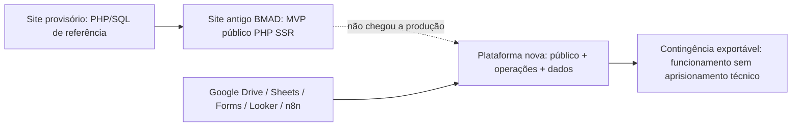
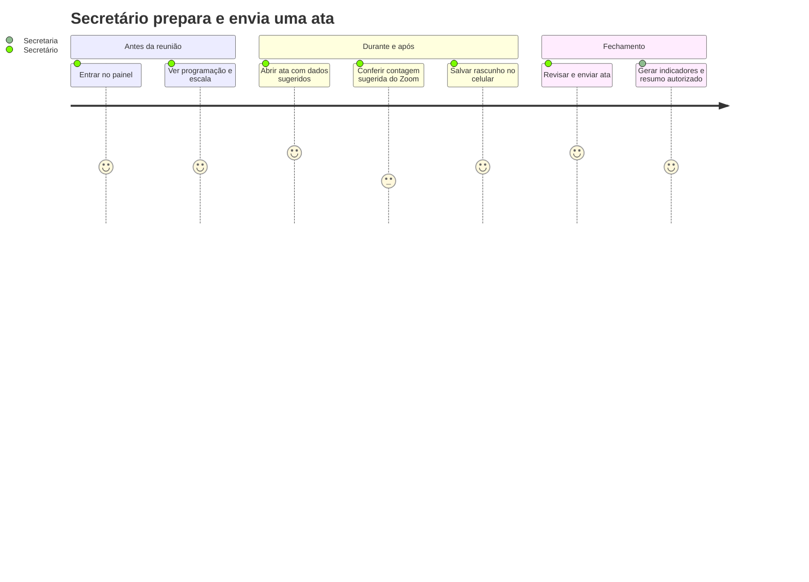
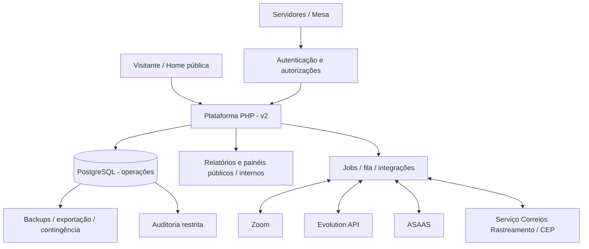
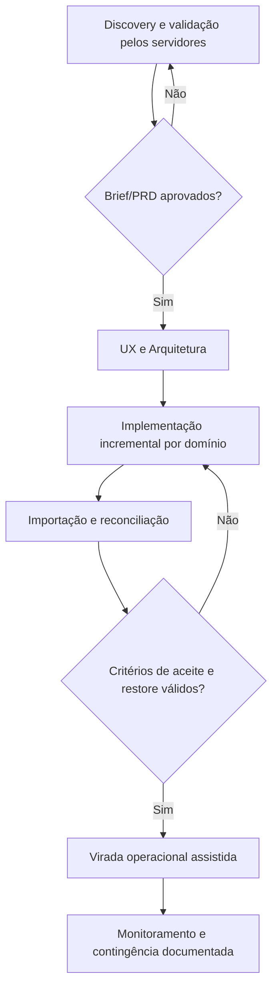

# ProductBrief.md — Visão e estratégia do Sistema QuarenteNA

> **Situação: APROVADO.** Visão de produto e escopo aprovados. Aprovação documental não comprova implantação, levantamento em tempo real das ferramentas legadas nem testes técnicos. Requisitos completos em `PRD.md`, inventário em `QuarenteNA.md` e projeto técnico em `Arquitetura.md`.

## 1. Visão executiva

A **plataforma QuarenteNA v2** transforma uma operação hoje descrita como distribuída entre Google Forms/Sheets/Drive/Docs, Looker Studio, Apps Script, n8n e integrações externas em um sistema web único, acessível e administrável por servidores voluntários. Mantém uma porta de entrada pública centrada na reunião, e oferece `/admin` para atividades operacionais protegidas.

**Tese:** diminuir a dependência de planilhas e conhecimento técnico individual, preservar a continuidade do serviço e melhorar a qualidade dos registros **sem converter a irmandade em um sistema de vigilância**. O software serve à consciência coletiva, não a substitui.

### Evolução do produto

| Aspecto | O que se preserva | O que muda |
|---|---|---|
| Entrada | Zoom e orientação acolhedora em poucos segundos | Agenda controlada pelo mesmo sistema operacional |
| Presença digital | Conteúdo institucional, história, relatórios públicos | Páginas/dados servidos sem exposição de registros privados |
| Administração | Governança editorial e fonte de verdade | Usuários, papéis, auditoria e workflows integrados |
| Confiança | Anonimato e clareza | Proteção forte de dados pessoais e financeiro; reversibilidade |

## 2. Problema e oportunidade

| Problema documentado | Consequência operacional | Valor pretendido |
|---|---|---|
| Dados dispersos e editados por ferramentas distintas | Trabalho duplicado e erros de relacionamento | Fonte institucional única e rastreável |
| Formulários e planilhas com texto livre | Nomes e categorias não reconciliáveis | Seletores estruturados e controle de integridade |
| Dashboards Looker sensíveis a fontes e filtros | Indicadores quebrados e manutenção difícil | Relatórios reproduzíveis, públicos/restritos |
| Apps Script/n8n como backend informal | Fluxos pouco documentados e dependência técnica | Jobs/webhooks com observabilidade e revisão |
| Acesso amplo ao Drive com dados pessoais | Risco de alteração e exposição indevida | Autorização por papel e necessidade operacional |
| Troca recorrente de servidores voluntários | Treinamento repetido e baixa continuidade | UX mobile-first e documentação viva |
| Dados de ingresso/kit/Zoom e contribuições | Risco de exposição e vigilância | Minimização, sigilo e controle por necessidade |

## 3. Visão e proposta de valor

**Visão:** um grupo que administra reuniões, encargos, atas, finanças e comunicação em uma só plataforma, com processos claros e reversíveis, mantendo a experiência pública simples e acolhedora.

**Proposta de valor por público:**

| Público | Trabalho a realizar | Sucesso percebido |
|---|---|---|
| Recém-chegado | Entender o grupo e acessar a reunião | Acha horário, regras e Zoom sem criar conta |
| Participante recorrente | Entrar rápido e consultar informações públicas | Home confiável e leve |
| Dupla de moderadores escalada | Conduzir Zoom e registrar a reunião | Ambos conseguem coordenar e secretariar; o responsável pelo chat envia a ata, com substituição entre pares |
| Mesa e responsáveis por serviço | Administrar encargos, documentação, atas e decisões | Acessos automáticos vinculados ao mandato; responsabilidades separadas e auditadas |
| Tesoureiro | Administrar entradas/saídas e prestar contas | Webhook ASAAS registra automaticamente; lançamento manual é imediato; apenas tesoureiro edita/exclui logicamente |
| Coordenador Kit Ingresso | Contatar ingressantes, organizar envios e acompanhar rastreamento | Acesso exclusivo aos dados de endereço/contato; remessas e eventos rastreáveis |
| Responsável técnico | Manter a plataforma e recuperar o serviço | Backup testado, logs, exportação, instalação documentada |

### Estrutura de servidores e responsabilidades aprovada

O grupo possui **seis encargos de mesa** e, separadamente, dois **moderadores escalados por reunião**. Um cargo na mesa não equivale a uma função exercida na reunião diária.

| Encargo na mesa | Responsabilidade | Autorização institucional predominante |
|---|---|---|
| Coordenador Geral | Coordenação geral, supervisão administrativa, apoio a todos os serviços | Administração funcional/técnica e gestão de acessos; **não edita tesouraria nem kit** |
| Secretário Geral | Documentos, registros, atas mensais de serviço, acervo e apoio à administração técnica | Gestão documental, modelo editável de ata de serviço, administração funcional/técnica; **não edita tesouraria nem kit** |
| Tesoureiro | Escrituração e movimentações financeiras, conferência de entradas/saídas | **Único encargo que cria, edita e exclui logicamente lançamentos financeiros**, com auditoria |
| RSG | Representação do grupo perante NA e a sociedade | Consulta/ações de representação conforme designação; sem acesso financeiro ou aos dados do kit por padrão |
| RSG Suplente | Auxílio e substituição do RSG | Permissões de representação durante substituição autorizada, sem privilégios administrativos implícitos |
| Coordenador Kit Ingresso | Contato com ingressantes, montagem, envio e acompanhamento dos kits | **Único encargo com acesso operacional ao kit, telefones, endereços e remessas** |

**Moderadores das reuniões regulares:** todos os dias, das **20h às 22h**, há uma dupla escalada. Ambos devem saber configurar a sala Zoom, coordenar pela fala e secretariar pelo chat. Em cada ocorrência, um atua como coordenador (partilhas, falas e avisos) e outro como secretário (chat, lista de partilhas, contagens e ata), mas **essas são funções intercambiáveis na escala, não dois encargos/mandatos independentes**. Se um faltar ou tiver dificuldade, o outro pode substituí-lo. Não confundir Coordenador Geral e Secretário Geral com essas funções temporárias.

**Acesso dinâmico por encargo:** designação ativa concede apenas as capacidades daquele encargo; término do período revoga automaticamente; entrega/destituição/revogação manual por administrador é efetiva imediatamente. O histórico da designação, da concessão e da revogação é preservado. Uma designação expirada jamais pode ser usada para autorizar uma requisição, mesmo antes da execução do job de limpeza.

**Conta `root` institucional:** acesso genérico de contingência, reservado à recuperação de acesso, gestão excepcional de administradores da mesa e manutenção/configuração de integrações. Não é conta de trabalho cotidiano nem substitui identidades pessoais; deve ter MFA, credencial sob guarda segura, justificativa de uso, alerta e registro de sessão com identificação do operador para rastreabilidade. Sessão `root` **não deve ser caminho normal de edição de tesouraria ou kit**.

### Jornada-síntese: ata do dia

## 4. Objetivos estratégicos e sinais de resultado

| Objetivo | Sinal verificável | Medição / base |
|---|---|---|
| Acesso público sem atrito | O link da reunião e seu contexto continuam visíveis sem login | Teste funcional/UX; baseline a estabelecer |
| Continuidade do serviço | Novo servidor conclui ata sem consultar planilhas | Teste de tarefa observada; tempo-alvo **a validar** |
| Integridade dos dados | Importações reconciliadas com totais e amostras | Relatórios de reconciliação por fonte |
| Transparência segura | Painel público agrega métricas sem pessoas identificáveis | Revisão de privacidade e testes de autorização |
| Redução da dependência técnica | Rotinas críticas independem de edição do n8n/Forms/Sheets | Critérios de cutover por operação |
| Segurança e reversibilidade | Backup restaurável e dados exportáveis | Teste de restore e procedimento de contingência |
| Auditabilidade | Mudanças sensíveis associadas a autor, data e diferenças | Amostragem de trilhas de auditoria |

**Não há base confiável para afirmar economia de horas, metas numéricas de produtividade ou cronograma fechado.** Definir depois da observação do fluxo real.

## 5. Escopo funcional do produto completo

| Núcleo | Capacidades incluídas |
|---|---|
| Portal público | Landing page, agenda, Zoom, informações NA, relatórios públicos aprovados |
| Pessoas e acesso | Encargos da mesa, duplas moderadoras por ocorrência, permissões temporárias por mandato, contas pessoais e root excepcional |
| Atas regulares | Pré-preenchimento, rascunho, conferência, envio, correção e histórico |
| Atas de serviço | Template editável pelo Secretário Geral, presenças, ausências, decisões e PDF arquivado no Google Drive institucional |
| Gestão de serviço | Encargos, reuniões, escalas, vagas, histórico e vencimentos |
| Indicadores | Dashboards operacionais, visitas, ingresso, conquistas, temáticas e filtros |
| Tesouraria | Lançamentos automáticos imediatos via ASAAS e manuais imediatos; tesoureiro exclusivo para correção/exclusão lógica com trilha, reserva prudente e agregados públicos |
| Kit ingresso | Pendência, coleta restrita, entrega, expedição e rastreamento automático via serviço `opastorello/correios-rastreamento` |
| Comunicações | Evolution API, WhatsApp, comandos e notificação autorizada |
| Presença Zoom | Webhook, eventos separados, sugestão de contagem; não vigilância individual |
| Migração | Importar legado, deduplicar com revisão humana, comparar totais |
| Operação | Auditoria, logs mínimos, configurações de integrações via root/admin autorizado, documentos no Google Drive, MinIO/Redis somente se necessários, backup e restauração |

### Migração integral do ecossistema operacional

**Decisão aprovada:** planilhas, tabelas, documentos operacionais, scripts do Google Apps Script, fluxos n8n, fórmulas relevantes e relatórios do Looker Studio devem ter sua **função, dados e regras de negócio incorporados à plataforma**. As ferramentas externas deixam de ser a fonte operacional após a virada validada; integrações de infraestrutura (Evolution API, ASAAS, Zoom e Correios) continuam como serviços externos necessários.

| Fonte atual | Resultado na nova plataforma | Evidência de conclusão |
|---|---|---|
| Google Forms / Sheets | Formulários, tabelas PostgreSQL, validações e histórico | Campos e registros conciliados |
| Google Docs operacionais | Conteúdo versionado, gestão de documentos e visões derivadas de dados | Sem edição duplicada de informação autoritativa |
| Looker Studio | Dashboards públicos e restritos com consultas reprodutíveis | Paridade aprovada dos indicadores |
| Apps Script | Serviços Laravel, eventos, jobs e agendamentos equivalentes | Regras testadas e acionamentos rastreáveis |
| n8n | Endpoints, jobs, comandos e notificações próprios | Workflows mapeados e casos de teste por automação |
| Kit ingresso | Rastreamento integrado ao `correios-rastreamento` via API REST | Atualizações deduplicadas, histórico e tratamento de falha |

A migração compreende **tudo que esteja ativo e aplicável**, com classificação de rotinas obsoletas antes da implementação; não significa transportar código inseguro literalmente.

### Fronteiras e integrações

### Regras financeiras e divulgação pública

O **tesoureiro é o único titular da permissão de edição financeira**. Evento ASAAS validado gera lançamento confirmado conforme a regra do evento, sem fila de aprovação humana; registro manual salvo pelo tesoureiro também produz lançamento imediatamente. Divergência posterior é corrigida/estornada/excluída logicamente mediante justificativa, mantendo a trilha histórica e o evento de origem. Filas de processamento de webhook não representam “lançamento financeiro pendente”.

A identidade de ingressantes pode figurar em **relatório público de ingresso apenas como primeiro nome ou apelido editorialmente autorizado**; endereço, telefone, dados de contato e detalhes do kit nunca integram a projeção pública. Homônimos e grafias diferentes não autorizam fusão automática de pessoas.

### Governança de comunicação e documentos

Avisos dos antigos cron jobs e rotinas do n8n serão jobs/eventos Laravel com **ativação/desativação por rotina**, programação editável, modelos de mensagem editáveis por responsável autorizado, trilha de envio e idempotência. Comandos Evolution API (`!ajuda`, `!vago` etc.) serão despachados por um roteador de comandos PHP, sem dependência de n8n em produção. Google Drive permanece integração de armazenamento institucional de documentos, **não banco operacional**.

## 6. Não objetivos e limites éticos

- Não construir SaaS ou multi-tenant para múltiplos grupos na v2; reuso futuro por **fork** documentado.
- Não criar aplicativo nativo obrigatório: site e painel **mobile-first**.
- Não exigir login para informação pública ou produzir ranking nominal de frequência individual.
- Não inferir identidade real automaticamente de nome/e-mail Zoom; participantes eventuais não viram contas administrativas.
- Não revelar publicamente endereço/telefone de ingressantes, dados bancários pessoais, logs de mensagens ou lista nominal do Zoom.
- Não eliminar revisão humana de atas, remessas, categorias financeiras, merges ou decisões de serviço.
- Não tornar ferramentas externas disponíveis o requisito para carregar a página pública.
- Não desligar o fluxo anterior sem reconciliação, testes, backup e aceitação do grupo.

## 7. Princípios irrenunciáveis

1. **Serviço antes da tecnologia:** a plataforma ajuda, não governa o grupo.
2. **Anonimato por padrão:** minimização, uso agregado e acesso proporcional à necessidade.
3. **Uma fonte institucional de verdade:** dados operacionalmente geridos em registros coerentes.
4. **Automação revisável:** assistentes e webhooks sugerem; servidores autorizados validam.
5. **Simplicidade para servidores leigos:** vocabulário de NA, orientação contextual, uso móvel.
6. **Reversibilidade:** exportações, backups verificáveis e rota de retorno manual.
7. **Transparência proporcional:** prestação pública de contas sem identificar contribuintes ou membros.
8. **Identidade do grupo:** operação single-group parametrizável para eventual fork, sem multi-tenancy.

## 8. Caminho de entrega — escopo completo, implantação controlada

*"Produto completo" designa o conjunto de capacidades-alvo; não autoriza big-bang irreversível.*

## 9. Principais riscos e mitigação esperada

| Risco | Consequência | Mitigação de produto |
|---|---|---|
| Migração dos registros históricos com duplicação | Indicadores inconsistentes | Pré-varredura, reconciliação e aprovação de merges |
| Exposição de dados pessoais de membros | Quebra de anonimato | Dados restritos, minimização e revisão editorial |
| Falha ASAAS/Zoom/Evolution | Interrupção de processos | Filas, retries controlados e contingência sem perda |
| Dependência de uma pessoa técnica | Descontinuidade | Contas institucionais, runbooks, backup e transferência de acesso |
| Painel excessivamente complexo | Rejeição por voluntários | Testes com servidores leigos, mobile-first e fluxos guiados |
| Big-bang sem validação | Perda operacional | Migração incremental, operação assistida, rollback documentado |
| Confusão entre papel e poder administrativo | Permissões indevidas | Matriz de autorizações e revisão da mesa |

## 10. Parâmetros para execução e homologação

**Brief APROVADO.** Os itens abaixo correspondem a conferências e parâmetros da execução; não são pendências de aprovação deste Brief.

| Nº | Parâmetro operacional | Responsável sugerido | Impacto |
|---|---|---|---|
| 01 | Confirmar agenda, tipos e horários vigentes | Mesa | Portal e pré-preenchimento |
| 02 | Confirmar forma de aprovação das atas e correções | Servidores/Mesa | Workflow e auditoria |
| 03 | Definir quais decisões/relatórios podem ser públicos | Consciência coletiva | Privacidade |
| 04 | Validar perfis, root técnico e limites do SuperAdmin | Mesa/responsável técnico | Segurança |
| 05 | Estabelecer retenção de webhooks e dados Zoom | Responsáveis pelo grupo | Proteção de dados |
| 06 | Conferir dados/fontes de migração e qualidade | Responsáveis pelos dados | Aceite do banco |
| 07 | Confirmar domínio institucional e aprovar o conteúdo | Mesa | Release público |
| 08 | Definir critérios de reconciliação financeira | Tesouraria | Cutover |
| 09 | Documentar política de contingência, conta institucional e acessos | Mesa/técnico | Reversibilidade |

## 11. Aprovação e continuidade no BMAD

**Status: APROVADO.** A visão, os públicos, o escopo completo e os princípios de serviço foram aprovados. Questões operacionais e técnicas que dependam de conferência no sistema real permanecem registradas para a execução e homologação, sem retirar o caráter de aprovado do Brief. `PRD.md` especifica o comportamento exigido; `QuarenteNA.md` documenta o legado; `UX-Design.md` e `Arquitetura.md` desenvolvem os projetos de experiência e engenharia. Epics/Stories devem citar os documentos canônicos.

## 12. Referências canônicas

| Documento único | Finalidade | Natureza |
|---|---|---|
| [`QuarenteNA.md`](QuarenteNA.md) | Inventário de planilhas, scripts, ferramentas, fluxos e decisões históricas; mapa de migração | Contexto operacional aprovado |
| [`ProductBrief.md`](ProductBrief.md) | Visão, públicos, objetivos, limites e resultados | **Brief aprovado** |
| [`PRD.md`](PRD.md) | Requisitos funcionais, não funcionais, negócios, migração e aceite | **PRD aprovado** |
| [`UX-Design.md`](UX-Design.md) | Experiência pública e administrativa, fluxos e design system | Projeto UX derivado |
| [`Arquitetura.md`](Arquitetura.md) | Solução Laravel, PostgreSQL, Docker, integrações e modelo lógico | Projeto técnico derivado |

Fontes técnicas externas: [BMAD Method 6.12.4](https://github.com/bmad-code-org/BMAD-METHOD/tree/v6.12.4), [template Laravel BMAD](https://github.com/cirinho/template-laravel-bmad), [rastreio Correios](https://github.com/opastorello/correios-rastreamento). Não há versões paralelas destes documentos canônicos.
