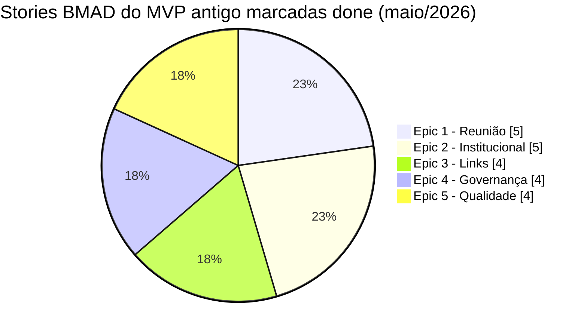
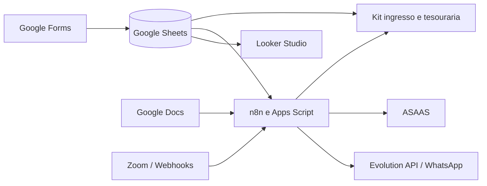
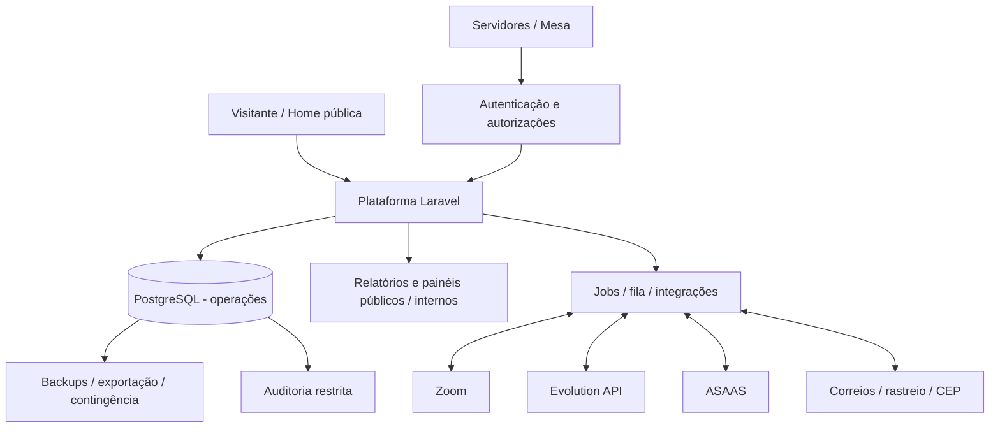
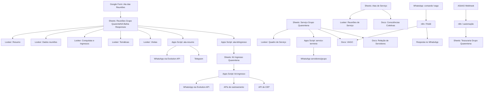
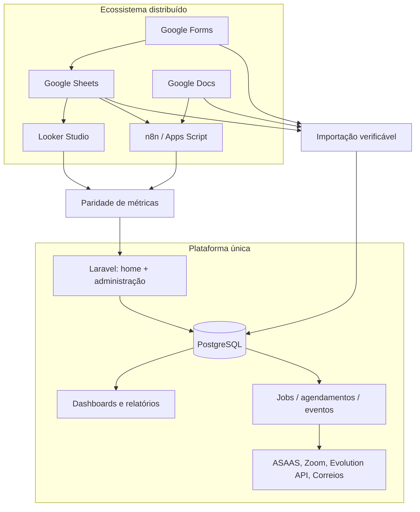
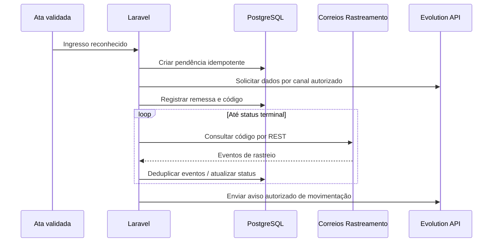

# QuarenteNA.md — Diagnóstico operacional e transição do legado

> **Situação: APROVADO.** Inventário canônico de contexto e migração. As informações sobre sistemas externos descrevem os registros e fluxos documentados, não uma auditoria em tempo real.

## Quadro comparativo: site antigo (MVP) × novo sistema (v2)

| Critério | Planejamento do antigo site (março/2026) | Planejamento da plataforma v2 (maio/2026) | Decisão para consolidação |
|---|---|---|---|
| Propósito | Acesso à reunião, acolhimento e presença digital | Centralização da operação do grupo | **Amplia** a missão sem perder a porta pública |
| Home | CTA do Zoom acima da dobra e dados essenciais | Home institucional com agenda, Zoom e links públicos | **Preservar** fluidez e prioridade do acesso à reunião |
| Público | Sem login | Sem login nas informações públicas; `/admin` autenticado | **Separar** publicações e operações internas |
| Backend | PHP SSR mínimo | Aplicação PHP com módulos de domínio | **Novo escopo**; escolha de framework pertence à arquitetura |
| Persistência | Arquivo PHP `app/data/meeting.php`, sem banco no MVP | PostgreSQL relacional como fonte operacional | **Substituir** fonte estática quando houver gestão administrativa |
| Admin | Epics 7–9 em backlog | Administração no escopo do produto | **Antecipar ao escopo**, sem liberar sem segurança |
| Atas | Não implementadas no MVP | Ata web, pré-preenchimento, rascunho, revisão, histórico | **Nova capacidade** |
| Reuniões de serviço | Fora do MVP | Ata de serviço e PDF | **Nova capacidade** |
| Dashboard | Link para relatório externo | Dashboard interno com recortes públicos/restritos | **Substituir** Looker Studio após validação de paridade |
| Pessoas | Sem cadastro no MVP | Cadastro operacional separado das identidades do Zoom | **Nova capacidade com proteção de dados** |
| Encargos | Fora do MVP | Mesa, moderadores, vagas, mandatos e permissões | **Nova capacidade** |
| Kit ingresso | Fora do MVP | Gestão logística restrita | **Nova capacidade** |
| Tesouraria | Fora do MVP | Lançamentos, ASAAS, reserva prudente e prestação de contas | **Nova capacidade** |
| WhatsApp | Link complementar | Evolution API, comandos e notificações | **Transformar** link em integração de serviço |
| Zoom | Link e dados de acesso | Webhook/contagem sugerida; nomes restritos | **Ampliar**, proibindo vigilância individual |
| Analytics | Cliques agregados e anônimos | Indicadores institucionais; auditoria técnica de modificações | **Separar** analytics público, auditoria interna e presença |
| Conteúdo | Dados institucionais, história e diretórios | Mantidos, com documentação e gestão integrada | **Preservar** governança editorial e anonimato |
| Acessibilidade | HTML SSR, foco, teclado e WCAG equivalente AA | Mobile-first em público e administração | **Manter e expandir** |
| Integração | Links externos acessórios, fail-soft | Evolution API, Zoom, ASAAS, correios/CEP e jobs | **Introduzir** contratos de integração e contingência |
| Deploy | PHP compartilhado, sem Docker obrigatório | Docker e PostgreSQL | **Alteração de plataforma** |
| Migração | Não prevista no MVP | Inventário, saneamento, reconciliação e cutover | **Gate obrigatório** antes de desativar o legado |
| Escopo de produto | MVP público + admin futuro | Produto completo com entrega técnica incremental | **Não confundir** escopo da v2 com entrega única sem marcos |

### Evolução documentada das 22 Stories do MVP antigo



> **Atenção:** 22/22 Stories marcadas `done` no `sprint-status.yaml`, porém o MVP BMAD antigo **nunca entrou em produção**. O code review de 27/05/2026 registra pendências de lançamento (issue `#28`); o gráfico indica somente progresso documental.

### Semelhanças que devem sobreviver

Acesso rápido ao Zoom; legitimidade e acolhimento do grupo; divulgação de agenda e tipos de reunião; anonimato; dados públicos essenciais disponíveis sem login; acesso a relatórios públicos aprovados; foco em mobile, simplicidade e resiliência a falhas externas. **Não transplantar automaticamente os arquivos PHP do MVP de 2026 como arquitetura da v2.**

### Desambiguação histórica

1. **Site provisório:** arquivos `index.php`, `conexao.php`, `db.sql` e `estilo.css` enviados como referência histórica de código (ex.: domínio `.com.br`).
2. **Site antigo planejado/implementado com BMAD:** brief/PRD/UX/architecture de março de 2026, 22 stories marcadas como `done` nos Epics 1–5, e code review de 27/05/2026 com pendências. O `done` documental não equivale a release: **o antigo site BMAD/MVP nunca foi colocado no ar**.
3. **Site novo v2:** documentação operacional + Product Brief + PRD de maio de 2026, objeto desta consolidação. Prevê domínio `GrupoQuarenteNA.org` (não equivale a DNS/posse verificados).

## Mapa consolidado do AS-IS e do TO-BE

| Processo | Fonte/execução documentada (AS-IS) | Capacidade pretendida (TO-BE) | Prova de migração esperada | Natureza da evidência |
|---|---|---|---|---|
| Reuniões/atas | Formulário Google → planilha de respostas | Ata web, rascunho, revisão e histórico | Paridade de campos e totais amostrais | Descrição de operação; não auditoria de instância |
| Frequência e partilhas | Sheets → Looker | Agregados no painel próprio | Comparação de métricas por período/horário | Indicadores históricos observados |
| Serviço/encargos | Sheets + Docs `VAGO` / `Relação de Servidores` | Cadastro, vagas, mandatos e notificações | Vagas e escalas reconciliadas | Planilhas/roteiros descritos |
| Kit ingresso | Planilha + mensagens e rastreamento | Fila, status, endereço restrito, expedição e serviço Correios REST | Conferência de kits pendentes/enviados | Fluxos e campos descritos |
| Tesouraria | Planilhas + ASAAS + automações | Lançamentos auditáveis e conciliação | Saldo, reserva prudente e categorias conferidos | Regras pretendidas + fontes antigas |
| WhatsApp | n8n + Evolution API | Comandos PHP sobre dados autorizados | Mesmo conjunto de comandos essenciais | Dependência funcional descrita |
| Zoom | Webhooks e scripts auxiliares | Eventos restritos; sugestões agregadas | Contagens por reunião com correção humana | Integração documentada; payload a confirmar |
| Reuniões de serviço | Planilha + PDFs + Docs | Ata de serviço estruturada com PDF | Histórico e decisões reconciliados | Dados descritos |
| Relatórios públicos | Looker Studio e links | Visões públicas minimizadas | Nenhum PII na saída | Escopo pretendido |

### Exemplo de indicadores históricos observados no Looker Studio

| Indicador | Valor observado em registro anterior | Interpretação segura |
|---|---:|---|
| Reuniões | 4.109 | Referência histórica de dashboard, **não número atualizado** |
| Média de membros por reunião | 27 | Indicador histórico, conferir fórmula/período |
| Visitas | 875 | Acumulado relatado; validar origem |
| Ingressos | 618 | Acumulado relatado; validar duplicidades |
| Conquistas | 384 | Acumulado relatado; conferir critérios |

> Valores reproduzidos de documentação de maio/2026 e sujeitos à revisão; não devem ser publicados como estatísticas atuais. Não existem métricas comprovadas para estimar ganho de produtividade após a v2.

### Diagrama do ecossistema descrito



### Diagrama de capacidades desejadas (não é arquitetura aprovada)



## Evoluções posteriores que prevalecem sobre as descrições mais antigas

Os registros históricos de maio de 2026, agora reconciliados com o Brief e PRD **aprovados**, estabelecem as seguintes decisões de produto. A verificação técnica da implantação permanece uma atividade distinta:

| Tema | Formulação canônica | Status documental |
|---|---|---|
| Identidade do projeto | Site público em `GrupoQuarenteNA.org` e painel em `/admin` | Planejado; domínio não verificado |
| Arquitetura tecnológica pretendida | PHP, PostgreSQL e Docker | Diretriz de produto; framework e desenho a definir |
| Servidores | Mesa: Secretário Geral, Tesoureiro, RSG, RSG Suplente e Kit Ingresso; Coordenador Geral extinto, mas configurável | Descrição histórica de cargos, confirmar composição vigente |
| Moderação do dia | Secretário registra ata; coordenador conduz; uma pessoa pode acumular quando necessário | Regra de proposta, sujeita a validação |
| Agenda | Reuniões diárias 20h–22h no recorte relatado, mas suportar múltiplos horários | Informação histórica, agenda vigente por confirmar |
| Identidade de pessoas | Pessoas operacionais cadastradas separadamente de participantes Zoom | Diretriz de privacidade |
| Permissões | Root institucional de contingência, SuperAdmin técnico, mesa, servidor e permissões granulares | Modelo a validar; não publicar seeds nominais |
| Ata | Login, dados sugeridos/editáveis, rascunho automático, revisão, correção justificada | Requisito aprovado |
| Ata de serviço | Template, rascunho, campos de presença/decisões e PDF | Requisito aprovado |
| Financeiro | ASAAS sugere categoria, tesoureiro confere, painel público sem identificação | Requisito aprovado |
| Zoom | Uso agregado e revisão humana; identidade nominal exclusivamente restrita quando indispensável | Limite de privacidade |
| Migração | Varredura, normalização, sugestão de mesclagem, revisão humana, importação e reconciliação | Gate obrigatório |
| Reversibilidade | Exportações, backup e retorno temporário à operação manual | Requisito transversal |
| Replicabilidade | Single-group e fork parametrizado; multi-tenant/SaaS fora do escopo | Decisão de delimitação |

### Governança de evidências e inconsistências

- **Observado/documentado**: nomes dos arquivos, fluxos das planilhas, campos do formulário, páginas do Looker, scripts e integrações descritos nas fontes.
- **Inferido**: relações do modelo de dados, alguns campos extraídos de scripts e dependências prováveis de automações; não tratar como inventário confirmado em runtime.
- **Planejado**: PHP + PostgreSQL + Docker, painel, migração, integrações diretas, desenho de permissões e relatórios próprios.
- **Pendente de confirmação**: dados/cadastros reais, saldos, planilhas completas, regras atuais da consciência coletiva, URLs de grupos, domínio final, campos Zoom efetivamente disponíveis, tempo de retenção e responsáveis pela aprovação.

### Riscos documentais que exigem decisão antes da arquitetura

1. O legado era orientado a landing page; a nova v2 introduz dados pessoais e integrações financeiras — requisitos de privacidade e segurança devem ter validação própria.
2. O planejamento diz “substituição completa”, mas também “fases técnicas”: **a substituição do fluxo principal é o estado final** e a virada deve ter critérios operacionais, não ocorrer antes da paridade comprovada.
3. O `PRD.md` é fonte única de requisitos; referências operacionais não devem usar códigos de requisitos de documentos obsoletos.
4. A documentação de maio é retrato histórico, não vistoria realizada em outubro de 2026.
5. Os riscos de `track.php` e URLs do antigo MVP pertencem ao acervo histórico e não comprovam vulnerabilidades no código futuro.

### Próximas verificações de discovery

| Fonte a inventariar | Verificação mínima |
|---|---|
| Google Drive | Listagem de planilhas, abas, tipos, contagens e proprietários, sem exposição de PII |
| Sheets | Export com versões/assinaturas, chaves lógicas, formatos e referências cruzadas |
| n8n / Apps Script | Export de workflows, triggers, mensagens e políticas de retry |
| ASAAS | Tipos de evento, idempotency keys, reconciliação e acesso técnico |
| Evolution API | Grupos, comandos autorizados, templates e volume de chamadas |
| Zoom | Escopos de app, payloads de eventos, disponibilidade e minimização de dados |
| Reuniões de serviço | Consciências vigentes, documentos aprovados e fluxos de autorização |
| Público | Domínio, SEO, copy e horários oficiais; distinção aberta/fechada |

## Fontes canônicas e natureza das evidências

| Documento | Papel único | Situação |
|---|---|---|
| `QuarenteNA.md` | Inventário AS-IS, contexto e plano de migração | **APROVADO** |
| `ProductBrief.md` | Visão, objetivos, destinatários e limites | **APROVADO** |
| `PRD.md` | Comportamentos, RF, RNF, regras e aceites | **APROVADO** |
| `UX-Design.md` | Fluxos, navegação e identidade da solução | Projeto de UX desenvolvido |
| `Arquitetura.md` | Arquitetura Laravel/PostgreSQL/Docker e modelo lógico | Projeto técnico desenvolvido |

O inventário foi elaborado a partir de prints, scripts, descrições e documentos anteriores. **Aprovação do documento não significa inspeção direta de todos os serviços em execução**. Durante migração, fluxos podem ser marcados como ativos, inativos ou obsoletos; nenhum fluxo ativo será omitido silenciosamente.

**Decisão de migração integral:** scripts e funções Apps Script, workflows n8n, planilhas, abas, cálculos, Google Docs operacionais e Looker Studio serão incorporados em capacidades nativas da nova aplicação, preservando os serviços externos necessários (Zoom, ASAAS, Evolution API e rastreamento Correios). O desligamento é por evidência de paridade e aceite, não pela simples criação de uma tela.

## Inventário detalhado da operação anterior — base documental preservada

### 1. Visão geral do funcionamento atual

O Grupo QuarenteNA utiliza principalmente o **Google Drive** como repositório operacional, com **Google Forms**, **Google Sheets**, **Google Docs**, **Looker Studio**, **Google Apps Script**, **n8n**, **Evolution API**, **ASAAS Webhook** e integrações auxiliares para administrar:

- atas das reuniões regulares;
- indicadores de frequência, partilhas, visitas, ingressos e conquistas;
- reuniões de serviço;
- quadro de servidores e encargos vagos;
- kit de ingresso enviado pelo correio;
- tesouraria;
- envio de mensagens automáticas via WhatsApp e Telegram;
- rastreamento de encomendas;
- documentos de consciência coletiva e funcionamento do grupo.

O fluxo atual funciona, mas cresceu em cima de planilhas, documentos e automações separadas. Isso gera problemas de manutenção, padronização, relacionamento entre dados, consistência de nomes, digitação divergente e fragilidade no Looker Studio.

---

### 2. Pasta principal no Google Drive

A pasta principal do Google Drive contém, conforme print enviado, os seguintes itens:

#### 2.1 Pastas

| Nome | Finalidade percebida |
|---|---|
| Arquivos para Reunião | Materiais usados nas reuniões. |
| Atas Reuniões de Serviço | PDFs ou documentos de atas de reuniões de serviço. |
| RSG | Materiais relacionados ao RSG. |
| Telas Reunião | Telas, imagens ou materiais visuais usados na reunião. |
| Tesouraria | Arquivos financeiros e controles de tesouraria. |
| Treinamento | Materiais de treinamento de servidores. |

#### 2.2 Arquivos principais

| Nome do arquivo | Tipo | Função atual |
|---|---:|---|
| Atas de Serviço | Google Sheets | Tabela com links de PDFs das atas de serviço e resumo das reuniões de serviço. |
| Consciências Coletivas do Grupo QuarenteNA | Google Docs | Documento com decisões, regras e funcionamento do grupo. |
| Formulário . Ata das Reuniões Grupo Quarentena Bahia | Google Forms | Formulário usado para preencher a ata das reuniões. |
| Kit Ingresso Quarentena | Google Sheets | Controle dos ingressantes e envio do kit de ingresso pelo correio. |
| Relação de Servidores | Google Docs | Documento textual com servidores por encargo/dia e vagas. |
| Reuniões Grupo QuarenteNA Bahia (Responses) | Google Sheets | Planilha principal de respostas do formulário da ata. Fonte central do dashboard. |
| Serviço Grupo Quarentena | Google Sheets | Planilha do quadro de servidores/serviços. Fonte do quadro de serviço e automações de término. |
| VAGO | Google Docs | Documento lido pelo robô do WhatsApp quando alguém digita `!vago`. |

---

### 3. Looker Studio — Dashboard atual

#### 3.1 Link do dashboard

Dashboard atual informado:

```text
https://datastudio.google.com/reporting/06f46456-c395-4bb3-bd11-f152a73ed04a
```

Nome exibido: **Grupo QuarenteNA**  
Título interno: **Relatório Grupo Quarentena**

#### 3.2 Filtros globais observados

O dashboard possui filtros recorrentes no topo:

| Filtro | Observação |
|---|---|
| Dia da Semana | Filtra os dados por dia da semana. |
| Horário da reunião | Filtra por horários como 0h30, 10h, 19h30, 20h, 22h. |
| Período de datas | Exemplo observado: 25/03/2020 a 15/05/2026. |

#### 3.3 Cards globais observados

Os cards aparecem em várias páginas:

| Indicador | Exemplo observado |
|---|---:|
| Reuniões | 4.109 |
| Média de Membros por Reunião | 27 |
| Membros por dia | 51 |
| Membros por semana | 4 mil |
| Visitas | 875 |
| Ingresso | 618 |
| Conquistas | 384 |

Esses indicadores parecem ser calculados majoritariamente a partir da planilha **Reuniões Grupo QuarenteNA Bahia (Responses)**.

---

### 4. Páginas do Looker Studio

#### 4.1 Página: Resumo

Objetivo: visão geral dos indicadores do grupo.

Componentes observados:

- cards principais;
- gráfico “Curva de Frequência por dia”;
- tabela “Visão Geral por dia da semana/Horário”;
- tabela “Visão Geral por horário”;
- tabela “Visão Geral por dia da semana”;
- gráfico “Visitas, Ingressos e Conquistas por dia da semana”.

Campos agregados observados:

| Campo | Uso |
|---|---|
| Reuniões | Contagem de atas lançadas. |
| Membros | Soma de presenças. |
| Média Membros | Média por reunião. |
| Partilhas | Soma de partilhas. |
| Média Partilhas | Média por reunião. |
| Visitas | Soma de visitas. |
| Ingresso | Soma de ingressos. |
| Conquistas | Soma de conquistas. |
| Dia da Semana | Agrupamento. |
| Horário da reunião | Agrupamento. |

Observação exibida no dashboard: o número de reuniões só é contabilizado quando os dados da ata são lançados.

#### 4.2 Página: Dados reuniões

Objetivo: listar as atas/reuniões de forma tabular.

Tabela principal: **Dados das Reuniões**

Campos observados:

| Campo | Descrição |
|---|---|
| Data | Data da reunião. |
| Dia | Dia da semana. |
| Horário | Horário da reunião. |
| Membros | Número de participantes. |
| Partilhas | Número de partilhas. |
| Visitas | Número de visitas. |
| Ingresso | Número de ingressos. |
| Conquistas | Número de conquistas. |

Legenda visual observada:

| Legenda | Uso |
|---|---|
| Reunião das 10h | Cor específica. |
| Reunião das 19h30 | Cor específica. |
| Reunião das 22h | Cor específica. |
| Ata não arquivada | Destaque em vermelho. |

Observação atual: há casos em que ingresso e visita nas reuniões com atas pendentes podem não corresponder à data específica.

#### 4.3 Página: Conquistas e Ingressos

Objetivo: acompanhar ingressos e conquistas/fichas de tempo limpo.

Componentes observados:

- gráfico de ingressos por dia da semana;
- tabela de ingressos;
- gráfico de conquistas por dia da semana;
- tabela de conquistas.

Campos da tabela de ingressos:

| Campo | Descrição |
|---|---|
| Data | Data da reunião/ingresso. |
| Horário | Horário da reunião. |
| Nome | Nome do ingressante. |
| Visitas | Quantidade relacionada à visita. |
| Ingresso | Quantidade relacionada ao ingresso. |

Campos da tabela de conquistas:

| Campo | Descrição |
|---|---|
| Data | Data da reunião/conquista. |
| Horário | Horário da reunião. |
| Nomes | Nome e tempo limpo/conquista. |

Observação de privacidade: esta página contém nomes pessoais e deve ser tratada com cuidado na migração. O sistema futuro deve avaliar quais nomes precisam ser armazenados, por quanto tempo e com qual nível de acesso.

#### 4.4 Página: Temáticas

Objetivo: listar reuniões temáticas.

Tabela principal: **Temáticas**

Campos observados:

| Campo | Descrição |
|---|---|
| Data | Data da reunião. |
| Dia da Semana | Dia da semana da reunião. |
| Título da temática | Tema abordado. |
| Partilhador da temática | Pessoa que partilhou a temática. |
| Presenças | Número de presenças. |

Indicador observado: 612 temáticas.

#### 4.5 Página: Visitas

Objetivo: analisar visitas e origem das visitas.

Componentes observados:

- gráfico “Visitas por dia da semana”;
- gráfico “Como a visita ficou sabendo de Narcóticos Anônimos?”;
- tabela “Reuniões com visitas”.

Campos da tabela “Reuniões com visitas”:

| Campo | Descrição |
|---|---|
| Data | Data da reunião. |
| Horário | Horário da reunião. |
| Dia da Semana | Dia da semana. |
| Como a visita ficou sabendo da Reunião? | Origem informada. |
| Membros | Número de membros/presenças. |
| Visitas | Número de visitas. |
| Ingresso | Número de ingressos. |

Opções de origem da visita observadas no formulário:

- Não foi informado;
- Membro de NA;
- Linha de Ajuda;
- Amigo / Familiar;
- Profissional (Médico, Psicólogo, Assistente Social);
- Justiça;
- Internet;
- Mídia social (Instagram, Facebook);
- Jornal / Rádio / TV;
- Igreja / Templo / Centro religioso;
- Instituição / Centro de tratamento;
- Cartaz/Folheto;
- Outro.

Problema relatado: pequenas variações de digitação, acentos, espaços e combinações podem quebrar a modelagem no Looker Studio.

#### 4.6 Página: Quadro de Serviço

Objetivo: mostrar servidores do grupo, dia de serviço, início, término, status e tempo para conclusão.

Situação atual: a página está quebrada por problema na fonte de dados.

Filtros observados:

| Filtro | Descrição |
|---|---|
| Tipo da reunião | Filtra por tipo de reunião. |
| Dia de serviço | Filtra por dia de serviço. |
| Servidor | Filtra por servidor. |
| Status manual | Filtra por status do serviço. |

Tabelas observadas, mas sem dados:

- Servidores do Grupo;
- Dia de Serviço e Tempo para conclusão de moderadores de Reunião;
- Tempo para conclusão de moderadores de Reunião.

Campos esperados pela tela:

| Campo | Descrição |
|---|---|
| Servidor | Nome do servidor. |
| Dia de serviço | Dia em que serve. |
| Início do serviço | Data de início. |
| Tipo da reunião | Tipo/formato da reunião. |
| Status manual | Status operacional. |
| Término do serviço | Data prevista ou efetiva de término. |
| Horário | Horário da reunião/serviço. |

#### 4.7 Página: Reuniões de Serviço

Objetivo: listar reuniões de serviço e resumir participação/faltas.

Tabela observada:

| Campo | Descrição |
|---|---|
| Data da Reunião | Data da reunião de serviço. |
| Tipo de reunião | Serviço, Administrativa, Continuação, Eletiva etc. |
| Link | Link para acessar a ata/PDF. |
| Servidores presentes | Quantidade de servidores presentes. |
| Membros Interessados | Quantidade de membros interessados presentes. |
| Justificativa | Número de justificativas. |
| Faltas (servidores) | Quantidade de faltas. |
| % de Ausência | Percentual de ausência. |

Fonte de dados: planilha **Atas de Serviço**, junto com a planilha **Serviço Grupo Quarentena**.

---

### 5. Formulário da Ata das Reuniões

Arquivo: **Formulário . Ata das Reuniões Grupo Quarentena Bahia**  
Tipo: Google Forms  
Função: formulário preenchido ao final da reunião. As respostas alimentam a planilha **Reuniões Grupo QuarenteNA Bahia (Responses)**.

#### 5.1 Informações introdutórias

Texto observado:

- Data de fundação do Grupo QuarenteNA: 23/03/2020.
- Orientação: itens sem informação devem ficar em branco; não é necessário preencher com `0`, `Não Houve` ou `Inexistente`.

#### 5.2 Campos observados no formulário

| Campo | Tipo aparente | Obrigatório? | Observação |
|---|---|---:|---|
| Data da reunião | Data | Sim | Selecionar no calendário. |
| Horário da reunião | Escolha | Sim | Opção observada: 20h. |
| Secretário da reunião (nome) | Texto curto | Sim | Digitado livremente. |
| Coordenador da reunião | Texto curto | Sim | Digitado livremente. |
| Membros | Número/texto curto | Sim | Total de participantes, incluindo PS e visitas. |
| Partilhas | Número/texto curto | Sim | Número de partilhadores. |
| Visitas | Número/texto curto | Não | Deixar em branco se não houver. |
| Ingresso | Número/texto curto | Não | Número de ingressos/3ª Tradição. |
| Nome dos ingressantes | Texto longo | Não | Pode conter múltiplos nomes. |
| Contato do ingressante | Texto longo | Não | Telefones/WhatsApp separados por vírgula. |
| Como a visita ficou sabendo da Reunião? | Checkbox | Não | Origem da visita. |
| Conquistas | Número/texto curto | Não | Número total de conquistas/fichas. |
| Nome das conquistas e tempo limpo | Texto longo | Não | Ex.: Fulano - 1 ano. |
| Título da temática | Texto curto | Não | Apenas para reunião temática. |
| Partilhador da temática | Texto curto | Não | Apenas para reunião temática. |
| 7ª Tradição | Valor | Sim | Valor do saldo da 7ª tradição no dia, padrão internacional com ponto decimal. |
| Data da atualização da 7ª tradição | Data | Sim | Selecionar no calendário. |
| Informações adicionais da reunião | Checkbox | Não | Leituras/tradições e outras informações. |
| Tipo de Reunião | Escolha | Sim | Aberta, Fechada, Fechada Mensagem Literatura, Temática, Estudo Passos, Serviço. |
| Eleição de Encargos | Texto longo | Não | Formato sugerido: Nome - Dia - Horário. |
| Observação | Texto longo | Não | Campo livre para informações não contempladas. |

#### 5.3 Problemas atuais do formulário

- Campos de nomes são livres e geram variações de grafia.
- Campos numéricos podem ser digitados de forma inconsistente.
- Origem da visita permite múltiplas combinações, dificultando agrupamento no dashboard.
- Dados pessoais de ingressantes podem ser coletados junto com dados agregados da ata.
- O formulário mistura dados de ata, tesouraria, visitas, ingressos, temáticas, conquistas e serviço no mesmo registro.

---

### 6. Planilha principal de respostas da ata

Arquivo: **Reuniões Grupo QuarenteNA Bahia (Responses)**  
Tipo: Google Sheets  
Aba observada: **Form Responses 1**  
Função: principal base de dados da operação e fonte da maior parte do Looker Studio.

#### 6.1 Campos/colunas identificadas

Com base nos prints e nos scripts, as colunas identificadas são:

| Coluna | Nome observado/inferido | Função |
|---:|---|---|
| A | Timestamp | Data/hora em que o formulário foi enviado. |
| B | Data da reunião | Data da reunião. |
| C | Horário da reunião | Horário da reunião. |
| D | Membros | Número total de participantes. |
| E | Partilhas | Número de partilhas. |
| F | Visitas | Número de visitas. |
| G | Ingresso | Número de ingressos. |
| H | Conquistas | Número de conquistas/fichas. |
| I | Nome dos ingressantes | Lista de ingressantes. |
| J | Nome das conquistas e tempo limpo | Lista de conquistas. |
| K | Título da temática | Tema da reunião temática. |
| L | Partilhador da temática | Nome do partilhador da temática. |
| M | Observação | Observações gerais. |
| N | Secretário | Secretário(a) da reunião. |
| O | Coordenador | Coordenador(a) da reunião. |
| P | 7ª Tradição | Valor/saldo da 7ª tradição. |
| Q | Data da atualização da 7ª tradição | Data informada para atualização da 7ª tradição. |
| R | Despesas | Valor de despesas. |
| S | Discriminação despesa | Descrição de despesas. |
| T | Informações adicionais da reunião | Leituras e informações marcadas no formulário. |
| U | Ata Pendente? | Indicador de ata pendente. |
| V | Email Address | Email do respondente, se coletado. |
| W | Tipo de Reunião | Tipo/formato da reunião. |
| X | Como a visita ficou sabendo da Reunião? | Origem da visita. |
| Y | Eleição de Encargo | Registro de eleição de encargos. |
| Z | Contato do ingressante | Telefone/WhatsApp dos ingressantes. |

#### 6.2 Usos da planilha principal

A planilha **Reuniões Grupo QuarenteNA Bahia (Responses)** alimenta:

- Looker Studio — página Resumo;
- Looker Studio — página Dados reuniões;
- Looker Studio — página Conquistas e Ingressos;
- Looker Studio — página Temáticas;
- Looker Studio — página Visitas;
- script **ata-resumo**;
- script **ata-kitingresso**;
- automação que cria registros na planilha **Kit Ingresso Quarentena**;
- mensagens de resumo para WhatsApp/Telegram.

#### 6.3 Fragilidades observadas

- Não há chave primária formal para a reunião.
- Não há relacionamento normalizado entre reuniões, visitas, ingressos, conquistas e temáticas.
- O campo de nomes mistura múltiplas pessoas em texto livre.
- O campo de contato pode conter múltiplos telefones em texto livre.
- Valores em branco e zeros precisam de interpretação.
- Campos de origem da visita podem conter múltiplas opções em uma única célula.
- Variações de digitação quebram agregações.
- Não há validação relacional, como “uma conquista pertence a uma reunião”.
- O mesmo registro concentra domínios diferentes: ata, tesouraria, visita, ingresso e serviço.

---

### 7. Planilha Kit Ingresso Quarentena

Arquivo: **Kit Ingresso Quarentena**  
Tipo: Google Sheets  
Função: controlar envio de kit para ingressantes.

#### 7.1 Processo atual

1. Uma ata é preenchida no Google Form.
2. Se houver ingressante informado, o script **ata-kitingresso** lê a última resposta da planilha principal.
3. O script extrai nomes da coluna de ingressantes e contatos da coluna de contato.
4. O script cria uma linha na planilha **Kit Ingresso Quarentena**.
5. Servidores atualizam endereço, status, código de rastreio etc.
6. Apps Script e/ou n8n enviam mensagens via Evolution API.
7. Rastreamento é atualizado via APIs de rastreamento.
8. O grupo e/ou ingressante recebem mensagens pelo WhatsApp.

#### 7.2 Campos identificados

| Coluna | Nome | Função |
|---:|---|---|
| A | NOME | Nome do ingressante. |
| B | DATA INGRESSO | Data de ingresso. |
| C | TELEFONE ZAP | Telefone/WhatsApp. |
| D | STATUS DO ENVIO | Status operacional do kit. |
| E | SERVIDORES | Servidor(es) ou robô responsável. |
| F | ÚLTIMA ATUALIZAÇÃO | Data da última atualização. |
| G | OBSERVAÇÕES | Histórico textual de atualizações. |
| H | CEP | CEP do destinatário. |
| I | ENDEREÇO COMPLETO | Endereço formatado. |
| J | CÓDIGO DE RASTREIO | Código de rastreamento dos Correios. |
| K | EVENTOS DO RASTREAMENTO | Eventos de rastreio concatenados. |

#### 7.3 Status observados/inferidos

| Status | Significado |
|---|---|
| VERIFICAR | Registro criado pelo robô e precisa ser verificado. |
| FALTA ENDEREÇO | Precisa solicitar endereço ao ingressante. |
| FALTA TELEFONE | Falta telefone/contato. |
| FALTA ENVIAR | Endereço ok, kit pendente de envio. |
| ENVIADO | Kit enviado com código de rastreio. |
| RECEBIDO | Recebimento confirmado. |
| DEVOLVIDO | Objeto devolvido ou em processo de devolução. |

#### 7.4 Integrações relacionadas

- Evolution API para mensagens via WhatsApp;
- API de CEP para preencher endereço;
- Linketrack ou API alternativa de rastreamento;
- Correios/rastreamento para eventos de entrega;
- planilha principal de ata como origem dos ingressos;
- n8n para alguns fluxos visuais de automação.

#### 7.5 Fragilidades

- Dados pessoais sensíveis: nome, telefone e endereço.
- Tokens e credenciais aparecem hardcoded nos scripts atuais e devem ser removidos/rotacionados.
- Eventos de rastreio são armazenados como texto concatenado.
- Status depende de edição manual em planilha.
- O relacionamento com a reunião original é indireto.
- O envio de mensagem depende de funções e credenciais espalhadas.

---

### 8. Planilha Atas de Serviço

Arquivo: **Atas de Serviço**  
Tipo: Google Sheets  
Aba: **Reuniões de Serviço**  
Função: armazenar links das atas em PDF e dados resumidos das reuniões de serviço.

#### 8.1 Campos identificados

| Coluna | Nome | Função |
|---:|---|---|
| A | Link Da Ata | Link para PDF/documento da ata de serviço. |
| B | Data da Reunião | Data da reunião de serviço. |
| C | Tipo de reunião | Serviço, Administrativa, Continuação, Eletiva etc. |
| D | Servidores presentes | Quantidade de servidores presentes. |
| E | Faltas | Quantidade de faltas de servidores. |
| F | Justificativas | Quantidade de justificativas. |
| G | Membros Interessados | Quantidade de membros interessados presentes. |

#### 8.2 Usos

- Fonte da página **Reuniões de Serviço** no Looker Studio;
- relacionada ao documento **Consciências Coletivas do Grupo QuarenteNA**;
- contém links para PDFs de atas;
- usada junto da planilha **Serviço Grupo Quarentena**.

#### 8.3 Fragilidades

- Link PDF é o identificador prático, mas não há ID relacional.
- O conteúdo da ata fica em PDF externo, fora da estrutura relacional.
- A planilha depende de preenchimento e manutenção manual.
- O dashboard depende da integridade dos links e campos.

---

### 9. Planilha Serviço Grupo Quarentena

Arquivo: **Serviço Grupo Quarentena**  
Tipo: Google Sheets  
Função: controle do quadro de servidores, encargos, início, término, status e telefones.

> Observação: os campos abaixo foram inferidos principalmente pelo script **servico-terminio** e pelo dashboard quebrado do **Quadro de Serviço**. Precisam ser confirmados com print/exportação da planilha.

#### 9.1 Campos inferidos pelo script

| Coluna | Nome inferido | Uso no script |
|---:|---|---|
| A | Dia de Serviço | Dia da semana ou categoria do serviço. |
| B | Nome Reunião | Nome/formato da reunião. |
| C | Não confirmado | Não identificado. |
| D | Servidor | Nome do servidor. |
| E | Início do serviço | Data de início. |
| F | Término do serviço | Data prevista/real de término. |
| G | Status Manual | Status como `ok` ou `Concluído`. |
| H | Não confirmado | Não identificado. |
| I | Número do servidor | Telefone usado para mensagens. |

#### 9.2 Usos

- Fonte esperada da página **Quadro de Serviço**;
- base para script de aviso de término de serviço;
- possível fonte para automatizar os documentos **VAGO** e **Relação de Servidores**;
- possível fonte para mensagens automáticas para servidores;
- possível fonte para histórico de servidores e encargos.

#### 9.3 Regras identificadas no script servico-terminio

O script:

- percorre linhas da planilha;
- verifica serviços com status manual `ok`;
- lê data de término;
- calcula dias restantes;
- envia aviso nos marcos de 30, 15, 7, 3, 2 e 1 dias antes do término;
- envia mensagem ao grupo e ao servidor;
- quando o encargo vence, envia mensagem de encargo concluído;
- copia a linha concluída para o final como histórico;
- altera a linha original para `Vago`;
- limpa início, fim e telefone;
- marca a linha copiada como `Concluído`;
- expõe dados em JSON via `doGet()` e `getServidores()`.

#### 9.4 Fragilidades

- O histórico é feito copiando linhas.
- O status `ok` é texto livre.
- O nome do servidor é texto livre.
- O telefone fica na planilha.
- Não há separação entre encargo atual, histórico e vaga.
- A automação altera a planilha diretamente.
- O quadro do Looker está quebrado por dependência de fonte/modelagem.

---

### 10. Planilha Tesouraria Grupo Quarentena

Arquivo: **Tesouraria Grupo Quarentena**  
Tipo: Google Sheets  
Função: controle financeiro do grupo.

#### 10.1 Campos observados

| Campo | Descrição |
|---|---|
| DATA | Data da movimentação. |
| TIPO | Entrada ou saída. |
| VALOR | Valor financeiro. |
| DESCRIÇÃO | Descrição da movimentação. |
| SUBTOTAL | Saldo após movimentação. |

#### 10.2 Funcionamento atual

- A planilha recebe informações automaticamente do **ASAAS via webhook**.
- Entradas observadas incluem 7ª Tradição via PIX recebido.
- Saídas observadas incluem envio de kit ingresso, repasse, transferência e devolução.
- Há um gráfico simples “Entrada / Saída”.

#### 10.3 Potencial futuro

No sistema futuro, os eventos financeiros poderiam ser recebidos diretamente por webhook e gravados no banco, permitindo:

- dashboard financeiro;
- conciliação básica;
- vínculo entre movimentações e categorias;
- histórico auditável;
- exportações;
- separação de saldo, entrada e saída;
- controle por origem, como 7ª tradição, kits, repasses etc.

#### 10.4 Fragilidades

- Planilha não garante consistência de categorias.
- Subtotal pode depender de fórmula.
- Integração via webhook em planilha é frágil.
- Ausência de banco relacional para classificação e auditoria.

---

### 11. Google Docs VAGO

Arquivo: **VAGO**  
Tipo: Google Docs  
Função: documento textual com encargos vagos.

#### 11.1 Funcionamento atual

- Existe uma automação com **Evolution API** ouvindo o grupo de WhatsApp de serviço.
- Quando alguém digita `!vago`, o robô lê o documento **VAGO**.
- O conteúdo é enviado no grupo de WhatsApp para facilitar a consulta dos servidores.

#### 11.2 Conteúdo observado

O documento lista encargos vagos por dia/horário, por exemplo:

- Segunda-feira — Fechada MSG Literatura;
- Terça-feira — Fechada;
- Quarta-feira — Fechada;
- Quinta-feira — Estudo de Passos;
- Sexta-feira — Temática;
- Sábado — Aberta;
- Domingo — Aberta.

Inclui atualização com data, hora e responsáveis.

#### 11.3 Observação de melhoria

Esse documento é uma representação manual de dados que poderiam ser derivados automaticamente da planilha **Serviço Grupo Quarentena** ou, no futuro, de tabelas relacionais como:

- `service_positions`;
- `service_assignments`;
- `service_terms`;
- `service_vacancies`.

---

### 12. Google Docs Relação de Servidores

Arquivo: **Relação de Servidores**  
Tipo: Google Docs  
Função: documento textual com os servidores atuais e vagas por encargo/reunião.

#### 12.1 Conteúdo observado

O documento contém:

- logo de NA;
- título “Servidores do Grupo QuarenteNA de NA Bahia”;
- encargos gerais como Secretário, Tesoureiro, RSG, RSG Suplente, Kit Ingresso;
- servidores por dia/horário;
- marcação de vagas em vermelho;
- observação de que servidores marcados em vermelho cobrem dias vagos até surgir servidor para o dia;
- link para detalhes.

#### 12.2 Observação de melhoria

Assim como o documento **VAGO**, este documento repete dados que deveriam ser derivados automaticamente de uma fonte estruturada de serviços/encargos.

---

### 13. Google Docs Consciências Coletivas do Grupo QuarenteNA

Arquivo: **Consciências Coletivas do Grupo QuarenteNA**  
Tipo: Google Docs  
Função: registrar decisões e regras de funcionamento aprovadas pelo grupo.

#### 13.1 Estrutura observada

O documento é organizado em tabela, com colunas:

| Campo | Descrição |
|---|---|
| Consciência | Texto da decisão/regra. |
| Data da aprovação | Data em que foi aprovada. |

#### 13.2 Seções observadas

- Funcionamento e Organização das Reuniões;
- Organização do grupo;
- Reunião de Serviço;
- Formato de Reunião;
- Critérios dos Encargos;
- Atribuição do Coordenador na Reunião;
- Atribuição do Secretário na Reunião;
- Pré-requisitos e tempo de duração do serviço.

#### 13.3 Regras importantes observadas

Exemplos de temas documentados:

- tempo de partilha;
- abertura e encerramento de lista;
- prioridade para partilha de membros recém-chegados;
- procedimento de ingresso;
- reuniões temáticas;
- reuniões de serviço mensais;
- votação por maioria simples;
- pautas novas e assuntos velhos;
- critérios de encargos;
- diretrizes para grupos de WhatsApp;
- ausência não justificada;
- treinamento de servidores;
- atribuições de coordenador e secretário;
- duração dos encargos.

#### 13.4 Relação com o sistema futuro

Esse documento deve ser considerado fonte normativa do produto, especialmente para:

- regras de serviço;
- papéis e permissões;
- prazos de encargos;
- critérios para eleição;
- campos e alertas de ausência;
- treinamento;
- telas de ajuda ou documentação interna.

---

### 14. Scripts Google Apps Script

Os scripts atuais automatizam vários fluxos. Eles devem ser tratados como documentação funcional, pois revelam regras de negócio que precisarão ser migradas para o sistema futuro.

> Segurança: os scripts atuais possuem URLs, tokens, IDs de grupos, telefones e credenciais hardcoded. No sistema futuro, tudo isso deve ser migrado para variáveis de ambiente, tabela de configurações segura ou gerenciador de segredos. As credenciais devem ser rotacionadas.

---

#### 14.1 Script: ata-resumo

Função principal: gerar e enviar o resumo da última ata.

#### Funções identificadas

| Função | Descrição |
|---|---|
| `enviarMensagemWhatsApp` | Envia mensagem para WhatsApp via Evolution API. |
| `enviarMensagemTelegram` | Envia mensagem para Telegram. |
| `formatarData` | Formata data com dia da semana. |
| `resumoDaAta` | Lê a última linha da planilha de respostas e monta o resumo da ata. |

#### Colunas lidas pelo script

| Coluna | Uso no resumo |
|---:|---|
| B | Data da reunião. |
| C | Horário da reunião. |
| D | Presenças. |
| E | Partilhas. |
| F | Visitas. |
| G | Ingressos. |
| H | Conquistas. |
| I | Nome dos ingressantes. |
| J | Nome das conquistas. |
| K | Título da temática. |
| L | Partilhador da temática. |
| M | Observações. |
| N | Secretário. |
| O | Coordenador. |
| P | 7ª Tradição. |
| Q | Data de atualização da 7ª Tradição. |
| T | Informações adicionais. |
| W | Formato/tipo da reunião. |
| Y | Eleição de encargo. |
| Z | Contatos dos ingressantes. |

#### Mensagem gerada

A mensagem inclui:

- formato da reunião;
- data;
- horário;
- coordenador;
- secretário;
- presenças;
- partilhas;
- 7ª tradição;
- data de atualização;
- visitas;
- ingressos;
- nomes e contatos de ingressantes;
- conquistas;
- temática;
- eleição de encargo;
- informações adicionais;
- observações.

#### Destinos

- Grupo de WhatsApp via Evolution API;
- Telegram.

---

#### 14.2 Script: ata-kitingresso

Função principal: quando há ingresso na ata, inserir os ingressantes na planilha **Kit Ingresso Quarentena**.

#### Funções identificadas

| Função | Descrição |
|---|---|
| `formatPhoneNumber` | Normaliza telefone para formato com código do Brasil. |
| `kiIngresso` | Lê última ata, extrai ingressantes e contatos, grava na planilha de Kit Ingresso. |

#### Origem

Planilha ativa: **Reuniões Grupo QuarenteNA Bahia (Responses)**  
Aba: **Form Responses 1**

#### Campos lidos

| Coluna | Campo |
|---:|---|
| B | Data de ingresso/reunião. |
| I | Nome dos ingressantes. |
| Z | Contato dos ingressantes. |

#### Destino

Planilha: **Kit Ingresso Quarentena**  
Aba: **Kit Ingresso**

#### Campos gravados

| Coluna destino | Valor |
|---:|---|
| A | Nome do ingressante. |
| B | Data de ingresso. |
| C | Telefone formatado. |
| D | Status inicial: `VERIFICAR`. |
| E | Servidor: `robô`. |
| F | Data atual. |
| G | Observação de inserção automática. |

#### Regras

- Se não houver nomes de ingressantes, o script não faz nada.
- Se houver múltiplos ingressantes separados por vírgula, cria uma linha para cada.
- Se o nome vier no formato `Nome - quem entregou`, mantém apenas o nome antes do hífen.
- Telefones são separados por vírgula e formatados individualmente.

---

#### 14.3 Script: kit-ingresso

Função principal: automatizar a planilha **Kit Ingresso Quarentena**.

#### Configurações principais

- Nome do grupo;
- IDs/números de grupos e pessoas no WhatsApp;
- URL da Evolution API;
- chave da API;
- usuário/token de API de rastreamento;
- índices das colunas da planilha.

#### Funções principais

| Função | Descrição |
|---|---|
| `aoEditarCEP` | Quando edita o CEP, busca e preenche endereço. |
| `aoEditarStatus` | Quando status muda, dispara ação correspondente. |
| `statusFaltaEndereco` | Solicita endereço ao ingressante. |
| `statusFaltaEnviar` | Envia dados do kit para grupo/responsáveis/ingressante. |
| `statusEnviado` | Envia código de rastreio. |
| `statusRecebido` | Confirma recebimento. |
| `atualizarDados` | Atualiza data, servidores e observações. |
| `atualizarPendencias` | Reprocessa itens pendentes de envio. |
| `atualizarRastreamento` | Consulta rastreamento e atualiza eventos/status. |
| `consultarRastreamento` | Consulta API Linketrack. |
| `rastreamento_correios` | Consulta API alternativa de rastreamento. |
| `formatarEventos` | Formata eventos de rastreio para a planilha. |
| `enviarMensagemWhatsApp` | Envia mensagem pela Evolution API. |
| `formataCep` | Normaliza CEP. |
| `buscaEndereco` | Busca endereço por CEP. |

#### APIs externas

| Serviço | Uso |
|---|---|
| Evolution API | Envio de mensagens WhatsApp. |
| Linketrack | Rastreamento de encomendas. |
| API alternativa de rastreamento | Consulta de rastreio. |
| AwesomeAPI CEP | Busca de endereço por CEP. |

#### Regras de status

| Status | Ação |
|---|---|
| FALTA ENDEREÇO | Envia mensagem pedindo endereço completo. |
| FALTA ENVIAR | Envia mensagem com dados do kit para grupo, responsável e ingressante. |
| ENVIADO | Envia código de rastreio para grupo e ingressante. |
| RECEBIDO | Envia confirmação de recebimento. |
| DEVOLVIDO | Marca devolução quando rastreamento indicar retorno. |

#### Problemas técnicos identificados

- Algumas funções parecem referenciar variáveis não definidas no escopo, como `ingressoFormatado` e `codigoRastreio` em determinados trechos.
- Eventos de rastreio são salvos como texto único, dificultando análise.
- Regras de status estão acopladas à edição manual da planilha.
- Há envio de mensagens para grupo e contato individual, exigindo controles de consentimento e privacidade.
- Há dados pessoais sensíveis, incluindo nome, telefone e endereço.

---

#### 14.4 Script: servico-terminio

Função principal: controlar término de serviço e avisar servidores.

#### Funções identificadas

| Função | Descrição |
|---|---|
| `verificarServicos` | Verifica prazos de término de serviços e envia alertas. |
| `copiarLinhaParaUltima` | Copia linha concluída para o final da planilha. |
| `enviarMensagemWhatsApp` | Envia mensagem via Evolution API. |
| `doGet` | Expõe os dados dos servidores em JSON. |
| `getServidores` | Lê as primeiras linhas da planilha e monta array JSON. |

#### Regras de alerta

Quando faltam os seguintes dias para o término do encargo, o script envia aviso:

- 30 dias;
- 15 dias;
- 7 dias;
- 3 dias;
- 2 dias;
- 1 dia.

#### Regra de conclusão

Quando o término já passou:

1. envia mensagem de encargo concluído;
2. copia a linha atual para a última linha da planilha;
3. altera a linha original para `Vago`;
4. limpa início, fim e telefone;
5. marca a linha copiada como `Concluído`.

#### Campos usados

| Coluna | Uso |
|---:|---|
| A | Dia de serviço. |
| B | Nome da reunião. |
| D | Servidor. |
| E | Início do serviço. |
| F | Término do serviço. |
| G | Status manual. |
| I | Número do servidor. |

---

### 15. n8n

Foi enviado print de um workspace n8n com fluxos visuais do projeto **NAA / QuarenteNA**.

#### 15.1 Workflows observados no print

Os nomes legíveis/identificáveis incluem:

| Workflow observado | Função provável |
|---|---|
| Resumo do Grupo QuarenteNA | Fluxo ligado ao resumo/relatório. |
| Divulgação das reuniões do Grupo QuarenteNA | Envio/divulgação automática de reuniões. |
| Envia Mensagens do Kit Ingresso | Mensagens relacionadas ao kit ingresso. |
| Robô | Fluxo principal de comandos/robô WhatsApp. |
| Planilha da Tesouraria | Integração com planilha financeira. |
| Envia MSG para todos os Servidores do Grupo | Envio de mensagens para servidores. |

#### 15.2 Integrações prováveis

- Evolution API;
- Google Sheets;
- Google Docs;
- ASAAS Webhook;
- WhatsApp;
- comandos em grupo;
- envio de mensagens em massa ou segmentado.

#### 15.3 Observação

Os fluxos do n8n devem ser exportados futuramente, se possível, para documentar com precisão:

- triggers;
- webhooks;
- nós;
- payloads;
- variáveis;
- endpoints;
- erros;
- dependências.

---

### 16. Integrações externas atuais

| Serviço | Uso atual |
|---|---|
| Google Drive | Armazenamento central de documentos, planilhas, PDFs e arquivos. |
| Google Forms | Coleta de atas das reuniões. |
| Google Sheets | Banco informal de dados operacionais. |
| Google Docs | Documentos operacionais e normativos. |
| Looker Studio | Dashboard e relatórios. |
| Google Apps Script | Automações internas nas planilhas. |
| n8n | Orquestração de automações e webhooks. |
| Evolution API | Envio/recebimento de mensagens via WhatsApp. |
| Telegram Bot API | Envio de resumo da ata para Telegram. |
| ASAAS | Recebimento de eventos financeiros via webhook. |
| Linketrack | Rastreamento de encomendas. |
| API de CEP | Busca de endereço a partir do CEP. |
| Correios/Rastreamento | Consulta de entrega de kits. |

---

### 17. Relações atuais entre arquivos e dados

#### 17.1 Mapa textual



#### 17.2 Principais dependências

| Origem | Destino | Tipo de dependência |
|---|---|---|
| Google Form da Ata | Planilha Responses | Respostas do formulário. |
| Planilha Responses | Looker Studio | Fonte de dados principal. |
| Planilha Responses | Apps Script ata-resumo | Geração de resumo da ata. |
| Planilha Responses | Apps Script ata-kitingresso | Criação de registros de kit ingresso. |
| Kit Ingresso | Apps Script kit-ingresso | Status, mensagens, CEP e rastreio. |
| Serviço Grupo Quarentena | Apps Script servico-terminio | Alertas e término de serviço. |
| Serviço Grupo Quarentena | Docs VAGO/Relação | Fonte conceitual dos documentos de vagas. |
| Atas de Serviço | Looker Reuniões de Serviço | Fonte da tabela de reuniões de serviço. |
| ASAAS | Tesouraria | Movimentações financeiras. |
| Docs VAGO | WhatsApp bot | Resposta ao comando `!vago`. |

---

### 18. Problemas atuais relatados

#### 18.1 Planilha não é banco de dados

Problemas:

- não há chave primária;
- não há chave estrangeira;
- não há constraints;
- não há tipos fortes;
- não há enumerações normalizadas;
- não há histórico confiável de alterações;
- fórmulas e dados ficam misturados;
- erros humanos quebram relatórios.

#### 18.2 Falta de relacionamento entre tabelas

Exemplos:

- ingresso deveria estar relacionado à reunião em que ocorreu;
- kit ingresso deveria estar relacionado ao ingresso;
- conquista deveria estar relacionada à reunião;
- servidor deveria estar relacionado a um encargo;
- ata de serviço deveria estar relacionada a uma reunião de serviço;
- movimentação financeira poderia ter categoria e origem.

#### 18.3 Problemas de padronização

Exemplos relatados:

- `01` em vez de `1` pode quebrar visualização de visita/ingresso no Looker;
- `Cíntia`, `Cintia`, `Cíntia L.`, `Cintia Levi`, `Cíntia Levi`, `cintia levi` viram dados diferentes;
- espaços, acentos, caixa alta/baixa e grafias diferentes geram duplicidade;
- opções textuais viram dimensões diferentes no dashboard.

#### 18.4 Looker Studio difícil de manter

Problemas:

- modelagem sensível a erros de preenchimento;
- fonte quebrada em página de Quadro de Serviço;
- manutenção visual e lógica trabalhosa;
- difícil reproduzir regras mais complexas;
- difícil auditar origem de inconsistências.

#### 18.5 Automação espalhada

Problemas:

- regras ficam distribuídas entre Sheets, Apps Script, n8n, Docs e Looker;
- scripts acoplados a colunas fixas;
- mudanças de coluna quebram automações;
- credenciais e endpoints espalhados;
- difícil versionar e testar.

#### 18.6 Privacidade e dados sensíveis

Dados sensíveis atualmente presentes:

- nomes de ingressantes;
- telefones/WhatsApp;
- endereços completos;
- CEP;
- eventos de rastreio;
- nomes de servidores;
- nomes em conquistas;
- tokens/API keys nos scripts;
- IDs de grupos e chats.

O sistema futuro deve separar dados públicos/agregados de dados restritos e proteger adequadamente informações pessoais.

---

### 19. Domínios funcionais identificados

A estrutura atual pode ser organizada em domínios:

| Domínio | Descrição | Fontes atuais |
|---|---|---|
| Reuniões | Atas regulares, presença, partilhas, tipo, horário. | Form + Responses + Looker. |
| Visitas | Quantidade e origem das visitas. | Form + Responses + Looker. |
| Ingressos | Ingressantes e dados de ingresso. | Form + Responses + Kit Ingresso. |
| Kit Ingresso | Envio de chaveiro/livreto pelo correio. | Kit Ingresso + Apps Script + n8n. |
| Conquistas | Fichas/tempo limpo. | Form + Responses + Looker. |
| Temáticas | Reuniões temáticas e partilhadores. | Form + Responses + Looker. |
| Serviço | Encargos, servidores, vagas, términos. | Serviço Grupo Quarentena + Docs + Scripts. |
| Reuniões de Serviço | Atas de serviço e participação. | Atas de Serviço + PDFs + Looker. |
| Consciências | Regras e decisões coletivas. | Google Docs. |
| Tesouraria | Entradas, saídas, saldo, PIX/ASAAS. | Tesouraria + ASAAS + n8n. |
| Comunicação | WhatsApp/Telegram, comandos, avisos. | Evolution API, Telegram, n8n, Apps Script. |

---

### 20. Candidatos a entidades no banco futuro

Esta seção ainda não define arquitetura, apenas documenta como os dados atuais poderiam ser representados futuramente.

#### 20.1 Reuniões

Possíveis entidades:

- `meetings`;
- `meeting_types`;
- `meeting_attendance`;
- `meeting_additional_infos`;
- `meeting_notes`.

#### 20.2 Visitas

Possíveis entidades:

- `visits`;
- `visit_sources`;
- `meeting_visit_sources`.

#### 20.3 Ingressos e Kit Ingresso

Possíveis entidades:

- `newcomers`;
- `newcomer_contacts`;
- `newcomer_kits`;
- `kit_shipments`;
- `shipment_tracking_events`;
- `shipment_status_history`.

#### 20.4 Conquistas

Possíveis entidades:

- `milestones`;
- `milestone_types`;
- `meeting_milestones`.

#### 20.5 Temáticas

Possíveis entidades:

- `themes`;
- `meeting_themes`;
- `theme_speakers`.

#### 20.6 Serviços

Possíveis entidades:

- `service_roles`;
- `service_positions`;
- `service_assignments`;
- `service_terms`;
- `service_vacancies`;
- `service_notifications`;
- `service_attendance`.

#### 20.7 Reuniões de Serviço

Possíveis entidades:

- `service_meetings`;
- `service_meeting_minutes`;
- `service_meeting_attendance`;
- `service_meeting_absences`;
- `service_meeting_links`.

#### 20.8 Tesouraria

Possíveis entidades:

- `financial_transactions`;
- `financial_categories`;
- `financial_accounts`;
- `asaas_webhook_events`;
- `financial_reconciliations`.

#### 20.9 Automações e mensagens

Possíveis entidades:

- `automation_events`;
- `outbound_messages`;
- `message_templates`;
- `webhook_events`;
- `integration_logs`.

---

### 21. Dados que precisam ser confirmados

Antes do PRD e da arquitetura, ainda é importante confirmar:

1. Colunas exatas da planilha **Serviço Grupo Quarentena**.
2. Se existem abas adicionais nas planilhas principais.
3. Quais workflows do n8n existem e quais estão ativos.
4. Quais automações são críticas e quais podem ficar para fase futura.
5. Quais dados pessoais devem ser migrados e quais podem ser descartados/anonimizados.
6. Qual período histórico será migrado.
7. Se a tesouraria entra no MVP ou em fase posterior.
8. Se o kit ingresso entra no MVP ou em fase posterior.
9. Quem poderá acessar dados de telefone/endereço.
10. Como será tratado o documento de Consciências Coletivas no sistema futuro.

---

### 22. Recomendações iniciais para migração

Estas recomendações não substituem PRD nem arquitetura, mas ajudam a orientar o planejamento:

1. Separar o MVP em módulos:
   - Atas de reuniões;
   - Dashboard básico;
   - Importação histórica;
   - Usuários/permissões;
   - Serviço/servidores;
   - Kit ingresso;
   - Tesouraria.

2. Começar pelo núcleo:
   - reuniões;
   - presença;
   - partilhas;
   - visitas;
   - ingressos;
   - conquistas;
   - temáticas;
   - dashboard equivalente ao Looker.

3. Migrar dados sensíveis com cuidado:
   - telefone;
   - endereço;
   - nomes;
   - dados de rastreamento.

4. Substituir texto livre por cadastros controlados:
   - servidores;
   - tipos de reunião;
   - origens da visita;
   - status de kit;
   - status de serviço;
   - categorias financeiras.

5. Criar camada de importação:
   - CSV da planilha principal;
   - CSV de Kit Ingresso;
   - CSV de Atas de Serviço;
   - CSV de Serviço Grupo Quarentena;
   - CSV de Tesouraria.

6. Manter compatibilidade inicial com exportação:
   - CSV;
   - relatório imprimível;
   - dashboard em PHP.

7. Tratar automações como segunda etapa, salvo as críticas:
   - resumo da ata;
   - kit ingresso;
   - alerta de serviço;
   - comando `!vago`;
   - webhooks ASAAS.

---

### 23. Pendências para documentação completa

Para fechar esta documentação da estrutura atual com mais precisão, seria útil obter:

| Item | Por quê |
|---|---|
| Print/exportação da planilha Serviço Grupo Quarentena | Confirmar colunas e regras do quadro de serviço. |
| Export JSON dos workflows n8n | Documentar automações reais, triggers e payloads. |
| Lista de abas de cada planilha | Evitar ignorar dados escondidos. |
| Configuração do Google Form | Confirmar tipos exatos de campo e obrigatoriedade. |
| Exemplo anonimizado de PDF de ata de serviço | Entender estrutura da ata e dados contidos. |
| Lista de dashboards/campos calculados do Looker | Replicar métricas com fidelidade. |
| Política desejada para dados pessoais | Definir o que migrar, anonimizar ou descartar. |

---

### 24. Glossário

| Termo | Significado neste contexto |
|---|---|
| Ata | Registro de dados da reunião. |
| Ingresso | Pessoa que fez ingresso/3ª Tradição. |
| Kit Ingresso | Chaveiro/ficha/livreto enviado ao ingressante. |
| Conquista | Registro de tempo limpo/ficha. |
| Temática | Reunião com tema e partilhador específico. |
| 7ª Tradição | Registro financeiro relacionado à contribuição. |
| Servidor | Membro que presta serviço em encargo. |
| Encargo | Função de serviço no grupo. |
| Vago | Encargo sem servidor fixo. |
| Consciência coletiva | Decisão aprovada pelo grupo. |
| Evolution API | API usada para envio/recebimento de WhatsApp. |
| ASAAS | Serviço financeiro integrado por webhook. |
| n8n | Ferramenta de automação visual usada em alguns fluxos. |
| Looker Studio | Ferramenta atual de dashboard. |

---

### 25. Conclusão histórica

A estrutura atual do Grupo QuarenteNA é funcional, mas foi construída com ferramentas de produtividade e automações incrementais. O Google Sheets atua como banco de dados informal, o Looker Studio como camada de relatório, Apps Script/n8n como automação e Google Docs como interface textual para dados operacionais.

A migração para Laravel + PostgreSQL + Docker deve preservar o que funciona hoje, mas corrigir os pontos frágeis:

- dados relacionais;
- validação;
- padronização;
- permissões;
- auditabilidade;
- dashboards mais controláveis;
- automações versionadas;
- segurança de credenciais;
- proteção de dados pessoais.

Este documento é o contexto canônico **aprovado** para o Brief, PRD, UX, arquitetura e futura decomposição em épicos e histórias.


---


---

## Plano de substituição integral das ferramentas (TO-BE aprovado)



### Matriz de planilhas, tabelas e destino no novo sistema

| Origem operacional | Dados e colunas descritas | Destino conceitual | Regra de migração e uso |
|---|---|---|---|
| `Reuniões Grupo QuarenteNA Bahia (Responses)` / `Form Responses 1` | Data, horário, secretário, coordenador, membros, partilhas, visitas, ingressos, contatos, conquistas, temática, resumos | `ocorrencias_reuniao`, `atas`, `visitas`, `ingressos`, `conquistas`, `tematicas` | Importar cada linha com ID de origem e data, normalizar números e preservar contagem original para conciliação |
| `Kit Ingresso Quarentena` / `Kit Ingresso` | Nome, data, telefone, status, servidor, observações, CEP, endereço, código de rastreio | `ingressos`, `kits_ingresso`, `enderecos_kit`, `remessas`, `eventos_rastreio` | Proteger dados pessoais, ligar kit ao ingresso, deduplicar rastreios; evitar criar login para ingressante |
| `Serviço Grupo Quarentena` | Dia, reunião, servidor, início/fim, status, telefone e demais colunas ainda não verificadas | `encargos`, `designacoes_servico`, `escalas_reuniao` | Reproduzir vagas, vencimentos e histórico sem copiar linhas |
| `Atas de Serviço` | Data, referência, resumo, tipo, PDFs e links | `reunioes_servico`, `atas_servico`, `decisoes_coletivas`, `anexos` | Preservar PDFs, vincular documento e texto estruturado quando possível |
| `Tesouraria Grupo Quarentena` | Datas, entradas/saídas, categorias, valores, observações, saldo e referências ASAAS | `lancamentos_financeiros`, `contas_financeiras`, `categorias_financeiras`, `eventos_webhook` | Reconciliar valores e saldo com responsável autorizado; não inventar contrapartes |
| `VAGO` e `Relação de Servidores` (Docs) | Encargos, titulares, substitutos e vagas | Visões derivadas de `designacoes_servico` + `encargos` | Documento antigo vira saída publicada, nunca fonte separada de verdade |
| `Consciências Coletivas` (Docs) | Decisões, textos, datas e revisões | `decisoes_coletivas`, `documentos`, `anexos` | Preservar autoria/visibilidade conforme privacidade e o registro do grupo |
| Looker Studio | Resumo, Reuniões, Visitas, Ingressos/Conquistas, Temáticas, Quadro e Serviço | consultas e relatórios sobre PostgreSQL | Reproduzir totais e filtros; divergências de fórmula exigem aprovação |

> Campos inferidos de prints/scripts não são esquema comprovado. `Arquitetura.md` descreve as tabelas propostas; a extração real deve conferir abas e tipos antes da primeira importação.

### Matriz de funções Apps Script e jobs n8n a migrar

| Rotina/documento legado | Gatilho/entrada atual | Implementação própria correspondente | Critério de paridade |
|---|---|---|---|
| `ata-resumo` | Resposta de ata no Forms/Sheets | Evento de ata enviada, serviço de resumo, mensagem autorizada | Conteúdo equivalente, sem divulgar informação privada |
| `ata-kitingresso` / `kiIngresso` | Ingressantes de novas atas | Serviço transacional que cria pendências únicas de kit | 1 ingresso lógico ⇒ no máximo 1 kit ativo |
| `kit-ingresso` | Edição da planilha; atualizações de CEP/status | Serviço de remessa, rastreio Correios e notificações por eventos | Sem disparos duplicados e com status histórico |
| `servico-terminio` | Rotina de verificação de datas | Scheduler de mandatos e alertas; atualização de vaga e histórico | Avisos em 30/15/7/3/2/1 dias e ausência de perda de histórico |
| n8n `Robô` | Comandos `!` no WhatsApp | Rotas de webhook + registry de comandos + políticas | Respostas atuais e permissões por grupo |
| n8n `Resumo do Grupo QuarenteNA` | Dados e agendamentos de ata | Template de resumo e job idempotente | Mesmo significado dos indicadores |
| n8n `Divulgação das reuniões` | Horários e textos da agenda | Notificação programada e configurável | Sem edição de texto em código/n8n |
| n8n `Envia Mensagens do Kit Ingresso` | Estado de kit | Outbox de mensagens e regras de transição | Confirmação, histórico e retry seguros |
| n8n `Planilha da Tesouraria` | Webhook ASAAS | Inbox de eventos + lançamento financeiro + conciliação | Sem duplicidade monetária por evento repetido |
| n8n `Envia MSG para todos os Servidores` | Grupo/escala | Audiência autorizada e templates | Destinatários verificados e sem vazamento de contatos |
| Telegram | Resumo da ata | Canal opcional de notificação | Manter se operacionalmente ativo e autorizado |
| Linketrack / APIs alternativas | Código de remessa | Serviço `opastorello/correios-rastreamento` via REST | Histórico e status normalizados em PostgreSQL |

### Diagrama do ciclo do kit ingresso e rastreamento



**Requisitos de implantação:** serviço de rastreamento separado, API autenticada, sem exposição da interface administrativa externa à Internet, rate limit, retries graduais, observabilidade, avaliação de estabilidade do scraping/CAPTCHA e conformidade com condições de uso dos Correios. O histórico do serviço externo não substitui as tabelas institucionais.

### Critérios de corte operacional por fonte

| Verificação | Evidência obrigatória |
|---|---|
| Completude | Todas as abas, fórmulas, scripts e workflows ativos inventariados |
| Preservação | Export original imutável, hash, data e responsável pelo lote |
| Migração | Contagem por entidade, mapa campo→destino, erros e descartes justificados |
| Paridade | Totais financeiros, atas, visitas, ingressos, serviços e kit conferidos |
| Automação | Entradas, saídas, triggers, erros e reprocessamento testados |
| Privacidade | Acesso restrito, dados minimizados e ausência de PII no dashboard público |
| Recuperação | Backup restaurado e procedimento de retorno manual disponível |
| Aceite | Responsáveis autorizam desligamento da rotina antiga individualmente |

## Encerramento e handoff BMAD

**Situação dos documentos canônicos: APROVADO (Brief, PRD e inventário).** O UX e a arquitetura são propostas técnicas derivadas, ainda sujeitas à verificação no runtime e em protótipos.

Este documento responde **como a operação estava descrita** e quais fricções motivam a v2. Para **por quê e para quem**, consultar `ProductBrief.md`; para **o que o produto deve realizar e seus critérios**, consultar `PRD.md`. A solução técnica está detalhada em `Arquitetura.md`; migrations e banco físico definitivo serão verificados no código/runtime. Stories e aceitação de implantação pertencem aos próximos workflows BMAD.
