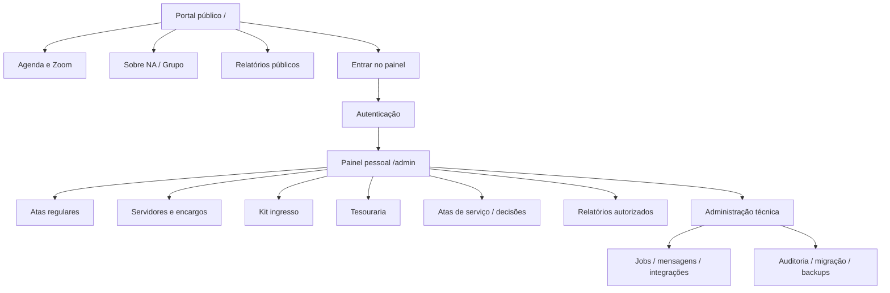
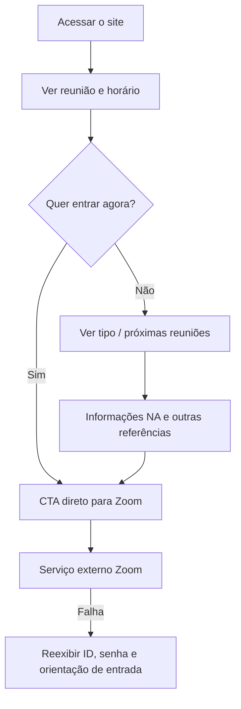
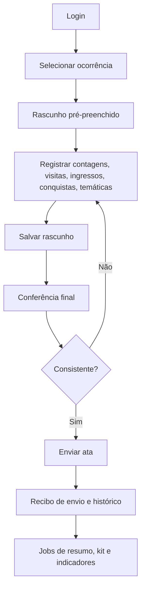
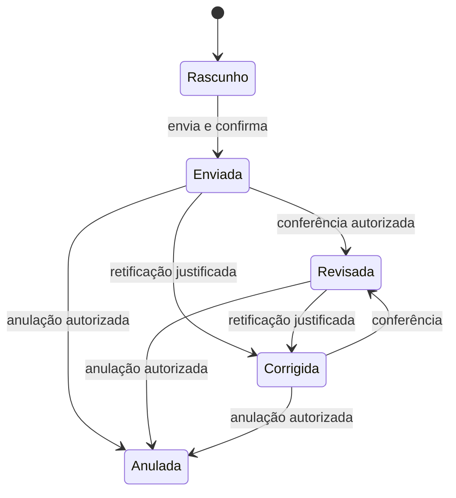
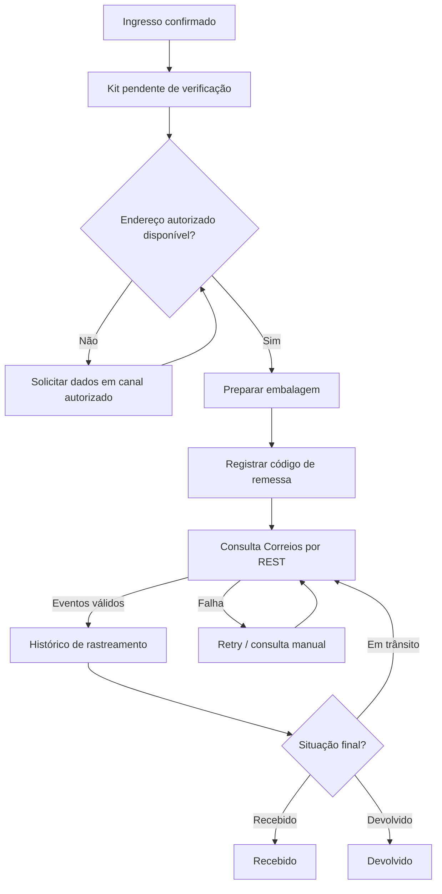
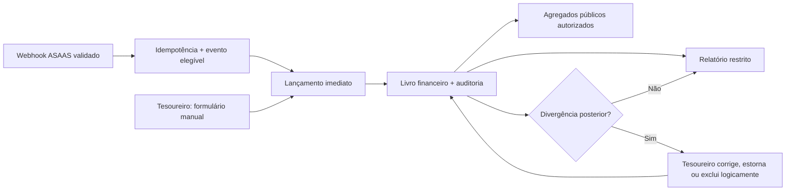
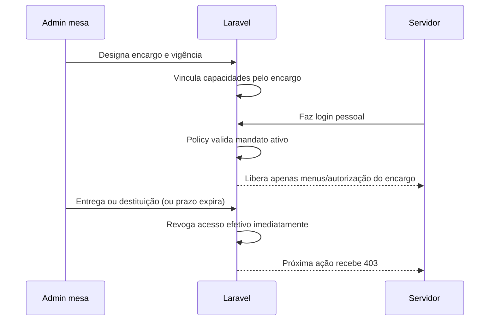

# UX Design — Site e Administração do Grupo QuarenteNA

> **Origem normativa:** [`ProductBrief.md`](ProductBrief.md) e [`PRD.md`](PRD.md), ambos **APROVADOS**. Inventário operacional: [`QuarenteNA.md`](QuarenteNA.md). **UX VALIDADO E APROVADO pelo responsável do projeto.** Protótipos e testes de usabilidade com servidores permanecem como atividades de homologação da implementação; a aprovação documental não os substitui. Mantém em um único Markdown a visão **DESIGN** (visual) e **EXPERIENCE** (comportamento) que o workflow oficial `bmad-ux` 6.12.4 normalmente produz em dois arquivos distintos. O template Laravel não define a aparência final.

## 1. Experiência desejada

A plataforma terá duas experiências distintas: **entrada pública simples e acolhedora**, sem login; e **administração orientada a tarefas**, pensada principalmente para servidores voluntários que usam celular. A interface acompanha o serviço, sem produzir vigilância de membros ou privilegiar conhecimento técnico.

| Público | Necessidade prioritária | Resultado observável | RF principais |
|---|---|---|---|
| Recém-chegado | Encontrar reunião e entender se pode participar | Localiza link, horário, tipo e orientações sem cadastro | `RF-PUBLICO-001…005` |
| Participante recorrente | Entrar imediatamente | Consegue acessar Zoom sem percorrer outras páginas | `RF-PUBLICO-002` |
| Secretário do dia | Preencher e corrigir a ata | Usa fluxo guiado, rascunho, conferência e envio no celular | `RF-ATA-001…025` |
| Mesa/servidores | Consultar serviço e decisões | Encontra escalas, vagas, decisões e histórico, conforme mandato vigente | `RF-SERVIDORES-*`, `RF-ATASERVICO-*` |
| Tesouraria | Conferir lançamentos e saldo | ASAAS e manuais contabilizados diretamente; Tesoureiro corrige divergências com trilha | `RF-TESOURARIA-*` |
| Kit ingresso | Atender remessas com sigilo | Resolve endereço, remessa e rastreio com acesso restrito | `RF-KIT-*` |
| Administrador técnico | Manter sistema saudável | Enxerga jobs, integrações, incidentes, backup e auditoria | `RF-ADMINISTRACAO-*`, `RF-BACKUP-*` |


### Estrutura de servidores e responsabilidades aprovada

O grupo possui **seis encargos de mesa** e, separadamente, dois **moderadores escalados por reunião**. Um cargo na mesa não equivale a uma função exercida na reunião diária.

| Encargo na mesa | Responsabilidade | Autorização institucional predominante |
|---|---|---|
| Coordenador Geral | Coordenação geral, supervisão administrativa, apoio a todos os serviços | Administração funcional/técnica e gestão de acessos; **não edita tesouraria nem kit** |
| Secretário Geral | Documentos, registros, atas mensais de serviço, acervo e apoio à administração técnica | Gestão documental, modelo editável de ata de serviço, administração funcional/técnica; **não edita tesouraria nem kit** |
| Tesoureiro | Escrituração e movimentações financeiras, conferência de entradas/saídas | **Único encargo que cria, edita e exclui logicamente lançamentos financeiros**, com auditoria |
| RSG | Representação do grupo perante NA e a sociedade | Consulta/ações de representação conforme designação; sem acesso financeiro ou aos dados do kit por padrão |
| RSG Suplente | Auxílio e substituição do RSG | Permissões de representação durante substituição autorizada, sem privilégios administrativos implícitos |
| Coordenador Kit Ingresso | Contato com ingressantes, montagem, envio e acompanhamento dos kits | **Único encargo com acesso operacional ao kit, telefones, endereços e remessas** |

**Moderadores das reuniões regulares:** todos os dias, das **20h às 22h**, há uma dupla escalada. Ambos devem saber configurar a sala Zoom, coordenar pela fala e secretariar pelo chat. Em cada ocorrência, um atua como coordenador (partilhas, falas e avisos) e outro como secretário (chat, lista de partilhas, contagens e ata), mas **essas são funções intercambiáveis na escala, não dois encargos/mandatos independentes**. Se um faltar ou tiver dificuldade, o outro pode substituí-lo. Não confundir Coordenador Geral e Secretário Geral com essas funções temporárias.

**Acesso dinâmico por encargo:** designação ativa concede apenas as capacidades daquele encargo; término do período revoga automaticamente; entrega/destituição/revogação manual por administrador é efetiva imediatamente. O histórico da designação, da concessão e da revogação é preservado. Uma designação expirada jamais pode ser usada para autorizar uma requisição, mesmo antes da execução do job de limpeza.

**Conta `root` institucional:** acesso genérico de contingência, reservado à recuperação de acesso, gestão excepcional de administradores da mesa e manutenção/configuração de integrações. Não é conta de trabalho cotidiano nem substitui identidades pessoais; deve ter MFA, credencial sob guarda segura, justificativa de uso, alerta e registro de sessão com identificação do operador para rastreabilidade. Sessão `root` **não deve ser caminho normal de edição de tesouraria ou kit**.

### Princípios de interface

| Prioridade | Princípio | Consequência no design |
|---|---|---|
| 1 | Anonimato e discrição | Telefone, endereço, dados de contato e informações do kit nunca são públicos; primeiro nome/apelido de ingressante **pode aparecer** no relatório público autorizado de ingressos |
| 2 | Reunião sempre encontrável | CTA principal único; não depender de script de terceiros para aparecer |
| 3 | Economia de atenção | Menus por tarefa e funções realmente autorizadas; sem painel lotado |
| 4 | Retomada segura | Rascunhos e estados persistentes; nunca confirmar envio que falhou |
| 5 | Visibilidade de responsabilidade | Mostrar autor, última alteração e estado em operações restritas |
| 6 | Correção sem apagamento | Revisar/anular sem destruir histórico auditável |
| 7 | Acessibilidade | Teclado, leitores de tela, foco e responsividade desde o primeiro componente |
| 8 | Linguagem do grupo | “Ata”, “Encargo”, “Vago”, “Kit ingresso”, “7ª Tradição”; explicar jargões técnicos |

## 2. Estrutura da informação



### Navegação pública

| Ordem | Bloco | Objetivo | Conteúdo mínimo |
|---:|---|---|---|
| 1 | Cabeçalho discreto | Identidade oficial | Marca do grupo, navegação curta, acesso administrativo secundário |
| 2 | Hero da reunião | Ação prioritária | Botão “Entrar na reunião”, horário, fuso, tipo, eventual próxima ocorrência |
| 3 | Informação de elegibilidade | Reduzir dúvidas | Reunião aberta ou fechada, instruções claras e sem julgamento |
| 4 | O que é NA | Acolher | Texto breve, institucional e revisado |
| 5 | Sobre QuarenteNA | Reforçar legitimidade | História resumida e funcionamento |
| 6 | Agenda completa | Outras opções da semana | Dia, horário e formato, sempre derivados de dados oficiais |
| 7 | Apoio e transparência | Referências complementares | Diretório, relatórios agregados e contatos autorizados |
| 8 | Rodapé | Acesso institucional | Privacidade, referências e link de administração discreto |

### Navegação `/admin`

| Entrada de menu | Exibir para | Prioridade móvel | Observação |
|---|---|---|---|
| Início | Todos com login | Alta | Próxima tarefa autorizada e avisos operacionais |
| Preencher ata | Dupla moderadora escalada e substituto autorizado | Máxima | Atribuição de função por ocorrência: coordenação na fala e secretaria no chat; ambos aptos a alternar |
| Atas | Autorizados | Alta | Consulta, rascunhos, revisão e correções |
| Encargos e vagas | Mesa/serviço | Alta | Escala, histórico e término |
| Kit ingresso | Coordenador Kit Ingresso com designação vigente | Alta | Tela integral exclusiva, contatos e endereços restritos |
| Tesouraria | Tesoureiro com designação vigente | Alta | Edição exclusivamente do tesoureiro; gestão de valores sem rascunho de lançamento |
| Reuniões de serviço | Serviço autorizado | Média | Pauta, ata, decisões, PDF |
| Indicadores | Públicos ou restritos conforme política | Média | Agregações sem PII |
| Configurações | Coordenador Geral, Secretário Geral e root excepcional | Baixa | Configurar APIs, URL, webhook, rotinas e templates, com segredos mascarados e auditados |
| Auditoria / integrações | Coordenador Geral, Secretário Geral e root excepcional | Baixa | Páginas protegidas; logs sem PII e marcação visível do executor |

> O menu é **filtrado pela permissão**, mas o backend faz a verificação real em cada ação. Esconder item de menu não autoriza nem protege endpoints.

## 3. DESIGN — direção visual

### Identidade e diretrizes

O site provisório e o planejamento antigo oferecem uma direção útil (azul profundo, branco e amarelo), mas **o site BMAD antigo nunca foi publicado**. A direção abaixo é **proposta de design**, não uma identidade visual homologada. A marca e o conteúdo oficial de NA precisam de conferência editorial do grupo.

| Token proposto | Valor ilustrativo | Finalidade | Observação |
|---|---|---|---|
| `--cor-fundo` | `#0B1120` | Fundo público profundo | Derivado da referência visual anterior; validar contraste |
| `--cor-superficie` | `#17243B` | Cards e navegação | Superfície elevada |
| `--cor-primaria` | `#38BDF8` | Links e elementos secundários | Não disputar atenção com CTA |
| `--cor-acao` | `#FACC15` | CTA principal público | Contraste forte com texto escuro |
| `--cor-texto` | `#F8FAFC` | Texto principal em fundo escuro | Priorizar legibilidade |
| `--cor-secundaria` | `#CBD5E1` | Texto auxiliar | Contraste a medir |
| `--cor-sucesso` | `#16764C` | Status de sucesso | Nunca usar cor como único sinal |
| `--cor-aviso` | `#9A5A06` | Avisos operacionais | Acompanhar ícone e texto |
| `--cor-erro` | `#B42318` | Erros relevantes | Explicitar consequência e resolução |
| `--cor-painel` | `#F7F9FC` | Superfícies administrativas claras | Proposta: admin claro para reduzir densidade |

**Tipografia:** sistema nativo acessível com fonte sans-serif de boa legibilidade; testar Inter disponível na referência HTML. O uso de fontes externas não pode impedir leitura quando CDN falhar. Base 16px; controles com alvo de toque confortável; hierarquia por tamanho, peso e espaçamento, não só por cor.

**Grid e espaçamento:** sistema de 4/8/12/16/24/32/48px; coluna única para formulários móveis; cards de largura limitada no desktop; tabelas complexas com versão resumida em cards e opção de detalhar/baixar sem rolagem horizontal obrigatória para tarefas essenciais.

### Identidade visual homologada e arquivos de origem

A marca existente do Grupo QuarenteNA **deve ser preservada**: escudo, ave/águia, asas, azul predominante, amarelo e lettering conforme os originais CorelDRAW. As variantes fornecidas (`final BA`, `final amarelo`, `azul e branco`) são fontes de design; o screenshot é referência visual, **não arte-final vetorial**. Não propor um rebranding que substitua o símbolo do grupo. Aplicar a marca sobre fundo compatível e ajustar a paleta e espaçamentos do site **ao logotipo**, não o inverso.

| Entrega de branding | Origem | Verificação indispensável |
|---|---|---|
| Original vetorial | Arquivos `.cdr` fornecidos | Preservar arquivos originais; confirmar fontes, objetos e direitos de uso |
| SVG principal e variantes | Exportação/conversão do CDR | Revisão visual lado a lado: fontes, texto, alinhamento, cores e clip paths |
| PNG web | Renderizar SVG homologado | Fundo transparente e nitidez em 1024/512/256/128/64 px |
| Favicon | Versão compacta do escudo, sem lettering ilegível | Testes reais em 16/32/48 px e tema claro/escuro |
| Uso no site/painel | Logo aprovada | Header desktop/mobile, login, rodapé e OpenGraph |

**Nota de produção:** a importação automática dos CDR neste ambiente distorceu parte do texto, provavelmente por substituição de fontes. Os derivados entregues são **pré-visualizações técnicas**, não uma substituição fiel homologada do original. O SVG final deve ser revisado/corrigido em editor vetorial antes de publicação.

**Arquivos de marca gerados:** `QuarenteNA-Marca/originais/` preserva os CDR; `png/` utiliza a prévia *incorporada dentro do próprio CDR* (aparência mais fiel do que exportação automática com fontes substituídas); `svg/*-previa-raster.svg` é **container SVG de PNG e não arte vetorial editável**; `svg/logo-bahia-conversao-vetorial-REVISAR.svg` contém conversão para vetores, mas **a tipografia precisa ser corrigida**; `favicon/` traz ICO e PNG pequenos provisórios. Esses ativos devem passar por homologação visual antes de integrar `public/` da aplicação.

### Comparação entre as duas superfícies

| Característica | Página pública | Administração |
|---|---|---|
| Ambiente | Sóbrio, acolhedor, marca presente | Objetivo, operacional e claro |
| Navegação | Poucas âncoras; CTA único | Navegação por módulos e tarefas permitidas |
| Cards | Agenda e informações essenciais | Pendências, rascunhos, alertas e filas |
| Formulários | Mínimos ou ausentes | Assistidos, com validação e retomada |
| Dados pessoais | Primeiro nome/apelido de ingressante autorizado pode ser exibido publicamente; nunca contato/endereço | Exibição sob finalidade/permissão |
| Gráficos | Apenas agregados aprovados | Agregados + operações dentro da autorização |

## 4. Padrões de componentes

| Componente | Estados obrigatórios | Regras |
|---|---|---|
| Botão primário | Normal, foco, carregando, desabilitado, sucesso/erro | Não mostrar sucesso antes da gravação |
| Campo | Vazio, preenchido, inválido, somente leitura, indisponível | Label externa persistente; erro associado ao campo |
| Autocomplete de pessoa | Buscando, nenhuma correspondência, múltiplas, seleção | Não fazer fusão automática de homônimos |
| Seletor de reunião | Agenda, horário, data, estado | Fuso `America/Bahia`; explicitar ocorrência |
| Tabela administrativa | Carregamento, vazia, paginada, filtro, erro | Exportação só com permissão |
| Modal de confirmação | Cancelar, confirmar, processando, concluído | Usar apenas em ações irreversíveis ou sensíveis |
| Banner de integração | Normal, degradado, indisponível, reprocessando | Distinguir falha do serviço externo de falha do banco |
| Status de ata | Rascunho, enviada, revisada, corrigida, anulada | Texto e explicação; não apenas cor |
| Status de kit | Verificar, falta endereço, falta enviar, enviado, recebido, devolvido, cancelado | Mudanças registram origem e autor |
| Aviso financeiro | Efetivado, divergência posterior, corrigido, estornado ou excluído logicamente | Não há rascunho de lançamento financeiro; dados do contribuinte não são públicos |
| Gráfico | Sem dados, dados parciais, carregando, disponível | Eixos, unidades, período, fonte e tabela alternativa |

## 5. EXPERIENCE — fluxo principal da página pública



### Wireframe informativo (proposta, desktop)

```text
┌─────────────────────────────────────────────────────────────────────────┐
│ QuarenteNA                                      Agenda  Sobre   Entrar │
├─────────────────────────────────────────────────────────────────────────┤
│ GRUPO QUARENTENA — NA ONLINE                                            │
│ Reuniões e acolhimento de pessoas que desejam parar de usar drogas     │
│                                                                         │
│ [ ENTRAR NA REUNIÃO ]    Próxima: dia • HH:MM • aberta/fechada          │
│                                                                         │
│ ID: ...        Senha: ...        Fuso: Bahia                             │
├─────────────────────────────────────────────────────────────────────────┤
│ Reuniões da semana         │ O que é NA?                                │
│ Dia / horário / tipo       │ Texto institucional curto                  │
├─────────────────────────────────────────────────────────────────────────┤
│ História e apoio                      Relatórios públicos aprovados    │
└─────────────────────────────────────────────────────────────────────────┘
```

### Wireframe informativo (proposta, smartphone)

```text
┌────────────────────────────┐
│ QuarenteNA         Menu    │
│ Próxima reunião: HH:MM     │
│                            │
│ ┌────────────────────────┐ │
│ │  ENTRAR NA REUNIÃO     │ │
│ └────────────────────────┘ │
│ Tipo  •  ID  •  Senha      │
│                            │
│ O que esperar?             │
│ Reuniões da semana         │
│ Sobre NA e o grupo         │
│ Relatórios / apoio         │
└────────────────────────────┘
```

**Homologação complementar recomendada:** teste real em 360px, 375px, 768px, 1024px e 1440px; zoom de 200%; navegação apenas por teclado, sem JS; leitura por tecnologia assistiva.

## 6. EXPERIÊNCIA — ata regular pelo celular



### Etapas propostas para o assistente de ata

| Etapa | Campos/elementos | Validação em interface | Persistência |
|---:|---|---|---|
| 1. Reunião | Data, horário, tipo, secretário, coordenador | Mostrar ocorrência; conferir permissão e fuso | Rascunho inicial |
| 2. Indicadores | Membros, partilhas, visitantes, ingressos e conquistas | Números inteiros não negativos; explicar totais | Salvamento incremental |
| 3. Detalhes | Origem de visitas, nomes mínimos de ingressos, temática e partilhador autorizado | Se necessário, dados pessoais em seção protegida | Sub-registros vinculados |
| 4. Resumo | Texto gerado/editável, observações | Visualização prévia e alerta sobre anonimato | Rascunho do resumo |
| 5. Conferência | Dados completos, contagem Zoom como sugestão | Comparar valores; mostrar divergências sem impedir correção humana | Versão pronta para envio |
| 6. Confirmação | Recibo, status, hora e identificador da ata | Feedback após commit bem-sucedido | Ata enviada + trilha |

**Autossalvamento:** salvar localmente apenas informação não sensível temporária quando necessário e de modo consciente; a persistência definitiva deve ser do servidor. Não armazenar telefone/endereço sem necessidade em localStorage. Exibir status “Salvando”, “Salvo” e “Falha ao salvar”; prevenir envio duplo.

### Estados e comportamentos da ata



## 7. EXPERIÊNCIA — kit ingresso e rastreamento



| Tela / ação | Público autorizado | Dado exibido | Proteção |
|---|---|---|---|
| Fila de kits | Apenas Coordenador Kit Ingresso (mandato vigente) | Status, pendência, dias de espera | Sem acesso operacional da mesa por padrão |
| Detalhe do kit | Apenas Coordenador Kit Ingresso | Contato/endereço, remessa e observações | Policy por usuário e encargo ativo; auditoria e criptografia |
| Registro de expedição | Apenas Coordenador Kit Ingresso | Código de rastreio, data e comprovante | Validar código e evitar repetição |
| Eventos de rastreio | Apenas Coordenador Kit Ingresso | Data, evento, cidade/UF e estado | Sem PII pública; histórico institucional |
| Integração indisponível | Apenas Coordenador Kit Ingresso | Última consulta e próximo retry | Atualização manual permitida e rastreável |

O rastreio é processado pelo projeto [correios-rastreamento](https://github.com/opastorello/correios-rastreamento). **A interface não chama a API externa diretamente do navegador**: Laravel consulta o serviço por rede privada e aplica suas autorizações.

## 8. EXPERIÊNCIA — tesouraria e relatórios



| Visualização | Público | Filtros | Restrições |
|---|---|---|---|
| Resumo financeiro público | Qualquer visitante | Período, categoria pública | Sem contribuinte, instrumento financeiro individual ou referência privada |
| Gestão financeira | Apenas Tesoureiro para alterações | Datas, origem ASAAS/manual, categoria, histórico | Salvar publica o lançamento imediatamente; correções posteriores são auditadas |
| Dashboard de ata | Mesa/serviço autorizado | Reunião, dia, horário, período | Contagens agregadas, sem rastrear indivíduos Zoom |
| Quadro de encargos | Públicos/restritos conforme regra editorial | Data, encargo, reunião | Publicar apenas primeiro nome/apelido se autorizado |
| Dados de visitantes/ingresso | Público: somente projeção aprovada; operadores conforme autorização | Período, origem, total, primeiro nome/apelido de ingressantes quando autorizado | Nunca incluir contato/endereço nem dados do kit |

### Especificações de gráficos

| Gráfico | Eixos/medidas | Fonte | Alternativa acessível |
|---|---|---|---|
| Presença por data | X=ocorrência; Y=total de participantes | Atas confirmadas | Tabela data/horário/total |
| Visitas/ingressos/conquistas | X=período; Y=contagens | Sub-registros de ata | Tabela de indicadores |
| Distribuição semanal | X=dia/horário; Y=total/média | Ocorrências e atas | Tabela com total e média |
| Saldo financeiro | X=período; Y=valor e saldo | Lançamentos conciliados | Tabela de totais |
| Kits por estado | Categorias de status e quantidade | Kits/remessas | Tabela status/quantidade |
| Encargos | Ativos, vagos e próximos ao fim | Designações | Tabela de cargos e datas |

### Gestão de templates, rotinas e configurações

| Tela | Quem opera | Comportamento obrigatório |
|---|---|---|
| Integrações | Coordenador Geral, Secretário Geral; root excepcional | Host/URL/webhook, estado, últimos eventos, mascaramento de segredo, teste de conexão, rotação auditada |
| Rotinas programadas | Administração funcional autorizada | Ativar/desativar, frequência, próximo disparo, última execução, retry, impedir duplo envio |
| Modelos de mensagem | Administração funcional autorizada | Edição, variáveis permitidas, prévia sanitizada, aprovação e histórico de versões |
| Conta root | Contingência | Tela separada com justificativa, operador identificado, aviso e encerramento de sessão emergencial |
| Template da ata de serviço | Secretário Geral | Editar pauta, seções, texto padrão, gerar prévia/PDF, histórico do template |



## 9. Erros, privacidade e acessibilidade

| Situação | Mensagem ao usuário | Comportamento requerido |
|---|---|---|
| Sessão expirada | “Sua sessão expirou. Entre novamente.” | Não perder rascunho confirmado no servidor; não vazar a tentativa |
| Sem permissão | “Você não tem acesso a esta função.” | Código 403; nunca mostrar dados em HTML/JSON |
| Falha ao salvar ata | “A ata não foi salva. Revise a conexão e tente novamente.” | Preservar dados em tela sem informar sucesso falso |
| Webhook atrasado | “Dados do Zoom ainda não disponíveis.” | Entrada manual e conferência continuam possíveis |
| Serviço de rastreamento fora | “Consulta indisponível no momento.” | Último evento permanece e job terá retry controlado |
| Duplicidade potencial | “Encontramos possíveis registros semelhantes.” | Não fundir nem apagar automaticamente |
| Importação parcial | “Existem registros pendentes de conferência.” | Lista de exceções e relatório de paridade |
| Desativação de usuário | “Acesso desativado.” | Revogar tokens/sessões conforme política |
| Ausência de dados | “Nenhum registro no período selecionado.” | Não exibir zeros como se fossem dados validados |

**Acessibilidade exigida pelo projeto:** estrutura semântica, contraste conforme WCAG 2.1 AA como alvo, labels associadas, erros anunciados, foco visível, navegação teclado, conteúdo sem cor como único significado, botões/tabelas operáveis em celular, respeito a preferência por movimento reduzido e gráficos com tabela acessível. As metas numéricas finais serão ensaiadas no gate de UX.

**Privacidade:** não registrar em analytics público nome de ingressante, telefone, endereço, identificação Zoom, dados de pagador ou conteúdo integral de mensagens. Nunca mostrar segredos em logs, toast, relatórios ou exportações comuns.

## 10. Critérios de aceite de UX

| Teste | Roteiro objetivo | Aceite |
|---|---|---|
| Público sem login | Abrir `/` com JavaScript desativado | CTA, data/horário, ID e orientação disponíveis |
| Primeiro acesso | Pessoa que não conhece o grupo localiza reunião | Sem leitura longa nem conta; avaliar tempo em teste observado |
| Ata móvel | Secretário preenche, corrige, interrompe e retoma | Dados recuperáveis, revisão visível, envio único |
| Kit restrito | Usuário sem permissão tenta URL/API do detalhe | Nenhum dado de contato exibido |
| Tesouraria | Tesoureiro identifica lançamento duplicado ASAAS | Sem saldo duplicado e com feedback compreensível |
| Dashboard público | Consultar e exportar agregados | Sem PII nem filtros que revelem indivíduos |
| Falha de integração | Desligar Correios/Zoom/Evolution simuladamente | Fluxo interno preservado e aviso adequado |
| Teclado e leitores de tela | Executar rotas e formulários críticos | Ordem de foco/labels/erros coerentes |
| Navegação responsiva | 360px e desktop | Tarefas concluíveis sem zoom ou rolagem horizontal essencial |

## 11. Detalhes para homologação prática durante a implementação

O Brief e PRD estão **aprovados**. Os seguintes pontos são decisões de apresentação que exigem teste, não reabertura do escopo: correção técnica da exportação do CDR e contraste da paleta; disposição do menu; ordem exata das telas; quantidade de passos da ata; textos de validação; acessibilidade real; terminologia e permissões de visualização por encargo. Prototipar as telas críticas e confrontar com servidores em contexto real.

## 12. Vinculação ao método e às fontes

- BMAD 6.12.4: [Design UX and Architecture](https://github.com/bmad-code-org/BMAD-METHOD/blob/v6.12.4/docs/plan/design-ux-and-architecture.md), com separação conceitual entre visual (`DESIGN.md`) e funcionamento (`EXPERIENCE.md`).
- Referências internas canônicas: [`ProductBrief.md`](ProductBrief.md), [`PRD.md`](PRD.md), [`QuarenteNA.md`](QuarenteNA.md), [`Arquitetura.md`](Arquitetura.md).
- Framework-base: [template-laravel-bmad](https://github.com/cirinho/template-laravel-bmad); **a UX não precisa herdar interface comercial de clientes** do template.
