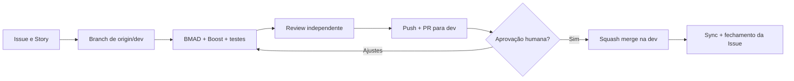

# Git workflow integrado ao BMAD — Grupo QuarenteNA

> **Status: APROVADO.** Política operacional única para humanos e agentes. `AGENTS.md` aponta para este documento; o `README.md` apresenta apenas o projeto. Aplica-se ao repositório `grupoquarentena/site`.

## 1. Branches e autoridade

| Branch | Contrato |
|---|---|
| `main` | **Padrão do GitHub**, estável/congelada. Sem desenvolvimento ou push direto. Só recebe promoção `dev → main`, hotfix ou bootstrap administrativo com autorização humana **expressa e específica**. |
| `dev` | Integração. Todo trabalho normal chega por PR revisado; sem commit ou push direto, salvo exceção pontual expressamente autorizada. |
| `feature/*`, `fix/*`, `chore/*`, `refactor/*`, `test/*`, `docs/*`, `bmad/*` | Temporárias, nascem do `origin/dev` atualizado e fazem PR **para `dev`**. |
| `hotfix/*` | Excepcional: parte de `main` somente após autorização expressa; retorna também à `dev` após a correção. |
| `legado/*` | Histórico, somente leitura; jamais base de implementação. |

- Nome preferido: `<prefixo>/issue-<n>-<resumo>`; exemplo `feature/issue-42-atas-servico`. Um escopo revisável por Issue/PR; não criar Issue por requisito RF individual.
- Preservar trabalho não commitado. Nunca usar `reset --hard`, `clean`, `stash`, rebase compartilhado, push forçado, exclusão de branch com trabalho exclusivo ou mudanças de configuração sem autorização.
- O agente pode executar **commits locais na branch temporária** durante o trabalho, inclusive quando a skill BMAD assim proceder; nenhum commit local significa aceite/merge. Push apenas para a branch temporária autorizada.
- A `main` **não será alterada para `dev` como branch padrão**.

## 2. Fluxo obrigatório por Issue / Story

1. **Issue.** Pesquisar duplicatas; informar problema, objetivo, escopo/limites, referência à Story/Epic/RF quando pertinente, critérios de aceite e riscos. Atribuir a `@grupoquarentena` e `@cirinho` **se ambas as contas forem elegíveis**; usar apenas labels, milestones e relações realmente disponíveis. Registrar dependências e vincular a branch/PR pelo campo **Development**.
2. **Branch.** Conferir `git status` e sincronizar somente com fast-forward seguro. Criar a branch a partir de `origin/dev`, **não** pelo botão genérico “Create a branch” sem checar a base. Se houver mudanças locais conflitantes, parar e preservar os dados. Exemplo: `git fetch origin dev && git switch -c feature/issue-42-atas-servico origin/dev`.
3. **Execução.** Ler `AGENTS.md`, Issue/Story e apenas os trechos relevantes de PRD/UX/Arquitetura. **BMAD** governa requisitos, aceite, estado e mudança de curso; **Laravel Boost** consulta o Laravel real, documentação da versão, MCP e convenções. Um orquestrador coordena especialistas sob demanda; edições simultâneas no mesmo arquivo são proibidas. Mudança substantiva no contrato aprovado: justificar na Issue, solicitar aprovação e aplicar `bmad-correct-course` quando cabível.
4. **Qualidade.** Executar testes focados e negativos, revisão de permissão/PII, `git diff --check` e gates aplicáveis (tabela §4). Conferir todas as alterações, inclusive arquivos novos, migrations e documentos afetados. Não declarar executado o que ainda não existe na fundação.
5. **Review técnico independente.** Antes do PR, solicitar **outro modelo/sessão sem histórico do implementador**, fornecendo Issue/Story, contratos afetados, comandos e resultados de testes e **todo o diff** contra a base `origin/dev`. Incluir commits locais (`git diff origin/dev...HEAD`), staged/unstaged e arquivos untracked (inspecionar `git status --short` e ler arquivos novos; `git diff` isolado não os cobre). Preferir a skill de code review BMAD, **sem confiar em base implícita `main` nem aceitar marcação automática `done`**. Registrar achados e correções na Issue/PR, não em relatórios permanentes. Correções materiais exigem nova conferência.
6. **PR.** Após validação, fazer push **somente da branch temporária** e abrir PR com **base explícita `dev`**. Preencher o template, vincular manualmente Issue/PR em **Development**, atribuir responsáveis elegíveis e pedir revisão manual a conta elegível **distinta da autora do PR**. Agente não aprova o próprio PR nem faz merge autônomo.
7. **Aceite e squash.** Responsável confere PR, Issue, testes, CI (se existir), achados resolvidos e diff; ajustes permanecem no **mesmo PR**. Com autorização humana expressa, realizar **squash merge para `dev`**, consolidando os commits da branch em **um único commit** no histórico de integração. Editar o título e **o corpo do commit de squash** conforme §3, em vez de aceitar uma lista automática extensa de commits.
8. **Encerramento.** Verificar merge no remoto, sincronizar `dev` local por fast-forward e remover a branch temporária local/remota **somente após conferir que nada exclusivo será perdido**. Corrigir título/descrição de Issue ou PR se necessário, sem apagar histórico relevante nem reescrever comentários de outras pessoas. Fechar a Issue **manualmente** com nota concisa: solução, PR, commit e testes. Atualizar o estado BMAD: `review` enquanto aguarda aprovação/merge, `done` somente após integração e conferência final.



**GitHub com `main` padrão:** as palavras-chave `Closes/Fixes #N` em PR para `dev` não criam o vínculo automático nem fecham a Issue. Usar **Development** manualmente e `Refs #N` como referência textual; encerramento após o merge é manual. As contas `@grupoquarentena` e `@cirinho` são tratadas como usuários **quando elegíveis**, não como equipe presumida. Reviewer não pode ser o autor.

## 3. Mensagens de commit e squash

- Commits locais: `tipo(escopo): resumo objetivo em pt-BR` (`feat`, `fix`, `docs`, `chore`, `refactor`, `test`, `perf`). Permitir checkpoints locais relacionados à Issue; não alterar histórico remoto compartilhado por amend/rebase sem autorização.
- **No squash da PR**: uma linha de título (`tipo(escopo): resumo`), **uma linha em branco** e, no corpo, **2–5 tópicos curtos com as modificações principais**, testes/decisões relevantes e referência `Refs #N` ou Story. Não colar logs extensos, dezenas de commits intermediários ou relatório de review.

```text
feat(atas): implementar revisão de atas de serviço

- Implementa rascunho, conclusão e retificação auditada.
- Ajusta Policies e testes de autorização.
- Atualiza os contratos afetados no PRD e na Arquitetura.

Refs #42 | Story 3.2
```

- O responsável pode usar o botão **Squash and merge** e editar título/corpo antes de confirmar. **Merge em `dev` não implica release nem deploy**.

## 4. BMAD, Boost e documentação mínima

- Preservar **cinco documentos canônicos** em `_bmad-output/planning-artifacts/`; `QuarenteNA.md` é AS-IS. Alterou requisito, fluxo UX ou arquitetura? Corrigir a seção existente no **mesmo PR**, com rastreabilidade na Issue/PR, sem gerar versão paralela. Se mudar banco: migration nova + testes PostgreSQL + snapshot real e `docs/banco/db.md` conforme o template; nunca produzir dump fictício ou reescrever migration aplicada em ambiente compartilhado.
- Menos é mais: preferir **um `epics.md` consolidado** (todos os Epics e Stories), sem relatórios separados por Epic. Na execução, admitir **somente arquivos efetivamente exigidos** pelo BMAD instalado, por exemplo `sprint-status.yaml`, Story identificada por chave e `spec-{slug}.md` quando o workflow `bmad-build` a utilizar. Atualizar o artefato ativo em vez de criar documentos concorrentes. Não apagar um contrato de execução ainda utilizado por skills de continuidade/review.
- Achados adiados, decisões, evidências de teste e review: **Issue/PR** (ou seção exigida de um artefato ativo), não criar `review.md`, `deferred-work.md`, ADR, relatório de teste ou changelog por Story **por padrão**. Se uma skill exigir outro arquivo para funcionar, demonstrar a necessidade antes e evitar duplicação; customizações de skills devem ter fonte versionada e ser resistentes a atualizações.
- **`tmp/`** é área local ignorada: arquivos temporários criados pela tarefa devem ser eliminados quando não forem mais necessários; **nunca apagar material de outra tarefa** nem relatórios que o responsável ainda precise analisar.
- Não replicar regras Git em README/AGENTS. Usar contexto mínimo da Issue/Story e Boost no código, evitando carregar todos os documentos e vários modelos sem necessidade.

| Alteração | Evidência obrigatória quando aplicável |
|---|---|
| Documentos | `git diff --check`, tabelas/links, IDs e referências pertinentes |
| Laravel | `./scripts/testar.sh`: Pint, Larastan, testes Unit/Feature, quando instalado |
| Banco | Migration, testes `./scripts/testar.sh --postgres`, snapshot/documentação física quando existir |
| Root, identidade, PII, Kit ou tesouraria | Testes de acesso permitido/negado, autoria, auditoria e revisão de segurança |
| Webhook/integrações | Autenticidade, idempotência, replay, retry, falhas e dados minimizados |
| Infra/release | CI disponível, backup/restore conforme impacto, imagem reproduzível, rollback e autorização humana |

## 5. GitHub, promoção e implantação

- **Templates `.github/`**: como `main` é a branch padrão congelada, templates apenas na `dev` **não aparecem automaticamente** na interface de novas Issues/PRs. Sua disponibilização exige **uma autorização expressa e específica para bootstrap administrativo mínimo da `main`** (somente templates necessários), com PR/validação e posterior reconciliação `main → dev`. Até lá, criar Issue/PR com corpo explícito/manual; não mudar a branch padrão nem promover código de aplicação para ativar templates.
- Configurar branch protection/rulesets em `main` e `dev` quando o plano permitir: PR obrigatório, checks efetivos, bloqueio de force-push/exclusão, conversas resolvidas; se indisponível, **não alegar proteção técnica**. CI Laravel/Boost será introduzida na futura Issue de adaptação da fundação.
- **Promoção `dev → main`**: exclusivamente PR e autorização humana expressa, com testes/release/rollback. Preferir **merge commit** para registrar promoção; depois reconciliar `main` de volta na `dev` e verificar a ancestralidade. Hotfix originado de `main` segue exceção autorizada e retorna à `dev`.
- **Build ≠ deploy**: tags mutáveis `dev`/`latest` são aliases; releases e rollback devem identificar imagem imutável por SHA/digest. Publicar imagem não autoriza migrations, Cloudflare, Swarm ou deploy; produção exige autorização separada.

**Checklist de PR/Issue:** escopo e aceite; review independente; testes verdadeiros; contratos atualizados; vínculo Development; aprovação humana; squash legível; `dev` sincronizada; branch descartada com segurança; Issue encerrada; nenhuma promoção ou implantação implícita.
